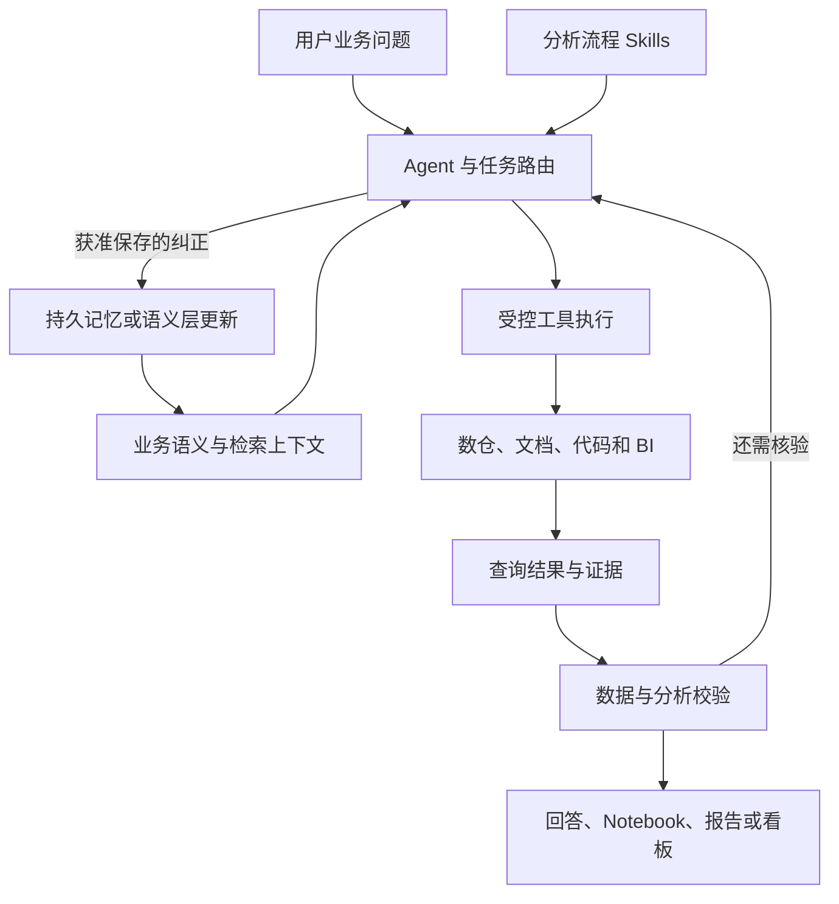

# OpenAI Data Agent 核心设计：中文学习稿

> 编写：Codex，2026-09-15。用户已明确希望完整学习并复现核心设计；当前学习状态为 `待继续`，运行复现为 `待验证`。本文是官方公开资料的中文重组与机制解释，不是逐句翻译，也不是 OpenAI 内部系统的完整设计文档。具体复现阶段属于 **AI 建议草案**，尚未执行。

真正需要学会的是这一条链路：**把业务问题变成明确的分析目标，找到有证据的业务口径，通过受控工具取数，验证计算与结论，再把可复用的知识保存下来。** Skills、语义层、SQL、记忆和报告分别承担其中的一部分。

配套阅读：

- [中文语义层空白模板](资料/01-语义层中文模板.md)：展示入口文件与参考文件的完整形状。
- [订阅转化语义层填写示例](资料/02-订阅转化语义层示例.md)：虚构教学案例，含时间边界、关联方式、SQL 骨架和验证点。
- [来源、版本与许可](资料/03-来源与版本.md)：固定源码版本，区分官方事实与本文补充。

## 1. 先明确要复现的对象

我们掌握四类资料，能复现的程度不同：

| 对象 | 公开内容 | 本文怎样使用 |
| --- | --- | --- |
| ChatGPT Work Data 产品 | 产品能力、插件入口、连接与使用说明 | 了解最终服务什么问题 |
| OpenAI 内部 Data Agent | 上下文组织、检索、记忆与评估的工程介绍 | 理解规模化设计方向 |
| 官方 Data Analytics 插件模板 | Skills、连接声明、渲染代码与辅助脚本 | 学习分析流程、语义层和产物组织 |
| Cookbook Data Agent 示例 | 可运行的会话、工具、数据库和记忆代码 | 学习模型调用与程序执行如何衔接 |

**复现目标建议：做出功能与机制可解释的核心系统。** 不把未公开的内部服务、线上模型路由或数据平台规模当作已经能够逐项照搬的对象。

公开插件模板采用 MIT 许可。本稿使用插件版本 `0.2.6` 对应的固定提交，以及 Cookbook 的固定提交；完整标识见来源页。源码公开不代表线上产品与模板逐文件相同。[插件仓库说明][plugin-readme]

## 2. 整体架构：六项职责

下图按公开代码和 Skills 整理，表示逻辑职责，不代表线上部署拓扑。



| 职责 | 解决的问题 | 典型产物 |
| --- | --- | --- |
| 任务路由 | 用户是在查数、诊断、做建议，还是搭看板？ | 选择的主 Skill 与辅助 Skill |
| 业务语义 | “转化”“用户”“上周”具体是什么意思？ | 指标定义、粒度、过滤、来源 |
| 工具执行 | 到哪里查、允许做什么、执行是否成功？ | SQL、参数、执行结果、错误 |
| 分析迭代 | 现象是否成立，什么证据支持解释？ | 拆分结果、假设、核验过程 |
| 校验与证据 | 数字和结论是否可信，能否重查？ | 校验记录、查询与来源链接 |
| 记忆与交付 | 什么值得复用，怎样让人理解并继续使用？ | 纠正记录、语义层、分析报告 |

这里的几个概念需要分清：

| 概念 | 内容 | 生命周期 |
| --- | --- | --- |
| 分析 Skill | 如何做指标诊断、校验、报告 | 跨任务复用的流程 |
| 语义层 Skill | 某业务领域的指标、表、关联和限制 | 跨任务复用的领域知识 |
| 会话状态 | 这次问了什么、查过什么、还缺什么 | 当前调查及其追问 |
| 长期记忆 | 经确认、以后仍有用的特殊纠正 | 多次会话之间 |
| 数据与证据 | 当前查询拿到了什么，何时拿到 | 绑定具体执行与快照 |

例如，“诊断比率时检查分子和分母”属于分析 Skill；“企业客户不包括人工开通账号”属于领域规则；“这次只看华东”首先属于当前任务条件。不能自动把它们保存到同一类记忆里。

## 3. 用一次具体任务串起来

贯穿案例是虚构的订阅业务。用户问：“上一批新用户的 7 日付费转化率为什么下降了？”

### 第一步：明确要回答的问题

Agent 需要弄清楚：

- 指标是否为“注册后 7 日内付费的用户占比”。
- 按注册 Cohort 比较，还是按付款发生周比较。
- 当前批次和基线分别是什么时间段。
- 是全部新用户，还是某个渠道或地区。
- 两个批次是否都有完整的 7 日观察窗口。

这里的 Cohort 就是按同一条件归组的人群，例如“8 月 24 日至 30 日注册的用户”。只有自然周结束，不代表该 Cohort 的 7 日结果已经成熟。

### 第二步：路由到分析流程

这是一项指标诊断，可以选择 `metric-diagnostics` 为主流程。缺少业务定义时用 `gather-business-context`；数据可用性存疑时用 `analyze-data-quality`；需要形成报告时交给 `build-report`。

这些是可组合的指令流程，**不能因此认定每个 Skill 都对应一个独立模型、进程或子 Agent**。[路由][router]、[指标诊断][diagnostics]

### 第三步：读取领域定义并发现数据

语义层给出注册用户表、付款事件表、关联键、排除条件与时间口径。Agent 再通过实际工具确认表结构和数据状态，而不把文件里的旧表名当作当前必然存在的事实。

这里要解决两种不同错误：找不到正确口径；找到了口径但执行没有遵守。

### 第四步：先复现变化

先计算两个批次的分母、分子和转化率。假设教学数字为：

| 批次 | 合格注册用户 | 7 日内转化用户 | 转化率 |
| --- | ---: | ---: | ---: |
| 基线 | 1,000 | 80 | 8% |
| 当前 | 500 | 30 | 6% |

这是**虚构算例，不是实际查询结果**。变化是下降 2 个百分点，相对下降 25%。人数下降与转化率下降是两个问题，不能混为一谈。

### 第五步：找证据支持的解释

按业务合理的维度拆分，例如注册渠道、地区和产品版本；检查是用户结构变了，还是同一分组里的表现变了。还要检查埋点、数据延迟、重复记录、分母口径等测量问题。

发现“新版发布后转化率下降”只能形成一个假设。若要说“新版导致下降”，需要更有力的实验或因果证据。[指标诊断][diagnostics]

### 第六步：形成可以核验的结论

回答应区分：已验证变化、较强解释、待验证假设、实际做过的检查、缺少的数据。保留查询来源，方便别人复查。

### 第七步：按授权保存知识

若用户指出“人工开通账号不计入这个指标”，先判断这是已有定义被遗漏、正式口径变更，还是仅用于本次分析的临时要求。前两者可能值得更新语义层，最后一种一般只保留在当前会话。

## 4. Skills 层：把分析经验写成可组合流程

公开插件的 `index` 是入口。它负责判别任务、发现来源、选择输出方式、加载适用流程，并检查任务是否完成。领域知识不能替代主分析流程，报告生成也不能替代分析本身。[路由源码][router]

14 个顶层 Skill 可以按职责理解：

| Skill | 中文含义 | 核心工作 |
| --- | --- | --- |
| `index` | 任务入口 | 路由、来源准备与交付选择 |
| `create-data-context` | 建立领域知识 | 创建或维护语义层 |
| `gather-business-context` | 收集业务背景 | 找定义、背景、变化与可信来源 |
| `product-business-analysis` | 经营与产品分析 | 用证据支持业务判断和建议 |
| `metric-diagnostics` | 指标诊断 | 复现变化、分解驱动、验证解释 |
| `design-kpis` | 设计指标体系 | 结果指标、驱动因素、护栏和测量要求 |
| `kpi-reporting` | 指标汇报 | 当前值、对比、驱动、业务含义 |
| `market-sizing` | 规模估计 | 假设、规模区间与敏感性 |
| `analyze-data-quality` | 数据质量检查 | 粒度、缺失、唯一性、时效、关联 |
| `validate-data` | 分析校验 | 方法、计算、图表和结论是否成立 |
| `jupyter-notebooks` | 可重跑分析记录 | SQL、Python、计算与输出 |
| `visualize-data` | 数据可视化 | 图表选择、编码、标签与展示校验 |
| `build-report` | 分析报告 | 结论、证据、叙事与交付 |
| `build-dashboard` | 数据看板 | 监控指标、筛选、交互与刷新 |

复现时不必先把 14 个都实现。先用“查数、指标诊断、校验”三个流程，验证路由和执行链；之后再扩展报告与其他场景。这是本文的学习建议。

Skill 可以包含这些内容：何时适用、需要哪些信息、必须完成哪些分析动作、什么时候补查、什么条件下不能下结论、输出交给谁。它不应固化所有问题的具体 SQL 和维度顺序。

**能力边界：** Markdown 指令能引导模型，但不能强制数据库权限，也不能保证模型每次都遵守。程序可以直接检查的约束，应进入工具执行器或校验器。

## 5. 语义层：把业务含义做成可引用的知识

Schema 只能告诉你字段叫什么、类型是什么，通常不能完整回答：

- 一行是一个用户、一次事件，还是用户一天的快照？
- `paid` 是支付成功、订阅有效，还是账单已开具？
- 哪个指标定义是当前权威版本？
- 这张表是否排除了内部流量？
- 能否将两个来源直接 Join，关联后是否会重复计数？

公开模板用一个短 `SKILL.md` 作为入口，把具体业务知识放到参考文件中。[语义层模板][semantic-template]

```text
<area>-semantic-layer/
├── SKILL.md
└── references/
    ├── semantic-layer.md
    ├── source-inventory.md
    └── evidence.md           复杂来源或冲突时按需增加
```

| 文件 | 主要内容 | 为什么分开 |
| --- | --- | --- |
| `SKILL.md` | 触发条件、读什么、遵守什么 | 入口短小，便于选择和加载 |
| `semantic-layer.md` | 指标、实体、表、粒度、过滤、关联、查询模式、坑点 | 承载实际业务知识 |
| `source-inventory.md` | 查过什么、权限、缺口、刷新条件 | 让覆盖范围和后续维护可检查 |
| `evidence.md` | 事实到证据的映射、置信度、冲突 | 复杂场景追溯具体依据 |

完整中文空白格式见[配套模板](资料/01-语义层中文模板.md)。先关注四个字段组合：**指标的分子与分母、表的行粒度、关联键与基数、时间窗口与完整性。** 它们决定很多“SQL 跑通但答案错了”的问题。

### 语义层从哪里来

官方创建流程优先使用转换代码、测试、维护中的指标文档和验证过的看板。查询历史和团队讨论也有用，但应标记其依据强弱；冲突需要显式保留。[创建语义层][create-context]

构建它可以理解为：

```text
确定一个业务范围
→ 列出候选来源与覆盖缺口
→ 阅读定义、代码、测试、看板等证据
→ 提取实体、指标、粒度、关联、过滤和限制
→ 对齐冲突并保留未解决问题
→ 生成短入口与详细参考文件
→ 核对来源与适用范围
→ 保存到用户指定的位置
```

### 这种语义层有什么能力边界

它是一份让 Agent 理解并遵循的知识包，不自动成为强制的指标编译器。若模型依然可以提交自由 SQL，就仍可能漏掉过滤或使用错误分母。

本文建议的加强方式是：对稳定高频指标提供结构化查询接口，例如指标 ID、时间、人群、维度，由程序生成受控 SQL；开放分析仍可保留 SQL 工具。两者可以并存，是否采用应由复现目标决定，不能说这是官方公开插件已经实现的结构。

## 6. 上下文检索：离线准备与在线核验各做什么

内部技术博客披露了六类上下文：表使用与历史查询、人工注释、代码补充、企业知识、个人或全局记忆、运行时数据平台信息。前三类通过每日离线流水线归一化并生成 Embedding；在线检索相关内容，必要时实时核验。[内部工程文章][internal-blog]

与之相比，Cookbook 使用本地 JSON 保存表说明、指标、文档和历史查询，再做简单关键词匹配。不能把这段教学代码称为内部向量检索系统。[数仓代码][warehouse-code]、[记忆代码][memory-code]

下面是**本文建议的核心复现方案**：

| 阶段 | 做什么 | 需要保留什么 |
| --- | --- | --- |
| 离线采集 | 读 Schema、转换 SQL、指标文档和测试 | 来源位置、版本、获取时间 |
| 离线整理 | 提取粒度、包含与排除条件、关联方式 | 原证据与派生说明分开 |
| 建立检索 | 先做少量可解释的词项检索，再按需要加向量 | 查询、候选、排序与来源 |
| 在线使用 | 按问题取最相关的定义和表说明 | 本轮实际加载的上下文 |
| 在线核验 | 检查当前 Schema、最新完整分区和关键样本 | 新鲜度与发现的差异 |

代码补充可以做一个很有价值的小实验：两张表字段相同，但上游过滤不同。只给 Schema 时观察选表；再加入加工代码中提取的排除条件，观察能否区分适用范围。验收对象是“找到了哪条代码依据”，而不只是回答措辞是否更像正确答案。

不必一开始用大向量库。先验证知识内容正确、能找到、被执行遵守，再考虑检索规模。检索性能与业务正确性应分别测量。

## 7. 工具执行：模型提出，程序执行

Cookbook 的四个工具是：

| 工具 | 输入 | 官方示例返回或动作 |
| --- | --- | --- |
| `search_tables` | `query` | 查目录，返回匹配表与真实列信息 |
| `search_context` | `query` | 返回指标、历史查询、文档和可见记忆 |
| `query_warehouse` | `sql` | 执行单条查询，返回 SQL 与最多 100 行 |
| `save_memory` | `note`、`scope` | 保存个人或团队纠正 |

工具名称与描述对模型可见，执行函数由应用持有；函数参数有 JSON Schema 声明。`save_memory` 按需加载；示例还启用了工具搜索与程序化工具调用。[Agent 代码][agent-code]

### SQL 的真实执行边界

示例由应用读取连接配置，使用数据库驱动执行 SQL。PostgreSQL 连接开启默认只读事务，并设置 30 秒查询超时。应用要求语句以 `SELECT` 或 `WITH` 开头，拒绝包含额外分号的输入，然后用 `fetchmany(100)` 获取结果。[数仓代码][warehouse-code]

三个细节不能误读：

1. 正则不是完整 SQL 解析器；数据库角色才应承担真实权限边界。
2. 最多返回 100 行，不代表只扫描 100 行。
3. 示例 `row_count` 是已返回行数，不是总结果行数，也没有展示完整的截断标记。

### 核心复现建议补充的结果结构

以下字段是 **AI 建议，不是官方工具的原始 Schema**：

```text
query_id                 应用生成的查询标识
sql                      实际执行的 SQL
parameters               实际使用的绑定参数
source_id                来自哪个数据库或数据应用
rows                     返回的结果行
returned_row_count       返回了多少行
truncated                是否截断；需要多读一行或其他可靠方法判断
data_complete_before     已验证的数据完整性截止时间，未知就明确未知
executed_at              本次执行时间
duration_ms              耗时
error_code               可区分的错误类型
```

不要为了填字段而编造“总行数”或“数据已完整”。不可得的值保持未知；如果确实需要总行数，另做有成本意识的统计。

## 8. Agent 循环、状态和失败处理

固定版本的代码使用官方 Python SDK 的 Agents API。首轮创建 session；追问复用 session。应用在首轮流收到 `requires_action` 后调用工具并回传结果；后续流使用 SDK 的工具处理映射。结果按调用标识与轮次对应。[Agent 代码][agent-code]

```text
用户输入
→ 创建或恢复调查会话
→ 模型选择工具
→ 应用解析工具名与参数
→ 工具执行
→ 回传结果或错误
→ 模型继续查证、修正或作答
→ 明确完成事件
```

官方示例把 `conversation_id → session_id` 和会话归属保存在进程字典中。应用重启会丢失这份映射。它也检查流是否真的出现完成事件，不能把“连接结束”直接当作“调查成功”。

### 本文建议记录的调查状态

```text
question                 原始问题
scope                    当前指标、时间、人群和维度
selected_skills          选用了哪些流程
semantic_sources         使用了哪些定义及版本
hypotheses               当前假设及其证据状态
queries                  已执行查询及结果引用
checks                   校验结果
unresolved               尚未解决的问题
budget                   剩余调用或时间预算
status                   运行、等待用户、完成、失败、取消
```

这是学习用的职责划分。实际实现可以先保存在内存中，再决定是否用数据库或图框架；这些字段并非 OpenAI 已公开的内部 State。

### 为什么需要区分错误

| 情况 | 合理动作 | 不能直接推出 |
| --- | --- | --- |
| 参数格式错误 | 修正参数后重试 | 数据不存在 |
| SQL 语法或字段错误 | 核查 Schema 并修正 | 用户问题无法回答 |
| 权限不足 | 说明受限，使用获准且语义等价的来源才可继续 | 换一张名字相近的表也一样 |
| 查询超时 | 检查扫描范围、聚合和执行计划 | 结果为零 |
| 结果为零行 | 验证窗口、过滤、关联与业务可能性 | 业务没有活动 |
| 连接中断 | 判定执行状态是否已知，再处理重试 | 工具必然未执行 |
| 用户改变范围 | 更新当前条件，检查旧证据适用性 | 旧查询仍全部有效 |

示例首轮 handler 异常返回的是通用错误信息，生产可观测性与错误分类还需补充。重试也需要上限，不能无限自我修正。

保存记忆、发布看板等动作可能产生副作用。`call_id` 去重或会话 checkpoint 都不能自动等同于跨重启的恰好一次执行；需要持久记录动作状态、稳定幂等标识和结果核对。这是核心系统设计的补充验收点。

## 9. 分析循环：先证明现象，再解释原因

公开指标诊断 Skill 的主体可以整理成六步：[原始流程][diagnostics]

1. 定义诊断问题：指标、时间、对象、粒度与基线。
2. 检查定义和来源：确认数据能可靠测量这个指标。
3. 复现变化：大小、时间、范围先成立。
4. 选择诊断计划：用最有解释力的业务维度切分。
5. 分解与验证驱动：量化贡献、验证测量问题、解释残差。
6. 说明含义与后续：区分事实、解释、建议和未解决问题。

比率变化经常有两个来源：分组内部表现变化，以及不同分组占比变化。只把各渠道转化率列出来，未必已经解释总体下降；可加总指标则应尽量用互斥分组，保证贡献可对齐。

Skill 给出分析原则，但没有强制某一种分解公式。复现时应先挑一种明确的方法，说明它适用于什么指标，并用可手算数据验证。复杂归因算法不是跑通 Agent 的前置条件。

停止条件也要具体：主要变化已复现、主要解释有支撑、额外拆分不太可能改变判断；或者必需证据缺失、预算耗尽。后两种应输出部分结论和缺口，而不是伪装成完整诊断。

## 10. 记忆：复用经过确认的经验

官方示例把记忆存进 JSON 文件，字段包括 `id`、`note`、`scope`、`user_id`、`created_at`；读取个人与团队可见记录，再做关键词匹配。[记忆代码][memory-code]

“只有用户明确要求才保存”主要存在于模型指令和工具描述中，存储函数没有独立核验用户授权事件。因此要区分：模型被要求守规则，与程序能验证规则成立。

本文建议将长期知识按成熟程度理解：

| 内容 | 处理方式 |
| --- | --- |
| “这次只看华东” | 当前会话范围 |
| “这张表可能有重复” | 待核验假设 |
| “这个指标必须排除人工开通” | 对照权威来源确认后形成领域规则 |
| “旧过滤字段从某日期停用” | 带生效日期和来源的规则变更 |
| 用户个人偏好的报告顺序 | 个人偏好，不覆盖团队指标定义 |

可复现的记忆闭环建议为：**提出候选 → 对照证据 → 用户确认范围 → 保存 → 后续检索 → 冲突或过期时复核。** 这里的学习是知识积累，不等于模型参数持续训练。

用户、团队、组织权限不能只靠记录上的字符串表达。真正多用户实现需要从认证系统取得身份，并由程序约束哪些记忆可以读写；公开网页示例按本地单分析师使用，未实现完整的租户系统。

## 11. 正确性：四个不同的检查层次

公开插件把数据质量与分析校验分开；另外还有产物结构校验。它们不能互相替代。[数据质量][data-quality]、[分析校验][validate-data]、[MCP 服务][mcp-server]

| 层次 | 问的问题 | 适合怎样验证 |
| --- | --- | --- |
| 数据质量 | 数据是否新鲜、唯一、完整，粒度是否一致？ | SQL 检查、断言、抽样追踪 |
| 计算口径 | 指标、分母、时间和关联是否正确？ | 黄金 SQL、独立重算、边界案例 |
| 分析结论 | 数据是否支持解释，是否有因果越界？ | 明确判据的人工或模型审查 |
| 交付产物 | 图表和报告能否正确展示？ | Schema 校验、渲染检查、交互验证 |

`validate-data` 要求关注 Join 膨胀、加权平均、不完整周期、时区、选择偏差、辛普森悖论等问题。它鼓励重算关键数字、逐条追踪记录，以及通过不同查询路径复核重要结论。

内部工程文章披露的评估使用问题与人工标准 SQL，对生成 SQL 及其执行结果进行比较，再由 Evals grader 给出评分和解释。[内部工程文章][internal-blog]

### 核心复现的评估建议

先设计下面 10 类案例；这是一份待执行的测试设计，不是已有成功率：

| 案例 | 预期行为 |
| --- | --- |
| 1. 正常单指标查询 | 定义、过滤和数值一致 |
| 2. 两张相似表，覆盖范围不同 | 依据代码或定义选择正确来源 |
| 3. 用户有多次付款 | 转化用户不被重复计数 |
| 4. Cohort 观察窗口不足 | 识别不成熟，不能直接得出下降结论 |
| 5. 两个看板口径不同 | 对齐定义，不能把差异叫数据错误 |
| 6. 返回结果被截断 | 显式说明，不能把预览当全集 |
| 7. 数据或记忆越权 | 程序拒绝，而不只靠模型自觉 |
| 8. SQL 可修复错误 | 依据错误与 Schema 有限重试 |
| 9. 已确认业务纠正 | 后续会话找得到并正确使用 |
| 10. 发布与异常时间相同但无因果证据 | 区分相关性、假设与因果结论 |

黄金结果应在固定数据快照上计算。数值比较明确排序、空值、单位和容差；SQL 文本不同可以结果等价，结果碰巧一样也可能隐藏口径错误，需要配合针对性数据。

记录检索是否找到、参数是否正确、工具是否成功、数值是否正确、结论是否有证据，以及耗时、调用次数和重试次数。不要只看一个总体分数。

## 12. 报告和看板：把证据留在可用的产物里

公开插件将报告和看板拆成 `manifest`、`snapshot` 和 `sources`：

- `manifest` 定义标题、页面块、指标卡、图表、表格和筛选。
- `snapshot` 保存数据集结果、生成时间及可用状态。
- `sources` 保存来源和实际产生结果的查询。

MCP 服务负责验证、渲染和打包，主要工具为 `validate_artifact`、`render_artifact`、`render_chart`、`render_table`、`export_artifact_package`。[渲染服务][mcp-server]

这里值得复现的原则是：数据、表现形式、证据出处分开；报告内部仍然能追溯关键数字。原始计算 SQL 不应被后续仅用于排序或截取的展示 SQL 替换。[产物约定][artifact-core]

第一版可以先输出 Markdown 报告与可重跑查询文件。把分析链路验证好，再接入 HTML 或 React 看板。不要把完成前端当作完成数据 Agent。

## 13. 如何分阶段复现核心设计

以下是 **AI 建议草案**，不代表已确认的时间表、技术选型或已完成实验。核心建议采用 Python；模型提供商与框架暂不固定。

| 阶段 | 你要做出的东西 | 验收时应该能证明什么 |
| --- | --- | --- |
| M0：手工定义与数据基线 | 小型固定数据、明确指标、人工 SQL | 能解释每张表的行粒度和标准答案 |
| M1：最小工具循环 | 模型调用一次工具，再依据结果继续或回答 | 能指出工具名、参数、handler、结果回传和停止位置 |
| M2：语义层与取数 | 短 Skill、领域参考文件、选表与查询 | 修改字段相同但口径不同的候选表后，仍能找到正确依据 |
| M3：多轮调查与修正 | 持续会话、当前范围、有限重试 | 改时间或人群后更新相关查询，不沿用失效证据 |
| M4：分析与校验 | 指标诊断流程、数值断言和证据记录 | 能抓住重复 Join、不成熟 Cohort 和错误分母 |
| M5：记忆与知识更新 | 获准纠正、范围隔离、生效日期 | 临时要求不污染长期口径，跨会话能正确复用规则 |
| M6：稳定性与交付 | 评估集、日志、取消/恢复边界、报告 | 错误有分类，结果可追溯，重启与重复动作边界清楚 |
| M7：上下文增强 | 加工代码提取、来源版本、增量刷新 | 代码变化能被识别，派生知识不会悄悄覆盖权威定义 |

M0–M6 建立完整的核心分析闭环；M7 补上内部系统中很重要的代码上下文与维护思路。高并发、多租户生产化、企业 BI 适配和大型检索平台应进入独立产品仓库，这里保留学习、资料与小型实验。

每阶段先说明目标，让用户预测关键行为，再由用户实现或运行并解释观察；Codex 可以诊断和协助，但代跑成功不等同于用户已经理解。

涉及付费模型实验时，先采用约 10 个代表案例，并在运行前说明预计调用次数、Token 与费用范围；Agent 一题可能调用多次模型，不能把“10 个问题”直接当成“10 次调用”。本稿没有发起任何付费运行。

## 14. 读源码的顺序

| 次序 | 资料 | 阅读目标 |
| --- | --- | --- |
| 1 | [语义层模板][semantic-template] | 理解业务定义如何进入 Agent |
| 2 | [指标诊断 Skill][diagnostics] | 理解分析方法与停止条件 |
| 3 | [index][router] | 理解主流程和辅助流程怎样组合 |
| 4 | [agent.py][agent-code] | 找到模型与程序之间的调用循环 |
| 5 | [warehouse.py][warehouse-code] | 区分检索、Schema 发现和真正 SQL 执行 |
| 6 | [memory.py][memory-code] | 理解跨会话信息保存与权限边界 |
| 7 | [validate-data][validate-data] | 找到需要转成确定性检查的规则 |
| 8 | [产物约定][artifact-core] | 理解证据如何进入报告与看板 |

读每个模块时回答四件事：输入是什么、输出是什么、失败时怎么处理、程序保证了什么而模型只被要求做什么。

## 15. 当前状态与下一步

| 项目 | 当前状态 |
| --- | --- |
| 中文核心设计材料 | 已形成文稿 |
| 中文语义层空白模板 | 已形成文稿 |
| 虚构订阅转化示例 | 已形成，SQL 为未运行骨架 |
| 用户理解各模块 | 待继续 |
| 真实模型与数仓复现 | 待验证，未开始运行 |
| OpenAI 线上完整实现 | 未公开部分仍未知 |

建议从 [订阅转化示例](资料/02-订阅转化语义层示例.md) 开始，先把“合格注册用户、7 日观察窗口、付款事件如何压到用户粒度”讲清楚，再进入 M0。具体进度不预先标为完成。

[plugin-readme]: https://github.com/openai/role-specific-plugins/blob/fe5608d2512a7d6a7b9821ce8a88c48464ecd6e4/README.md
[router]: https://github.com/openai/role-specific-plugins/blob/fe5608d2512a7d6a7b9821ce8a88c48464ecd6e4/plugins/data-analytics/skills/index/SKILL.md
[diagnostics]: https://github.com/openai/role-specific-plugins/blob/fe5608d2512a7d6a7b9821ce8a88c48464ecd6e4/plugins/data-analytics/skills/metric-diagnostics/SKILL.md
[semantic-template]: https://github.com/openai/role-specific-plugins/blob/fe5608d2512a7d6a7b9821ce8a88c48464ecd6e4/plugins/data-analytics/skills/create-data-context/references/semantic-layer/skill-template.md
[create-context]: https://github.com/openai/role-specific-plugins/blob/fe5608d2512a7d6a7b9821ce8a88c48464ecd6e4/plugins/data-analytics/skills/create-data-context/SKILL.md
[internal-blog]: https://openai.com/index/inside-our-in-house-data-agent/
[agent-code]: https://github.com/openai/openai-cookbook/blob/82cb1f5e0ebe243489b15de6471ce9e55cb8367d/examples/agents_api/apps/data_analyst/agent.py
[warehouse-code]: https://github.com/openai/openai-cookbook/blob/82cb1f5e0ebe243489b15de6471ce9e55cb8367d/examples/agents_api/apps/data_analyst/warehouse.py
[memory-code]: https://github.com/openai/openai-cookbook/blob/82cb1f5e0ebe243489b15de6471ce9e55cb8367d/examples/agents_api/apps/data_analyst/memory.py
[data-quality]: https://github.com/openai/role-specific-plugins/blob/fe5608d2512a7d6a7b9821ce8a88c48464ecd6e4/plugins/data-analytics/skills/analyze-data-quality/SKILL.md
[validate-data]: https://github.com/openai/role-specific-plugins/blob/fe5608d2512a7d6a7b9821ce8a88c48464ecd6e4/plugins/data-analytics/skills/validate-data/SKILL.md
[mcp-server]: https://github.com/openai/role-specific-plugins/blob/fe5608d2512a7d6a7b9821ce8a88c48464ecd6e4/plugins/data-analytics/mcp/server.cjs
[artifact-core]: https://github.com/openai/role-specific-plugins/blob/fe5608d2512a7d6a7b9821ce8a88c48464ecd6e4/plugins/data-analytics/src/analytics-app-core.md
