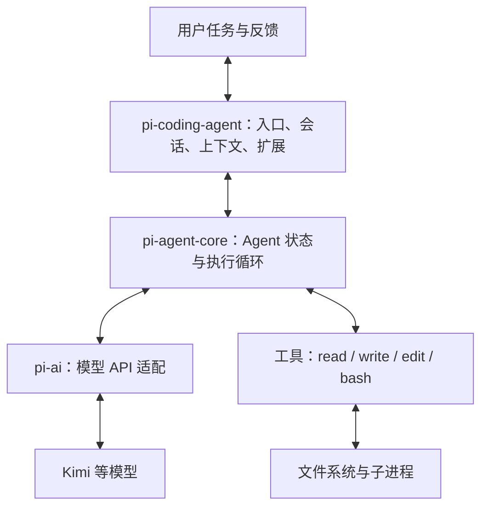

# Pi 整体框架与最小复现边界

日期：2026-09-05。Pi 事实基于本地 `v0.85.0` / `107d79f11072bbc8a3a757ed7fd69596bee7d68c`；对比参考当日查阅的官方文档。优势是设计取舍与学习适配判断，不是性能基准排名。

## 1. 它是什么、解决什么问题

Pi Coding Agent 是终端里的编程 Agent，也是可嵌入其他应用、可扩展的 Agent harness。这里的 harness 指围绕模型的运行程序：准备上下文、提供工具、执行工具请求、收集结果、继续下一轮，以及处理会话和交互。

Pi 不是大模型，不负责训练出一个模型。使用 Kimi 时，由 Kimi 根据输入生成回答或工具请求，由 Pi 的程序执行实际操作。

例如任务“修复这个项目里失败的测试”：普通聊天可以给你建议；接好工具的编程 Agent 则可以读取项目、修改文件、运行测试，再根据测试结果继续调整。成功仍需要真实验证，不由模型一句“完成了”保证。

## 2. 这类 Agent 通常怎样工作

这里讨论工具型编程 Agent，不是所有 Agent 的唯一架构：

1. 程序准备用户任务、已有消息、相关项目说明和工具描述。
2. 模型收到上下文，返回文字，或者返回工具名称和参数。
3. 程序识别工具请求，校验参数与执行规则，调用本地函数或外部接口。
4. 工具结果加入消息历史，再随下一次请求交给模型。
5. 模型利用新信息继续选择行动或给出回答；程序按结束、取消、错误或配置的停止规则结束运行。

关键是反馈：下一步会受刚才真实执行结果影响。它不一定是一开始就把“读文件→改代码→跑测试”全部排好的固定脚本。

“模型提议行动”和“程序执行行动”是两层。工具名称本身不是可执行代码；模型也不会因为知道文件路径就自动得到磁盘内容。

## 3. Pi 的特点和代价

- **核心工作机制可以分开学习。** 模型 API、Agent 运行循环、完整编程应用分成主要包，适合沿职责边界追踪源码。仓库仍有很多产品功能，不等于全部项目很小。
- **小的默认工具集合。** 此版本默认提供 read、write、edit、bash，分别用于读、写、精确修改文件和执行命令。少量通用操作可以组合出多步任务；这是设计取舍，不是“工具越少效果越好”的证明。另有其他内置工具可选。
- **扩展优先。** 自定义工具、事件处理、命令和界面可以通过扩展加入；许多功能不用 fork 核心即可定制。MCP、子 Agent、计划模式不作为核心默认工作流内置，可由扩展/包提供。
- **模型与运行程序分离。** `pi-ai` 统一多家模型接口；有助于复用工具与主循环，但不保证切换模型后能力、参数和上下文协议完全等价。

代价：需要的工作流可能要自己装扩展或开发；也不能把“可扩展”当作“默认安全”。此版本不内置限制文件、进程、网络和凭据访问的完整权限系统，默认继承启动进程权限。项目资源信任提示不等于操作系统沙箱。

依据：[Pi 定位、默认工具与设计哲学](本地资料/pi/packages/coding-agent/README.md)、[仓库权限边界](本地资料/pi/README.md)、[模型适配层](本地资料/pi/packages/ai/README.md)。

### 与其他选择相比

| 对象 | 主要出发点 | 对本次学习的意义 |
| --- | --- | --- |
| Pi | 可直接使用、也可拆解和定制的编程 Agent/harness | 选一个实际产品，沿模型—工具—循环的源码链学习 |
| Claude Code | 集成的编程 Agent；提供工具、上下文管理及多种扩展机制 | 并非不能扩展；Pi 在本次的价值是可直接研究已获取的运行时源码，不是宣称能力更强 |
| LangGraph | 用状态和图编排 Agent/工作流，支持持久执行与人工介入 | 适合混合确定性步骤和模型决策；也能实现同样的工具循环，但不是同一层级的现成编程产品 |

比较依据：[Claude Code 工作机制](https://code.claude.com/docs/en/how-claude-code-works)、[Claude Code 扩展](https://code.claude.com/docs/en/features-overview)、[LangGraph 概览](https://docs.langchain.com/oss/python/langgraph/overview)。

学习建议：先理解并复现核心机制，再决定将来用哪个框架承载业务；不是要求工作项目都改用 Pi。

## 4. Pi 的整体职责图

这是学习用的主要职责图，不是整个仓库的全部类依赖。

- `pi-ai`：把统一的模型请求与响应映射到具体服务商接口，包括流式事件等差异。
- `pi-agent-core`：维护运行状态、处理模型输出与工具执行、回填结果、推动后续轮次并发出事件。
- `pi-coding-agent`：把核心组成可用产品，包括编程工具、项目上下文、会话保存/分支、压缩、扩展和交互入口。终端渲染还有 `pi-tui` 支撑。

几个容易混淆的区别：工具是实际执行能力；Skills 是给模型参考的任务说明；扩展是接入/改变运行程序行为的代码。保存了全部会话历史，不代表每次会把全部历史发给模型；Pi 的上下文压缩会生成摘要，原历史仍可保留，摘要可能丢失信息。

依据：[Agent 核心概念与事件](本地资料/pi/packages/agent/README.md)、[AgentSession 实现](本地资料/pi/packages/coding-agent/src/core/agent-session.ts)、[会话与压缩](本地资料/pi/packages/coding-agent/README.md#sessions)。

## 5. 一个任务在 Pi 里怎样落地

示例任务是“找出配置里的超时值并解释”，不是一次已经运行过的真实轨迹。

1. 应用层把用户问题、相关说明、消息历史和可用工具交给 Agent。
2. 核心经模型适配层请求 Kimi。模型可能返回一次 read 请求。
3. `prepareToolCall` 寻找工具并验证参数；`executePreparedToolCall` 真正调用工具。
4. `createToolResultMessage` 包装结果，携带对应的调用 ID；`runLoop` 把它加入上下文。
5. 下一次请求将执行结果带给模型；模型可以据此回答，也可以要求继续查看其他文件。

实际源码有上下文变换、流式输出、并发工具、取消、错误、扩展拦截和停止钩子，不能把上述示意误认为完整实现。

只需在准备读代码时查看 [agent-loop.ts](本地资料/pi/packages/agent/src/agent-loop.ts)：`runLoop`、`prepareToolCall`、`executePreparedToolCall`、`createToolResultMessage`。此版本默认支持并行工具；学习版先按顺序执行，是明确的简化。

## 6. 为什么只复现这一小块

Python 首版只保留：一个模型接入、消息列表、一个只读工具、执行循环，以及基本参数/错误/停止处理。

这样仍然覆盖 Agent 最关键的闭环：任务 → 模型选择工具 → 程序真实执行 → 结果反馈 → 模型继续或停止。

单独调用一次聊天 API 学不到工具执行；只运行一个读文件函数学不到模型决策；只运行现成框架入口又容易看不见二者怎样连接。因此需要在整体框架明确后，把这条连接亲手写出来。

先不做 UI、多模型、完整会话树、自动压缩、插件平台、并发与恢复。保留扩展资料，时间允许再做；这是核心机制复现，不是全量 Pi 移植。

现在的顺序：整体定位与架构 → 无代码走完一个任务 → 对照关键源码职责 → Python 单次工具执行 → 接 Kimi 与完整循环。今天不要求运行之前的练习。

## 学习状态

整体架构与比较取舍：待继续。本文是有来源的教学导读，用户尚未复述或验证理解；不标为已理解。具体课时和拓展优先级仍是 AI 建议。
