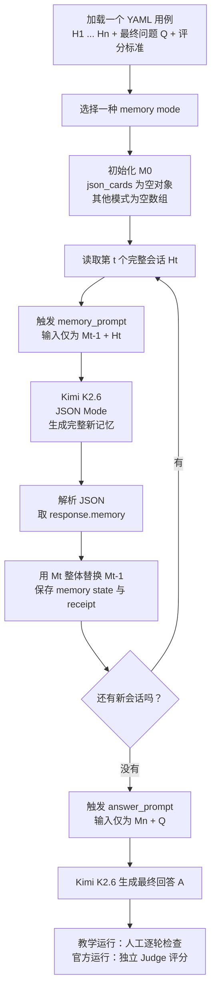
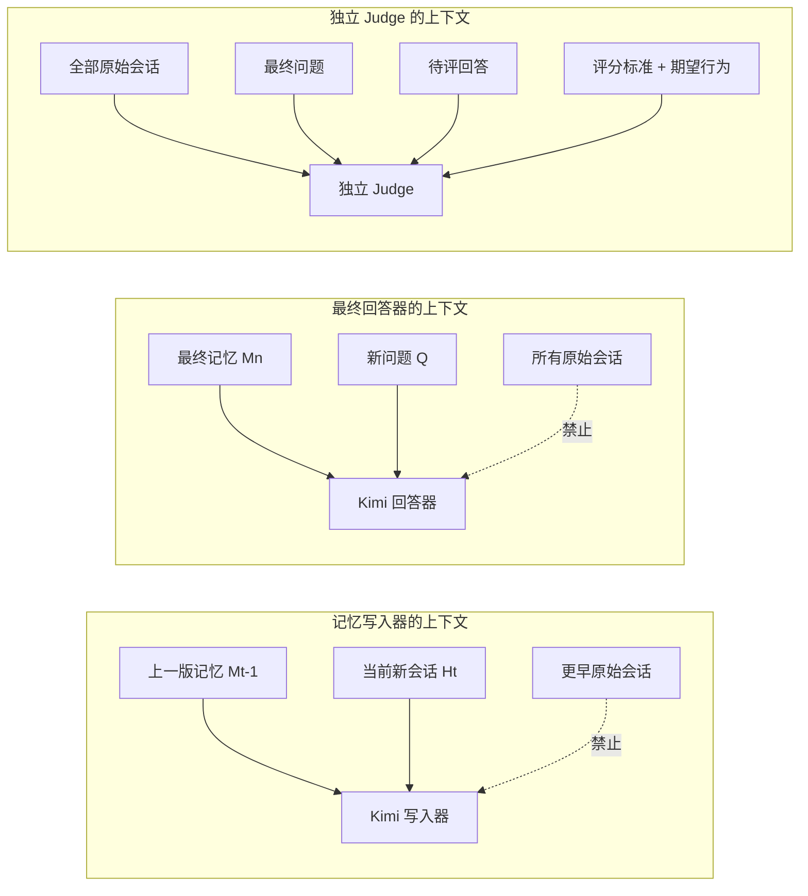
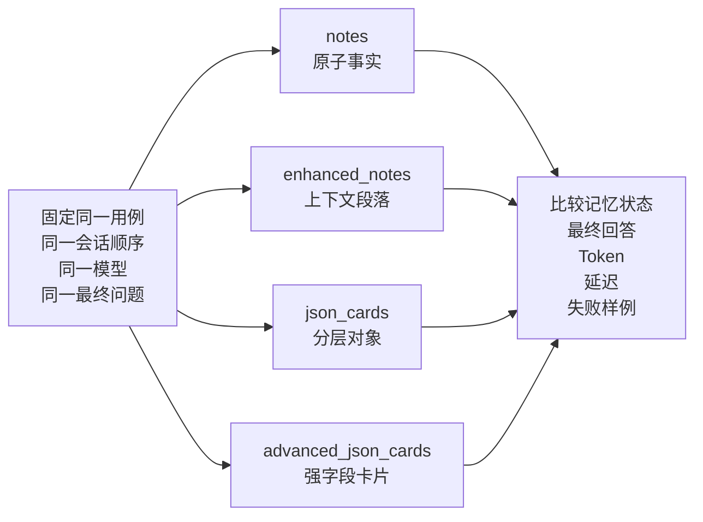
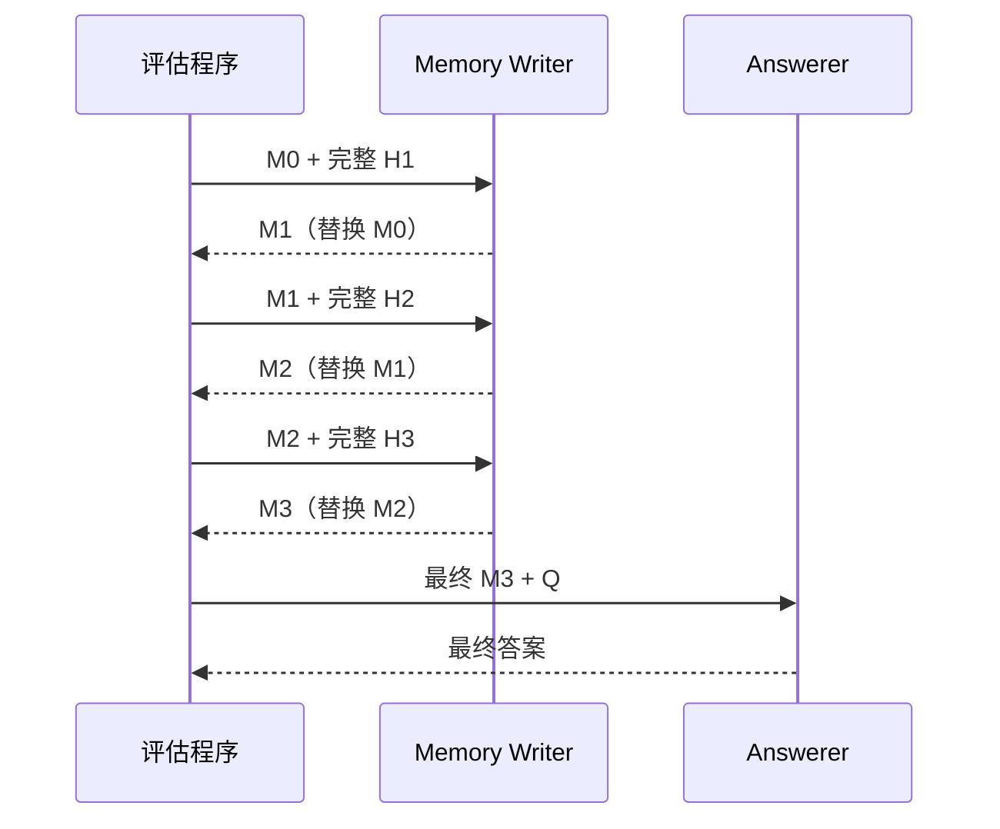

# 3-1 与 3-2 详细机制图

> 本文直接对应官方 `chapter3/user-memory/run_evaluation.py`。以下四种记忆示例是基于官方 `layer2_01_multiple_vehicles` 事实写的“结构示意”，不是 Kimi 实际运行输出。实际输出要等用户亲手运行后再观察。

| 组件 | 官方完整 campaign 默认 | 我们第一轮教学运行 |
| --- | --- | --- |
| 记忆 writer / answerer | Ark 上的 `doubao-seed-1-6-250615` | Kimi K2.6 |
| Judge | Moonshot `moonshot-v1-32k` | 暂不启用，用户和 Codex 逐轮检查 |
| Prompt 和 YAML | 官方原始内容 | 直接复用官方函数和用例 |
| 证据等级 | 满足全部接受条件时可作官方 campaign 证据 | `teaching_proxy` |

## 一、一个用例的完整执行流程



状态转移的严格表达是：

```text
M_t = MemoryWriter(mode_instruction, M_{t-1}, H_t)
A   = Answerer(M_n, Q)
```

这里有三个关键点：

1. `H_t` 是一次完整会话，不是单条 message。
2. 第二次更新只有 `M_1 + H_2`，不再有 `H_1` 原文。
3. 模型每次返回的是“完整新记忆”，程序用它整体替换上一版记忆，不是程序自动 append。

## 二、什么时候触发

| 时点 | 实验中的确定性触发条件 | 触发后做什么 |
| --- | --- | --- |
| 记忆更新 | YAML 中一个 `conversation_history` 完整处理完 | 调用一次 `memory_prompt`，生成 `M_t` |
| 下一轮记忆更新 | 下一个 `conversation_history` 到来 | 仅传入 `M_t + H_{t+1}` |
| 最终回答 | 该用例的所有历史会话都已处理 | 仅传入 `M_n + Q` |
| 官方 Judge | 最终回答生成完成 | 用全部原文作为真值评审回答 |
| 检查点保存 | 每次 LLM 调用或 memory state 生成后 | 保存请求、响应、Token、延迟和当前状态 |

注意：官方实验没有测试“用户沉默 30 秒”、“上下文达到某个 Token 数”或“人工点击保存”这些生产触发策略。它把 YAML 中的会话边界当作已知事实，固定在会话结束后更新。

我们的交互教学运行器又多了一个人工闸门：打印当前会话信息后，先让用户预测哪些事实应该进入记忆；用户按回车后才真正调用 Kimi。这个暂停只用于教学，不是被测记忆算法的一部分。

## 三、记忆写入 Prompt 是什么样

实际发给模型的 system prompt 结构如下：

```text
You are a long-term memory writer.
Select only facts that may help a future assistant,
but retain exact values, ownership, event status, dates,
provenance, and relationships.
Apply updates without losing still-valid facts.
Never answer the conversation.
Return JSON only as {"memory": ...}.

<追加当前 memory mode 的结构指令>
```

user prompt 结构如下：

```text
MEMORY MODE: <notes | enhanced_notes | json_cards | advanced_json_cards>
SESSION INDEX: <t>

CURRENT MEMORY STATE (the only retained information from older sessions):
<M_{t-1} 的完整 JSON>

NEW SESSION (analyze this session, then replace the memory state):
conversation_id=<id>
timestamp=<time>
metadata=<business / department / call_duration ...>
USER: ...
ASSISTANT: ...
USER: ...
```

这个 Prompt 同时做了三件事：

- **选择**：哪些信息对未来有用？
- **绑定**：信息属于哪个人、车、订单或事件？
- **合并/更新**：新信息是补充、替换、取消，还是与旧信息冲突？

我们的 Kimi 运行开启 JSON Mode，它保证返回可解析的 JSON object。但当前程序只做 `json.loads`，没有使用 JSON Schema 强制校验每个 card 是否真的包含全部要求字段。因此：

- JSON 语法错误会直接失败；
- `advanced_json_cards` 少了 `status` 等语义字段时，运行器未必会立即报错；
- 所以我们要亲手检查逐轮 memory state，不能只看程序退出码。

## 四、三种上下文的权限不同



这是故意的不对称：被测系统必须受到记忆压缩约束；Judge 必须看到全部真值，否则它不知道系统丢掉了什么。

## 五、四种方法到底会产生什么结构

下面四份数据表达的是同一组事实：William Chen 有一辆 2019 Honda Accord 和一辆 2023 Tesla Model 3；Honda 的 Firestone 保养已确认，Tesla 只讨论了轮胎换位，没有预约。

### 1. `notes`：原子事实数组

模式指令：把复杂句子拆成最小独立事实，保留精确名称、标识符和日期。

```json
{
  "memory": [
    "William Chen owns a 2019 Honda Accord.",
    "William Chen owns a 2023 Tesla Model 3 Long Range.",
    "The 2019 Honda Accord has a confirmed Firestone appointment on November 24 at 8:00 AM.",
    "The Honda appointment is for the 30K service package and costs $369.99 after discount.",
    "The Honda appointment confirmation number is FS-447291.",
    "A $29.99 tire rotation for the Tesla was discussed but was not scheduled."
  ]
}
```

优点是简单和容易检索；风险是关系被拆散后，“讨论过”和“已预约”容易被错误合并。

### 2. `enhanced_notes`：带上下文的段落数组

模式指令：每个段落保留理解事实所需的实体、事件、时间、状态和关系。

```json
{
  "memory": [
    "William Chen owns two vehicles: a 2019 Honda Accord and a 2023 Tesla Model 3 Long Range. These vehicles must be kept distinct when interpreting an ambiguous reference to 'my car'.",
    "On November 20, William confirmed a Firestone appointment for the 2019 Honda Accord on Friday, November 24 at 8:00 AM. The confirmed 30K service package costs $369.99 after a $20 discount, and the confirmation number is FS-447291.",
    "During the same Firestone conversation, a $29.99 tire rotation for the Tesla was discussed. William chose to focus only on the Honda, so no Tesla service was scheduled."
  ]
}
```

优点是“车辆—事件—状态”更不容易断开；代价是文本更长，部分信息可能在多个段落重复。

### 3. `json_cards`：分层 category/subcategory/key/value 对象

模式指令：用分层 JSON 组织信息，保留多实体区分和历史状态。

```json
{
  "memory": {
    "vehicles": {
      "2019_honda_accord": {
        "owner": "William Chen",
        "service_status": "confirmed",
        "appointment": {
          "provider": "Firestone Auto Care",
          "datetime": "2024-11-24 08:00",
          "service": "30K service package",
          "price_after_discount": 369.99,
          "confirmation": "FS-447291"
        }
      },
      "2023_tesla_model_3_long_range": {
        "owner": "William Chen",
        "service_status": "not_scheduled",
        "discussion": {
          "service": "tire rotation",
          "quoted_price": 29.99,
          "outcome": "William chose to focus on the Honda"
        }
      }
    }
  }
}
```

优点是实体边界明确；风险是模型必须即席设计层级和 key，同一事实可能在不同轮被放到不同路径。

### 4. `advanced_json_cards`：带强制字段的卡片数组

模式指令：每张卡必须有 `category / card_key / backstory / person / relationship / timestamp / status / facts`；冲突指令必须保存有顺序的版本，不能静默合并。

```json
{
  "memory": [
    {
      "category": "vehicle_service",
      "card_key": "service:2019_honda_accord:2024-11-24",
      "backstory": "William scheduled maintenance after the Honda reached 31,500 miles.",
      "person": "William Chen",
      "relationship": "owner of 2019 Honda Accord",
      "timestamp": "2024-11-20 09:30:00",
      "status": "confirmed",
      "facts": {
        "provider": "Firestone Auto Care",
        "appointment_datetime": "2024-11-24 08:00",
        "service": "30K service package",
        "price_after_discount": 369.99,
        "confirmation": "FS-447291"
      }
    },
    {
      "category": "vehicle_service",
      "card_key": "service:2023_tesla_model_3:tire_rotation",
      "backstory": "A same-day Tesla tire rotation was offered while scheduling the Honda.",
      "person": "William Chen",
      "relationship": "owner of 2023 Tesla Model 3 Long Range",
      "timestamp": "2024-11-20 09:30:00",
      "status": "discussed_not_scheduled",
      "facts": {
        "service": "tire rotation",
        "quoted_price": 29.99,
        "latest_instruction": "Focus only on the Honda for now"
      }
    }
  ]
}
```

优点是状态、时间、来源和冲突版本可以显式表达；代价是结构重、Token 多，而且如果 `card_key` 不稳定会产生重复卡片。

## 六、四条链路是怎么比的



受控不变项：用例、会话顺序、模型、随机种子、问题、Judge。

主要自变量：memory mode 及其对应的结构指令。结构指令的改变是实现这个自变量所必需的，不能再同时改模型或用例。

## 七、最终回答 Prompt 和评估

回答器的 system prompt 要求：

```text
You are an assistant in a brand-new session.
The supplied long-term memory is your only source about this user:
you cannot access earlier raw dialogue.
Answer accurately, resolve ambiguity, connect sessions,
and proactively warn about material risks.
Do not invent facts.
```

回答器的 user prompt 只包含：

```text
MEMORY MODE: <mode>
LONG-TERM MEMORY:
<M_n>

USER QUESTION:
<Q>
```

官方独立 Judge 能看到全部原始会话，从 1–4 评分：

| 维度 | 检查什么 |
| --- | --- |
| Precision | 回答中的事实是否都有原文支持 |
| Recall | 评分标准要求的关键信息是否齐全 |
| Reasoning | 是否正确解决多实体、状态和跨会话关系 |
| Proactivity | 是否该澄清时澄清、该提醒时提醒 |

另有幻觉一票否决：只要出现重大的无支持或与原文矛盾的事实，`reward = 0`。

官方代码的用例通过条件是：

```text
无幻觉
AND Precision >= 3
AND Recall >= 3
AND Reasoning >= 3
```

`Proactivity` 参与平均 reward，但没有被写入这个布尔通过条件。这是读总分时必须知道的机械例外。

## 八、我们第一轮教学运行的边界

我们第一轮会用 Kimi K2.6 同时写记忆和回答，展示每个 `M_t`，暂时不让它自评。这能用于学习逐轮压缩与失真，但不等于官方的独立 Judge 验收。

完整 campaign 需要：

```text
60 个用例 × 4 种模式 = 240 个评估
+ 会话内顺序记忆隔离
+ 与 writer 不同的独立 Judge
+ 所有调用成功
+ 原始 receipts 与输入哈希
```

## 九、记忆更新到底在什么时间触发

### 9.1 本书实验采用的触发方式

实验数据已经预先切成一段段 `conversation_histories`。程序遍历到一段完整会话的末尾，就直接调用一次记忆写入器：



因此它是“**预先知道会话边界后，在每段会话末尾自动、显式调用**”：

- 不是每收到一条消息就提取。
- 不是模型自己判断什么时候该保存。
- 不是回答最终问题的同时顺便提取。
- 也不是等整个案例全部结束才提取一次。

本地教学脚本让用户按 Enter，只是为了在调用前停下来观察输入。按下 Enter 后才执行本来应由循环自动执行的记忆更新；它不是书中算法的一部分。

本实验也没有研究生产环境怎样判定“会话结束”。空闲超时、用户关闭页面、明确点击结束、轮数或 Token 阈值都属于实验预先固定掉的外部机制。

### 9.2 成熟 Agent 通常把三件事拆开

| 层 | 常见触发 | 保存什么 | 是否需要 LLM 提取 |
| --- | --- | --- | --- |
| 原始事件日志 | 每条消息、工具调用发生后 | 原文、工具输入输出、时间和 ID | 否 |
| 短期会话状态 / checkpoint | 每轮或每个图节点结束后 | 当前线程可恢复的状态和消息历史 | 通常否 |
| 长期语义记忆 | 明确“记住”、关键事实出现、每轮/会话结束后的后台任务 | 偏好、约束、人物关系、长期目标、重要决定 | 通常是 |
| 记忆整理 | 空闲期、定时任务或累计到阈值 | 去重、合并、冲突版本、摘要和过期状态 | 常常是 |
| 记忆检索 | 下一次回答前 | 与当前用户和问题相关的少量记忆 | 检索器为主，可由 LLM 辅助 |

工程上更稳妥的是混合触发：原始日志和短期状态高频保存；用户明确要求或非常关键的持久事实可以在当前轮同步写入；普通语义提取放在回答后的异步任务；跨轮规律和去重再放到周期性整理中。这样能同时控制丢失风险、回答延迟和错误记忆污染。

这里没有唯一行业标准。OpenAI Agents SDK 的 Sessions 会在每次 run 前取回历史、run 后自动保存新增输入输出；其 Sandbox Agent memory 示例则在 run 结束后记录会话片段，并在 sandbox session 关闭时做两阶段提取与整理。LangMem 同时区分回答热路径上的即时写入和调用间/调用后的后台写入；Mem0 的 V3 add 接口由应用显式提交消息，再异步提取。它们共同说明：**触发器首先是 Agent 编排层的设计，不是 LLM 天生自带的行为。**

资料：

- [OpenAI Agents SDK Sessions](https://openai.github.io/openai-agents-python/sessions/)
- [OpenAI Sandbox Agent memory](https://openai.github.io/openai-agents-js/guides/sandbox-agents/memory/)
- [LangMem memory formation](https://langchain-ai.github.io/langmem/concepts/conceptual_guide/)
- [Mem0 Add Memories](https://docs.mem0.ai/api-reference/memory/add-memories)
