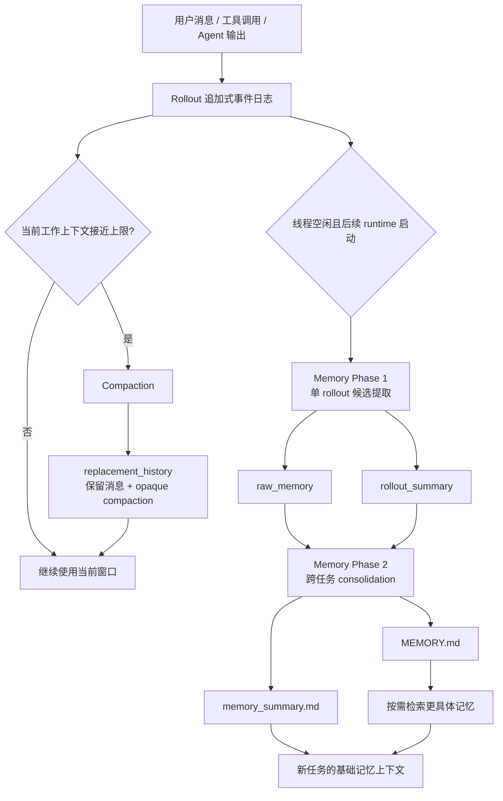

# Agent 记忆模块：从上下文压缩到长期记忆

> 状态：待继续  
> 建立日期：2026-08-22  
> 范围：理解 Agent 如何保存轨迹、压缩工作上下文、提取候选记忆、合并长期记忆，以及这些步骤的实验设计。

## 一、原始问题与用户理解

### 原始问题

- “上下文不是超了吗？那怎么去总结记忆呢？”
- “是逐块总结记忆吗？”
- Rollout 保存的是压缩前轨迹、压缩后上下文，还是两者之一？

### 用户理解

用户已经意识到一个真实矛盾：如果一条 Agent 轨迹已经长到必须 compaction，就不可能再把全量原始日志无条件塞进另一次记忆提取模型调用。因此，长期记忆生成前必然需要某种输入控制机制。

这个判断是对的。需要进一步区分的是：输入控制可以是过滤、截断、使用 compaction、逐块提取、递推更新或多级汇总；不能在没有实现证据时统称为“逐块总结”。

## 二、先记住最重要的结论

```text
Rollout       = 持久化的事件账本
Compaction    = 缩短当前任务继续推理所需的工作上下文
Memory Phase 1 = 从一条历史任务中提取候选记忆
Memory Phase 2 = 跨任务归并、去重、处理冲突并形成长期记忆
Retrieval     = 下一次回答前只取相关记忆
```

“当前上下文超限”不代表磁盘上的历史轨迹消失。磁盘存储容量和模型单次上下文窗口是两种不同约束。

## 三、五层完整流程



最容易混淆的是两条支路：

- `Rollout → Compaction → 当前任务继续运行`：服务短期上下文。
- `Rollout → Phase 1 → Phase 2 → 跨任务使用`：服务长期记忆。

## 四、Rollout 到底是不是“全量原始轨迹”

严格表达是：Rollout 是 Codex 层面的追加式可观测事件日志，不是整个模型服务的完整网络抓包。

它可以记录：

- user/developer/assistant 消息；
- 工具调用与结果；
- 文件修改、任务状态和 Token 事件；
- compaction 事件；
- Codex 暴露出来的 reasoning/运行事件。

它不保证包含：

- 模型服务端全部隐藏状态；
- 完整隐藏思维链；
- 未进入 Codex 事件系统的外部活动；
- 每个网络请求的原始字节。

### 当前任务的本地证据

当前第 3 章任务的 rollout 实测：

```text
文件大小：约 15.4 MB
JSONL 行数：1201
compaction 次数：2
第一次 compacted：第 437 行
第二次 compacted：第 884 行
```

旧事件没有因 compaction 被删除。系统在旧事件之后追加 `compacted` 记录，记录中包含新的 `replacement_history`；之后的新事件继续向文件尾部追加。

所以：

| 观察对象 | 压缩后保存/使用什么 |
| --- | --- |
| 磁盘 Rollout | 压缩前原事件 + compacted 事件 + 压缩后新事件 |
| 模型下一轮工作上下文 | 保留消息 + opaque compaction + 后续新消息 |
| 人类查看日志 | 仍能检查 compaction 前后的事件 |

## 五、上下文已经超了，怎样生成长期记忆

### 5.1 第一性原理

假设原始日志为 `R`，模型一次可处理的上限为 `B`，且 `|R| > B`。记忆系统必须先构造一个受控输入：

```text
X = Project(R), 且 |X| <= B
Memory = Extract(X)
```

`Project` 不是只有一种实现。常见方案如下：

| 方案 | 做法 | 主要风险 |
| --- | --- | --- |
| 直接截断 | 只保留开头或结尾 | 另一端的重要信息永久不可见 |
| 规则过滤 | 去掉低价值工具日志、重复系统提示 | 过滤规则可能误删关键证据 |
| 使用 compaction | 用当前任务的压缩状态作为输入 | compaction 为继续任务优化，不一定为长期事实召回优化 |
| 逐块 Map-Reduce | 每块提取候选记忆，再合并 | 重复、跨块关系丢失、成本增加 |
| 递推更新 | `M_t = Writer(M_{t-1}, H_t)` | 早期遗漏无法自动恢复，错误会累积 |
| 多级时间汇总 | turn → session → day/week → profile | 多层压缩会逐级放大失真 |

### 5.2 “逐块总结”是什么

逐块总结不是简单地把每块都写成自然语言摘要，而是两阶段计算：

```text
Map：每个块独立提取候选事实
    C1 → E1
    C2 → E2
    C3 → E3

Reduce：合并候选事实
    E1 + E2 + E3
      ↓ 去重、关联实体、解决版本/冲突
      M
```

候选记忆最好带证据，而不是只有一句无来源结论：

```json
{
  "subject": "user",
  "predicate": "prefers",
  "value": "teacher-led mechanism explanations",
  "scope": "technical learning",
  "source_event_ids": ["event_123", "event_456"],
  "observed_at": "2026-08-22T00:00:00+08:00",
  "status": "candidate"
}
```

Reduce 阶段才能判断它是一次性要求、重复偏好、旧版本还是冲突事实。

## 六、当前 Codex 是否确定采用逐块总结

目前不能这样下结论。

| 判断 | 状态 | 当前证据 |
| --- | --- | --- |
| Rollout 保留 compaction 前后的事件 | 已核对 | 当前 JSONL 中旧行仍在，并追加两个 `compacted` 事件 |
| Phase 1 以 rollout 为来源 | 已核对 | 安装版 Prompt 使用 `rollout_contents` |
| 一个线程对应一个 Phase 1 job 和一个最终输出 | 已核对 | `memories_1.sqlite` 以 `thread_id` 保存 `raw_memory/rollout_summary` |
| Phase 1 一定把完整 15.4 MB 原文放进一次模型调用 | 不成立/未证实 | 单次上下文限制不允许无条件这样做 |
| Phase 1 内部采用逐块 Map-Reduce | 待验证 | 尚未核对 loader/过滤/截断/分块实现 |
| Phase 1 只读取 compaction 结果 | 待验证 | 当前可见 Prompt 和数据库不能证明 |

更稳妥的结论是：Phase 1 必须得到一个受控的 rollout projection，但当前还不知道它具体采用过滤、逻辑历史重建、截断还是内部多块处理。

## 七、教材实验 3-1 采用的是哪一种

教材 3-1 使用递推更新：

```text
M_t = Writer(M_{t-1}, H_t)
```

每个预先切好的会话结束后，只把：

```text
上一版记忆 M_{t-1}
+ 当前完整会话 H_t
```

交给 Writer。更早的原始会话不再进入上下文。

它本质上是一个增量 Reduce：每个 `H_t` 是当前增量，`M_{t-1}` 是历史压缩状态。因此它避免了“把全部历史会话一次性塞给模型”，但仍存在两个问题：

1. 如果单个 `H_t` 自身过长，仍需继续分块或过滤。
2. 如果某轮 Writer 漏掉事实，后续会话没有重复该事实，就无法从旧原文恢复。

这也是实验为什么必须展示每个 `M_t`，而不能只看最终答案。

## 八、Compaction 与 Memory 为什么不能共用一个摘要

两者优化目标不同：

| 维度 | Compaction | Long-term Memory |
| --- | --- | --- |
| 目标 | 让当前任务继续执行 | 让未来不同任务复用信息 |
| 关注 | 已完成动作、当前假设、工具结果、下一步 | 稳定偏好、关系、约束、目标、重要决定 |
| 生命周期 | 当前线程 | 跨线程/跨任务 |
| 允许保留的细节 | 当前任务相关的临时状态 | 未来仍可能有用且可验证的信息 |
| 典型输出 | opaque compaction item | 可检索、可更新、有来源的记忆对象 |

例如，“刚刚运行测试失败于端口 8000”对当前任务 compaction 很重要，但通常不应该成为永久用户画像；“用户要求报告完成前必须运行验证”则可能值得进入长期记忆。

## 九、成熟 Agent 更稳妥的分层设计

```text
L0 原始事件日志：完整、可审计、不可由摘要替代
L1 短期 checkpoint：恢复当前任务
L2 分块候选记忆：带来源、时间、实体和作用域
L3 session memory：会话内去重和状态更新
L4 long-term memory：跨会话合并、冲突与版本管理
L5 retrieval view：回答前按用户/任务/问题检索
```

关键设计原则：

- 原始证据与派生记忆分开保存。
- Map 阶段尽量提取原子候选，不急着下全局结论。
- Reduce 阶段显式处理实体、时间、来源、冲突和失效。
- 记忆漏写与错误写入都要能追溯回证据。
- Compaction 的输出可以作为候选输入，但不能天然等同于长期记忆。

## 十、后续小实验设计

若要真正理解“长轨迹怎样生成记忆”，应固定同一案例、同一模型和同一记忆结构，只改变输入控制策略：

| 实验臂 | 输入策略 |
| --- | --- |
| A | 尾部截断后一次提取 |
| B | 只使用 compaction 状态 |
| C | 固定 Token 分块 Map，再 Reduce |
| D | 按 session 递推更新 `M_t` |

观察指标：

- 关键事实 Recall；
- 无来源事实/幻觉；
- 跨块实体关联；
- 冲突更新准确率；
- Token、延迟与调用次数；
- 最终回答质量。

这个实验与 3-2 的四种记忆格式对照必须分开。否则同时改变“输入切分策略”和“记忆表示”，无法解释差异来自哪里。

## 十一、结论状态

| 问题 | 状态 |
| --- | --- |
| Rollout 与 compaction 的物理保存关系 | 已理解（有当前任务本地证据） |
| Compaction 与长期记忆的目标差异 | 待继续（等待用户复述确认） |
| 教材 3-1 的递推记忆更新 | 待继续（尚未亲手观察逐轮输出） |
| Codex Phase 1 的 projection/分块实现 | 待验证（需进一步核对 loader 实现） |
| 四种长轨迹记忆策略的受控实验 | 待验证（尚未运行） |

## 十二、资料与本地证据

- [OpenAI Compact a response](https://developers.openai.com/api/reference/java/resources/responses/methods/compact)
- 本机 Codex 配置：`/Users/gaoronghui/.codex/config.toml`
- 本机 Phase 1 元数据：`/Users/gaoronghui/.codex/memories_1.sqlite`
- 本机长期记忆目录：`/Users/gaoronghui/.codex/memories/`
- 第 3 章实验机制：[3-1 与 3-2 详细机制图](../实验/chapter3-memory-rag-labs/3-1与3-2详细机制图.md)
- 本次调查记录：[第 3 章全套实验准备](../记录/2026-08-19-第3章全套实验准备.md)

## 十三、后续 Todo

- [ ] 核对 Codex Memory Phase 1 对超长 rollout 的 projection、过滤、截断或分块实现。
- [ ] 固定案例、模型和记忆结构，对比尾部截断、compaction、分块 Map-Reduce 和按 session 递推更新。
- [ ] 分别记录关键事实 Recall、幻觉、跨块实体关联、冲突更新、Token 与延迟。

当前顺序：先继续第 3 章实验；完成相关基础实验后，再回到本专题做机制核对和独立对照。
