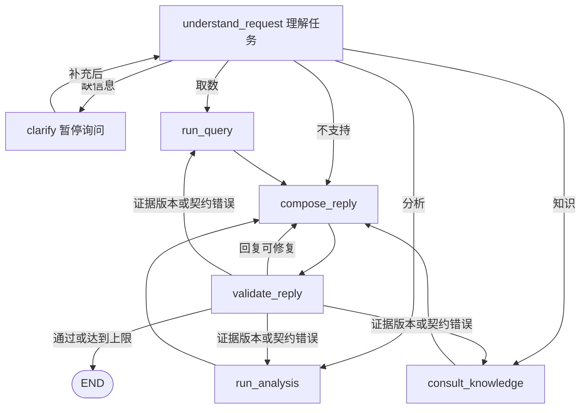

# 七节点 LangGraph 主 Agent

代码阅读中的延伸问题统一记录在[待解决问题 TODO](../../../../记录/LangGraph代码阅读-待解决问题TODO.md)，读到相关实现或完成代码阅读后再展开。

这是 2026-09-06 按当前讨论实现的小型复现。主 Agent 使用真实 LangGraph 和 Kimi K2.6；取数 Agent、分析 Agent 各封装成一个普通函数，业务数据全部合成。旧 E1/E2 示例保留。

**当前 v2：63 个本地测试通过；新增 4 个真实 Kimi 案例符合预期。** 初版的 10 个真实案例和原始日志保留。用户是否能独立解释此实现，尚未验收。

按代码执行顺序阅读，请从[主 Agent 代码导读](代码导读-按实际执行顺序.md)开始：命令行入口 → 创建图和初始 State → 理解问题 → 分析函数内部两次取数 → 生成回复 → 校验与重写 → 保存结果。每一步都对应源码位置，并对照新版分析案例的实际记录。

2026-09-07 自读材料：[详细阅读摘要](/Users/gaoronghui/Documents/agent_learning/2-进行中/面试准备/项目准备/智能经营分析/实验/LangGraph经营分析面试复现/business_analysis_repro/main_agent/代码阅读摘要.md) 汇总剩余四块流程、实际重写案例与当前实现边界；[完整注释版代码索引](/Users/gaoronghui/Documents/agent_learning/2-进行中/面试准备/项目准备/智能经营分析/实验/LangGraph经营分析面试复现/business_analysis_repro/main_agent/阅读版/README.md) 提供八个核心文件的阅读副本，原代码保持不变。用户阅读状态仍为待继续。

## v2：按步骤阅读回放，并保留指标元数据

- [新版分析回放](../../.runs/main-agent-v2/readable-analysis/trace.html)：左侧是实际执行步骤，右侧解释这一步做了什么、读到了什么、下一步往哪里走。
- [新版 SQL 取数回放](../../.runs/main-agent-v2/readable-sql/trace.html)：点击“指标与取数”，查看保单量的定义、别名、指标 ID、来源表、SQL 模板及实际绑定参数。
- [新版指标平台取数回放](../../.runs/main-agent-v2/readable-platform/trace.html)：查看业务线 ID、数据集 ID、平台指标 ID 及本次请求。
- [新版澄清恢复回放](../../.runs/main-agent-v2/readable-clarify/trace.html)：保留暂停、补充、恢复、取数和最终回答。

原始日志仍在底部展开项中；默认不再把几十条事件逐条展示。每一步可展开 State 前后变化或完整模型对话。回放文字按节点代码语义整理，实际数值、错误、候选提议和路由均来自日志，不额外调用模型“编写故事”。失败和重试也明确呈现。

按用户[此前的指标配置口述](../../../../记录/2026-09-05-指标维度配置口述与语义层学习.md)及本次补充，新增 [catalog.py](catalog.py)：名称、别名、标准指标 ID、英文名、含义、公式、单位、支持维度、时间口径、聚合规则和分析场景；取数配置另包含查询方式、业务线 ID、数据集 ID、平台指标 ID，或 SQL 模板、来源表。

配置中的所有 ID、表名和数据集名称都是本实验的模拟值。`premium` 配置为本地指标平台模拟接口，真实消费已组装的请求参数；`policy_count` 配置为本地 SQLite，实际执行参数化 SQL。没有调用公司指标平台或数据库。查询返回 `metric_definition`（当时配置快照）和 `query_execution`（本次参数、实际 SQL/请求、执行状态）；即使配置以后变化，也不会改写这份历史结果。

旧 Trace 没有记录的属性保持“未记录”，不会拿新版目录倒填过去的实际配置。仅重新渲染旧 Trace 不会触发模型调用。

v2 验证：4 个真实案例全部完成，共 15 次 Kimi 调用，输入 7,509 Token、输出 770 Token。分析和直接平台查询都经历了一次真实草稿修复；SQL 案例识别“保单数”并查询得到 5,600 单；澄清案例在独立进程恢复。详见 [v2 验收明细](../../.runs/main-agent-v2/verification.json)。桌面及 390/320 像素窄屏共 6 个页面、60 个交互状态检查通过，无脚本错误或页面横向溢出。

新增 [trace_report.py](trace_report.py) 将事件归并成可读步骤，[trace_view.html](trace_view.html) 负责回放界面。`Trace.render()` 的入口不变，新运行自动生成新版页面。以下初版用量和验收记录保留为历史记录。

## 先打开这两个入口

- [初版分析案例的完整 Trace](../../.runs/main-agent/live-analysis-02/trace.html)：有一次真实的回复校验失败及重写，适合观察有限循环；此旧记录缺少完整指标元数据。
- [澄清及跨进程恢复 Trace](../../.runs/main-agent/live-clarify-04/trace.html)：上周保费 → 等待业务信息 → 补充准时保 → 取数与回答。
- [十案例验收明细](../../.runs/main-agent/live-verification.json)：预期结果、实际结果、节点路径、回答与 Token 用量。

这些 Trace 是本机实际运行产物，位于 Git 忽略目录 `.runs/`，不会随源码提交到远端。

## 一次运行

```bash
cd "/Users/gaoronghui/Documents/agent_learning/2-进行中/面试准备/项目准备/智能经营分析/实验/LangGraph经营分析面试复现"
uv sync --frozen
uv run python -m business_analysis_repro.main_agent run \
  "查询准时保上周的保费收入" \
  --thread-id demo-query-v1 \
  --reference-date 2026-09-01
```

期望：`status=completed`，模拟保费收入 **56,000 元**，终端返回 `trace.html` 的完整路径。每个新问题使用新的 `thread-id`；重复 ID 会拒绝覆盖原任务。

日期默认为本机北京时间的当天。示例显式冻结 `2026-09-01`，使“上周”稳定对应 `2026-08-24 至 2026-08-30`，方便核算。

当前机器的项目 `.env` 已通过 `MOONSHOT_ENV_FILE` 引用既有本地 Kimi 密钥文件，无需复制密钥。配置由 [settings.py](../settings.py) 读取，默认模型 `kimi-k2.6`、地址 `https://api.moonshot.cn/v1`。在其他机器使用根目录 `.env.example` 配置环境变量即可。密钥、客户端和 Trace 对象都不会进入 State。

## 暂停后，退出进程，再恢复

```bash
uv run python -m business_analysis_repro.main_agent run \
  "上周保费收入是多少？" \
  --thread-id demo-clarify-v1 \
  --reference-date 2026-09-01
```

此命令问缺少哪项业务，并以退出码 **2** 返回。这是正常等待，SQLite 中已经保存状态。上一个命令的进程结束后运行：

```bash
uv run python -m business_analysis_repro.main_agent resume \
  "准时保" --thread-id demo-clarify-v1
```

程序重新创建 Graph，通过相同 `thread_id` 找到 checkpoint，并用 `Command(resume=...)` 给 `interrupt()` 返回值。再次进入 `clarify` 不会重复调用模型或查询数据；问题和用户补充只在恢复成功后写入 messages。

离线查看已存在任务，不调用模型，也不需要密钥：

```bash
uv run python -m business_analysis_repro.main_agent inspect --thread-id live-analysis-02
```

CLI 退出码：`0` 完成/查看成功；`2` 等待用户；`1` 失败。它目前支持一个任务内的多轮澄清；已经结束的任务不接受继续追问，请创建新任务。

## 图和代码怎么对应



| 文件 | 内容索引（执行顺序见上方导读） |
| --- | --- |
| [state.py](state.py) | `RootState` 字段、模型可写的 `Proposal`、回复和校验的结构 |
| [graph.py](graph.py) | 底部注册的 7 个节点及边，然后逐个读节点；这是实现主文件 |
| [capabilities.py](capabilities.py) | `query_agent()` 和 `analysis_agent()` 两个函数及共享准入 |
| [model.py](model.py) | 明确选择模型上下文、JSON Mode、结构校验、有限重试及用量记录 |
| [runtime.py](runtime.py) | SQLite、`thread_id`、`Command(resume=...)`、状态快照与执行入口 |
| [trace.py](trace.py) | Span 父子关系、事件落盘、脱敏、HTML 报告 |
| [__main__.py](__main__.py) | 三个 CLI 子命令 |
| [确定性测试](../../tests/test_main_agent.py) | 通过故障注入理解失败与恢复边界 |

`run_query` 节点只负责调用 `query_agent(task)`；`run_analysis` 节点只负责调用 `analysis_agent(task)`。函数内部步骤在这版没有注册成子图。未来替换时维持结果契约即可。分析函数内部使用同一个取数函数，因此也经过相同的准入和完整性检查。

## State、上下文和状态变化

- `RootState` 是任务工作数据：消息、标准任务、证据、草稿、校验结果、计数等。
- `Proposal` 是模型生成的候选任务。模型不能在这里填写 `status`、权限或执行结果。
- `messages` 使用 `add_messages` 合并，其余字段默认覆盖。节点返回增量更新，不原地修改 State。
- `understand_request` 只把对话、日期基准和小型目录发给模型；`compose_reply` 只发对话与事实摘要，原始数据行不会自动拼进去。
- `waiting_user` 在进入 `clarify` 前写入，实际暂停由 `interrupt()` 完成。
- `task_revision` 在重新理解任务时递增，并清除旧结果和草稿；能力返回旧版本结果会被拒绝。
- `completed` 只在最终校验通过后由代码写入。确定性失败说明使用 `failed`；未经校验的模型草稿不作为最终回答。

### 模拟数据可以独立核算

准时保保费：2026-08-24 之前每天 App=6,000、小程序=4,000；该日及之后每天 App=4,500、小程序=3,500。运费险为同一天准时保的两倍；保单量为金额除以 10。

在固定示例中，前一周 `7 × (6,000 + 4,000) = 70,000`，上周 `7 × (4,500 + 3,500) = 56,000`，变动 `-14,000`，环比 `-20.0%`；App 的变动为 `-10,500`，小程序为 `-3,500`。这只能说明数值和渠道分解，不能证明业务因果。

## 怎样追溯一次执行

每个任务在 `.runs/main-agent/<thread-id>/` 保存：

| 文件 | 用途 |
| --- | --- |
| `trace.html` | 可直接在浏览器打开；展开每项事件看详情 |
| `trace.jsonl` | 原始事件：开始/结束、节点输入与返回增量、条件路由依据、模型完整消息/响应、工具输入/结果、错误与重试 |
| `state.json` | 最后持久化状态 |
| `checkpoints.sqlite` | LangGraph 真正恢复时读取的数据库 |
| `checkpoints.json` | 方便阅读的 checkpoint 历史，含状态、下一节点、版本 ID |
| `graph.mmd` | 从实际编译 Graph 导出的 Mermaid 拓扑 |

`thread_id` 关联一个完整任务；`run_id` 区分启动和恢复的不同进程调用；`span_id/parent_span_id` 关联图、节点、模型和工具。`execution_start` 留下源码 SHA-256 与依赖版本。模型 Usage 记录的是提供方返回值，未调用计费账单接口。

Span 的 `ok` 表示函数正常返回；业务是否成功看返回的 `status`。例如权限错误可以被节点捕获并转换成失败结果，原始异常仍在 `node_error` 事件中。Trace 保存应用可观察到的请求、响应和控制流，不包含模型内部隐藏思考。LangSmith 云端 tracing 在此实验中明确关闭。

## 验收和运行边界

```bash
uv run pytest -q
uv run ruff check business_analysis_repro/main_agent tests/test_main_agent.py
uv run ruff format --check business_analysis_repro/main_agent tests/test_main_agent.py
```

2026-09-06：`54 passed`，Ruff 检查和格式检查通过；新增的 27 个测试覆盖三路分流、暂停恢复、澄清上限、模型故障、权限拒绝、超时重试、旧证据返修、回复校验/修复上限、调用预算、线程防覆盖、并发锁、Trace 脱敏和 HTML 转义。

付费验收入口如下；**已经存在的同名案例会直接检查已有产物，不重新调用模型**。需要重新检验模型时用新的 `--output-dir`：

```bash
uv run python -m business_analysis_repro.main_agent.verify_live --run-paid-cases
```

本次 10 案例共 26 次真实 Kimi 调用，输入 13,843 Token、输出 1,335 Token。案例包含直接取数、分析、知识、缺业务澄清、缺业务及时间澄清、未知指标、不支持的任务、超长范围、模拟权限拒绝、主动注入一次取数超时后恢复。故障注入案例中的故障来自本地测试，不能说成 Kimi 实际故障。

分析、知识各发生一次真实草稿修复；前者缺少“模拟数据”且改写了负数表示，后者改写了口径原句。当前数字和事实保护故意较严格，同义表达也可能触发重写。这是为了观察“最终回复校验 → 有限修复”的机制，尚不是通用的事实判定器；LLM Judge 也不提供绝对正确性保证。

当前范围：两个业务、两个指标、最多 31 天、单任务串行执行，分析为固定环比及渠道分解。三轮澄清、一次回复重写、一次能力结果返修、一次瞬时工具重试；每任务默认最多 16 次模型请求，SDK 隐式重试关闭。临时模型故障/JSON 结构错误在预算内最多尝试两次。权限是本地白名单，数据来源为合成函数；真实数据库、真实认证、开放分析循环及云端 LangSmith 尚未接入。用户主动终止进程后，Trace 可能保留未结束 Span；本次验证了正常 interrupt 的磁盘恢复，未验证任意断电时的故障恢复。

官方依据：[LangGraph Graph API](https://docs.langchain.com/oss/python/langgraph/graph-api)、[Interrupt 与恢复](https://docs.langchain.com/oss/python/langgraph/interrupts)、[持久化](https://docs.langchain.com/oss/python/langgraph/persistence)、[Kimi K2.6](https://platform.kimi.com/docs/guide/kimi-k2-6-quickstart)。实际版本锁定在项目 `uv.lock`，每条 Trace 另有版本记录。
