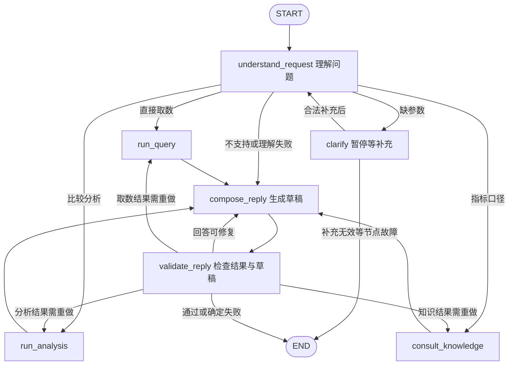

# LangGraph 主 Agent：代码阅读摘要

整理日期：2026-09-07。内容依据本机当前源码，并对照已保存的 `readable-analysis` 执行记录。本文是 Codex 的源码解读；学习状态仍为 **待继续**。

## 1. 目前还差多少

**主线已经讲到分析函数返回结果。剩下四块：生成回答、校验与重写、保存并返回结果、澄清恢复。** 前三块顺着这次分析执行往下走；澄清是最后补读的支线。不用再从 argparse 开始，也不用第一遍展开 Trace 页面的 HTML/CSS。

| 自读顺序 | 这块解决什么问题 | 当前原文件范围 | 带注释的对应位置 |
| --- | --- | --- | --- |
| 1. 生成回答 | 把事实整理成一份待检查草稿 | [graph.py 238–264 行](/Users/gaoronghui/Documents/agent_learning/2-进行中/面试准备/项目准备/智能经营分析/实验/LangGraph经营分析面试复现/business_analysis_repro/main_agent/graph.py:238) | [从 compose_reply 开始](/Users/gaoronghui/Documents/agent_learning/2-进行中/面试准备/项目准备/智能经营分析/实验/LangGraph经营分析面试复现/business_analysis_repro/main_agent/阅读版/04_主图_注释版.py:286) |
| 2. 校验与重写 | 判断能否交付，决定重写文字还是重新调用能力 | [graph.py 267–340 行](/Users/gaoronghui/Documents/agent_learning/2-进行中/面试准备/项目准备/智能经营分析/实验/LangGraph经营分析面试复现/business_analysis_repro/main_agent/graph.py:267)、[graph.py 365–386 行](/Users/gaoronghui/Documents/agent_learning/2-进行中/面试准备/项目准备/智能经营分析/实验/LangGraph经营分析面试复现/business_analysis_repro/main_agent/graph.py:365)；辅助函数 [graph.py 30–50 行](/Users/gaoronghui/Documents/agent_learning/2-进行中/面试准备/项目准备/智能经营分析/实验/LangGraph经营分析面试复现/business_analysis_repro/main_agent/graph.py:30) | [继续 validate_reply](/Users/gaoronghui/Documents/agent_learning/2-进行中/面试准备/项目准备/智能经营分析/实验/LangGraph经营分析面试复现/business_analysis_repro/main_agent/阅读版/04_主图_注释版.py:322) |
| 3. 保存与返回 | 保留执行存档、生成回放，把结果交回调用方 | [runtime.py 122–156 行](/Users/gaoronghui/Documents/agent_learning/2-进行中/面试准备/项目准备/智能经营分析/实验/LangGraph经营分析面试复现/business_analysis_repro/main_agent/runtime.py:122)、[__main__.py 53–87 行](/Users/gaoronghui/Documents/agent_learning/2-进行中/面试准备/项目准备/智能经营分析/实验/LangGraph经营分析面试复现/business_analysis_repro/main_agent/__main__.py:53) | [运行管理收尾](/Users/gaoronghui/Documents/agent_learning/2-进行中/面试准备/项目准备/智能经营分析/实验/LangGraph经营分析面试复现/business_analysis_repro/main_agent/阅读版/02_运行管理_注释版.py:154)、[命令行收尾](/Users/gaoronghui/Documents/agent_learning/2-进行中/面试准备/项目准备/智能经营分析/实验/LangGraph经营分析面试复现/business_analysis_repro/main_agent/阅读版/01_入口_注释版.py:73) |
| 4. 澄清恢复 | 缺参数时暂停，收到补充后回到理解节点 | [graph.py 189–206 行](/Users/gaoronghui/Documents/agent_learning/2-进行中/面试准备/项目准备/智能经营分析/实验/LangGraph经营分析面试复现/business_analysis_repro/main_agent/graph.py:189)、[runtime.py 96–102 行](/Users/gaoronghui/Documents/agent_learning/2-进行中/面试准备/项目准备/智能经营分析/实验/LangGraph经营分析面试复现/business_analysis_repro/main_agent/runtime.py:96) | [clarify 支线](/Users/gaoronghui/Documents/agent_learning/2-进行中/面试准备/项目准备/智能经营分析/实验/LangGraph经营分析面试复现/business_analysis_repro/main_agent/阅读版/04_主图_注释版.py:226)、[新任务与恢复分支](/Users/gaoronghui/Documents/agent_learning/2-进行中/面试准备/项目准备/智能经营分析/实验/LangGraph经营分析面试复现/business_analysis_repro/main_agent/阅读版/02_运行管理_注释版.py:111) |

**如果问代码是否还没写完：这份学习复现的主流程已经实现。** 取数和分析仍按此前要求封装为普通函数；后面讨论的模型自主调用工具、知识检索、真实平台接口和多人服务端还没有实现，它们是后续设计议题。

这一轮只整理阅读材料，没有新跑 Kimi。源码副本只增加整行注释，已逐文件做语法编译与 AST 一致性检查；此前实际运行结果作为历史证据引用，不视为本轮重新验收。

## 2. 整套代码到底在做什么

一次问题先变成标准任务，再产生带来源的结果，最后变成经过检查的回答。LangGraph 保存这条流程的状态，并根据代码定义的边决定下一步。

```text
用户问题
  → main 解析参数
  → execute 打开存档、创建模型与图
  → stream 开始驱动节点
  → understand_request：模型提议 + 代码检查/日期计算
  → run_query / run_analysis / consult_knowledge：产生事实
  → compose_reply：模型生成草稿
  → validate_reply：程序检查 + 必要时模型复核
  → 通过 / 有限修复 / 明确失败
  → execute 导出状态和回放
  → main 打印结果并退出
```

实际节点与边在 [graph.py 389–419 行](/Users/gaoronghui/Documents/agent_learning/2-进行中/面试准备/项目准备/智能经营分析/实验/LangGraph经营分析面试复现/business_analysis_repro/main_agent/graph.py:389)。下面包含完整七个业务节点；START、END 是起止标记，路由函数没有额外画成节点。



`clarify` 正常等待时由 `interrupt()` 暂停，不沿失败边结束。一次执行也不会把七个节点都走一遍；按意图选一条业务分支。

## 3. 先把这几个数据对象分清

定义见 [state.py 14–90 行](/Users/gaoronghui/Documents/agent_learning/2-进行中/面试准备/项目准备/智能经营分析/实验/LangGraph经营分析面试复现/business_analysis_repro/main_agent/state.py:14)；对应注释版为 [RootState 与字段用途](/Users/gaoronghui/Documents/agent_learning/2-进行中/面试准备/项目准备/智能经营分析/实验/LangGraph经营分析面试复现/business_analysis_repro/main_agent/阅读版/03_状态定义_注释版.py:67)。

| 对象或字段 | 保存什么 | 谁生成/修改 | 后面谁用 |
| --- | --- | --- | --- |
| `messages` | 原问题、澄清问答 | 入口和 clarify | 理解节点；回答、复核节点选取内容 |
| `Proposal` | 模型对意图、业务、指标、时间语义的提议 | Kimi，Pydantic 检查结构 | understand_request 内的代码 |
| `task` | 标准任务、指标 ID、精确日期、版本 | understand_request 组装；能力函数继续准入 | 取数、分析、知识函数 |
| `result` | facts、证据 ID、范围、查询结果及配置快照等 | 普通能力函数 | 回答与结果校验 |
| `draft_reply` | 待检查的回答文本及引用 ID | compose_reply | validate_reply |
| `validation` | 是否通过、问题清单、修复目标 | validate_reply 汇总程序/模型检查 | 路由函数、下一轮 compose_reply |
| `answer` | 可交付回答，或明确失败说明 | 校验节点，部分异常处理代码 | CLI 输出 |
| `status` | running / waiting_user / completed / failed | 程序节点 | 路由及调用方 |

State 是运行时共享数据，checkpoint 是它和执行进度的持久化存档。节点返回部分字段，由框架合并：`messages` 按消息 ID 合并，其余这些字段默认覆盖。`task_revision` 防止改变问题范围后误用旧证据。

**State 不会自动变成模型上下文。** 真正发给 Kimi 的内容，在 [model.py 50–56 行](/Users/gaoronghui/Documents/agent_learning/2-进行中/面试准备/项目准备/智能经营分析/实验/LangGraph经营分析面试复现/business_analysis_repro/main_agent/model.py:50) 由本阶段指令、输出 Schema 和显式 payload 组装。当前只有理解、回答、校验三个节点会调用模型；校验节点有时会跳过模型调用。

| 模型阶段 | 本代码明确给它的内容 | 用来做什么 |
| --- | --- | --- |
| understand_request | 本任务消息、日期基准、业务和小型指标目录 | 提议任务类型、业务、指标和时间语义 |
| compose_reply | 本任务消息、facts / limitations / evidence_id / source、校验反馈 | 根据已有证据组织草稿 |
| validate_reply | 本任务消息、facts、limitations、草稿文本 | 辅助检查语义一致性 |

原始 rows、完整 Trace 不会自动发给回答模型。当前完整指标定义和渠道变化明细也没有全部加入回答 payload；保存在 State/Trace，不等于模型已经看过它们。KV Cache 也不能代替这里显式传入所需内容。

## 4. 剩余第一块：compose_reply

阅读 [graph.py 238–264 行](/Users/gaoronghui/Documents/agent_learning/2-进行中/面试准备/项目准备/智能经营分析/实验/LangGraph经营分析面试复现/business_analysis_repro/main_agent/graph.py:238)，或者 [带注释的 compose_reply](/Users/gaoronghui/Documents/agent_learning/2-进行中/面试准备/项目准备/智能经营分析/实验/LangGraph经营分析面试复现/business_analysis_repro/main_agent/阅读版/04_主图_注释版.py:286)。

这个节点解决“结果是一个字典，用户需要一句能读懂的回答”的问题。分三种情况：

1. 能力明确失败：程序直接生成失败说明，不让模型编故事。
2. 能力结果不满足接口要求：先生成占位草稿，由后面的校验决定如何处理结果。
3. 结果合格：选出事实包交给 Kimi，要求保留数值和日期、写明模拟数据、使用对应证据 ID，避免把渠道贡献说成因果。

它返回的是 `draft_reply`，并保持 `status=running`。**“模型写出一句话”还不是“任务完成”。** 之后总会进入 validate_reply。

重写时同样执行这个函数，只是 `validation_feedback` 已经有内容。当前没有把上一次草稿一起发回模型，因此更准确地说是在同一事实包上带反馈重新生成；加入旧草稿的建议仍在后续问题清单。

## 5. 剩余第二块：validate_reply 与路由

主逻辑见 [graph.py 267–340 行](/Users/gaoronghui/Documents/agent_learning/2-进行中/面试准备/项目准备/智能经营分析/实验/LangGraph经营分析面试复现/business_analysis_repro/main_agent/graph.py:267)，边的决定见 [graph.py 365–386 行](/Users/gaoronghui/Documents/agent_learning/2-进行中/面试准备/项目准备/智能经营分析/实验/LangGraph经营分析面试复现/business_analysis_repro/main_agent/graph.py:365)。

第一层先看能力结果。如果它已经明确失败，就输出失败说明。如果只是结果不满足要求，例如任务版本过期、范围不符、缺少证据 ID，代码允许原能力重新执行一次；再不合格则停止。检查项目在 [graph.py 30–50 行](/Users/gaoronghui/Documents/agent_learning/2-进行中/面试准备/项目准备/智能经营分析/实验/LangGraph经营分析面试复现/business_analysis_repro/main_agent/graph.py:30)。

第二层才看草稿。程序检查：证据 ID 是否一致，是否注明模拟数据，每个事实值是否出现，是否多了事实包没有的数字。全部通过后，才请 Kimi 辅助检查语义：有没有扭曲事实、有没有答偏、有没有把渠道贡献写成因果。

| 检查结果 | 写入 State | 条件边去哪里 |
| --- | --- | --- |
| 能力明确失败，或重做后仍不合格 | `status=failed`，失败 answer | END |
| 能力结果首次不合格 | `validation.target=capability`，能力重做计数 +1 | 回原来的查询/分析/知识节点 |
| 证据合格，回答首次不合格 | `validation.target=reply`，重写计数 +1 | compose_reply |
| 回答经一次重写仍不合格 | `status=failed`，不交付草稿 | END |
| 程序和模型检查都通过 | `status=completed`，把正文与证据 ID 写入 answer | END |

重写回答通常沿用同一结果，不会自动重新取数。函数超时重试、结果重做与回答重写、模型网络/格式重试是不同层次，分别见 [graph.py 208–219 行](/Users/gaoronghui/Documents/agent_learning/2-进行中/面试准备/项目准备/智能经营分析/实验/LangGraph经营分析面试复现/business_analysis_repro/main_agent/graph.py:208)、[graph.py 275–340 行](/Users/gaoronghui/Documents/agent_learning/2-进行中/面试准备/项目准备/智能经营分析/实验/LangGraph经营分析面试复现/business_analysis_repro/main_agent/graph.py:275)、[model.py 58–117 行](/Users/gaoronghui/Documents/agent_learning/2-进行中/面试准备/项目准备/智能经营分析/实验/LangGraph经营分析面试复现/business_analysis_repro/main_agent/model.py:58)。这些限制防止某一类错误无限循环。

Judge 的意见来自模型，可能有误。它是辅助检查，不证明业务数据真实；程序硬检查也有表达形式上的局限。下面的实际记录正好能看到这一点。

## 6. 用已有执行记录走完一遍

打开 [可读分析回放](/Users/gaoronghui/Documents/agent_learning/2-进行中/面试准备/项目准备/智能经营分析/实验/LangGraph经营分析面试复现/.runs/main-agent-v2/readable-analysis/trace.html)，或 [该次最终 State](/Users/gaoronghui/Documents/agent_learning/2-进行中/面试准备/项目准备/智能经营分析/实验/LangGraph经营分析面试复现/.runs/main-agent-v2/readable-analysis/state.json)。问题是“分析准时保上周保费收入的变化，看看主要是哪个渠道”；基准日固定为 **2026-09-01**。这里的业务数值全部是程序生成的模拟数据。

理解后得到 `intent=analysis`、`business=准时保`、`metric=premium`、指标 ID `demo_metric_premium_income`；代码将本期定为 2026-08-24 至 2026-08-30，分析函数将前期定为 2026-08-17 至 2026-08-23。

| 实际节点执行 | 做了什么 | 关键变化 | 调用 Kimi |
| --- | --- | --- | --- |
| 1. understand_request | 提议任务并由代码解析日期/配置 | task_revision=1，得到标准 task | 是 |
| 2. run_analysis | 顺序查本期与前期，用 Python 计算 | 56,000 对 70,000；差额 -14,000；变动率 -20.0%；主要渠道 App | 否 |
| 3. compose_reply | 根据事实包写第一稿 | 草稿写“减少14,000元” | 是 |
| 4. validate_reply | 硬检查认为缺少带负号的原值 | target=reply，repair_count=1 | 否 |
| 5. compose_reply | 带校验反馈重新生成 | 改为“变动为 -14,000 元” | 是 |
| 6. validate_reply | 硬检查通过，再做语义复核 | status=completed，写入 answer | 是 |

随后条件边去 END，外层执行器保存并返回。**这个案例是六次节点执行、四次 Kimi 请求；不是七个节点各调一次模型。** 分析函数里的两次取数也不是主图额外的 run_query 节点。

第一稿的“减少 14,000 元”与差额 `-14,000 元` 在这里含义一致。校验器是按文本和带符号数字做匹配，于是报“原值缺失”和“证据之外的数字 14000”。这是现有规则偏严导致的误拒绝，不能描述成模型算错了差额。重写回路按代码预期执行，同时也暴露了这条规则需要改进的地方。

这次最终 `repair_count=1`、`capability_retry_count=0`，说明只修复了回答，没有重取业务数据。细节可在回放中逐步展开模型输入/输出和 State 变化。运行时版本以历史 Trace 的 manifest 为准，不把旧回放当作本轮刚运行的结果。

## 7. 剩余第三块：保存结果，返回调用方

看 [runtime.py 122–156 行](/Users/gaoronghui/Documents/agent_learning/2-进行中/面试准备/项目准备/智能经营分析/实验/LangGraph经营分析面试复现/business_analysis_repro/main_agent/runtime.py:122)，再回到 [__main__.py 53–87 行](/Users/gaoronghui/Documents/agent_learning/2-进行中/面试准备/项目准备/智能经营分析/实验/LangGraph经营分析面试复现/business_analysis_repro/main_agent/__main__.py:53)。

图停止后，execute 读取最近快照，记录 status、下一步、checkpoint ID 和中断信息。停止可能是完成、失败，也可能是等补充，所以要看状态，不能单靠 stream 已结束判断成功。

finally 中导出最后状态、checkpoint 历史，并生成 HTML 回放。然后返回 `(snapshot.values, directory)`。main 取出答案或待补充问题、打印回放路径，再返回退出码。

| 数据或文件 | 用途 | 恢复时是否以它为存档来源 |
| --- | --- | --- |
| 运行中的 State | 当前节点共享的任务数据 | 进程结束后不能仅靠内存继续 |
| `checkpoints.sqlite` | LangGraph 持久化状态和执行进度 | 是，通过 SqliteSaver 读取 |
| `state.json` | 最后状态的便于阅读的导出 | 否；inspect 会读取它 |
| `checkpoints.json` | checkpoint 历史的可读导出 | 否 |
| `trace.jsonl` | 模型请求/响应、节点、函数、路由、快照等逐行事件 | 不作为图恢复来源；用来回放和排查 |
| `trace.html` | 将已有事件整理成步骤供人阅读 | 否 |
| SQL 查询中的 SQLite 内存库 | 装模拟业务数据并执行模板 SQL | 否，与 checkpoint 文件是两回事 |

当前 rows 是 Python 列表，放在 result 内，会进入 State 和相关导出。没有 Excel 导出、外部结果存储、ES 或向量库。大结果存放和引用方式仍保留在 TODO，后续再讨论。

CLI 的 `0` 是完成/查看成功，`2` 是正常等待补充，`1` 是失败。finally 会尽量保存可用信息，但强制终止进程等情况不保证能执行收尾代码。

## 8. 剩余第四块：澄清后怎样继续

读 [graph.py 189–206 行](/Users/gaoronghui/Documents/agent_learning/2-进行中/面试准备/项目准备/智能经营分析/实验/LangGraph经营分析面试复现/business_analysis_repro/main_agent/graph.py:189) 和 [runtime.py 96–102 行](/Users/gaoronghui/Documents/agent_learning/2-进行中/面试准备/项目准备/智能经营分析/实验/LangGraph经营分析面试复现/business_analysis_repro/main_agent/runtime.py:96)。场景改成：“上周保费收入是多少？”——缺少业务。

1. understand_request 返回 `waiting_user` 和补充问题，例如“请问查询准时保还是运费险？”。
2. 边进入 clarify，执行 `interrupt()`；框架暂停，后面的消息追加还没发生。外层保存回放，CLI 以退出码 2 结束。
3. 用户补充“准时保”，新的进程用同一个任务 ID 和存档目录运行 resume。
4. execute 读取已有 checkpoint，并提供 `Command(resume="准时保")`。clarify 从头运行，这次 interrupt 返回补充文本。
5. clarify 把补充问题和回答写入 messages，计数加一，回到 understand_request。
6. 理解节点结合原问题和补充生成新版本 task；参数齐全后继续取数、回答、校验。

所以“从存档继续”指继续图的任务状态，不是保留着同一个 Python 函数调用栈或一直占用某个线程。中断前不能随意放不可重复的动作；本代码在 interrupt 之前没有取数或模型请求。

当前只支持一个任务里的多轮澄清。完成后的任务不能直接 resume 为新的追问；最终 answer 也没有自动追加到 messages。多人多会话、完成后继续聊天属于后续服务端设计议题。

## 9. 指标与工具部分记住哪些边界

指标定义见 [catalog.py 12–75 行](/Users/gaoronghui/Documents/agent_learning/2-进行中/面试准备/项目准备/智能经营分析/实验/LangGraph经营分析面试复现/business_analysis_repro/main_agent/catalog.py:12)，本次查询参数组装见 [catalog.py 94–119 行](/Users/gaoronghui/Documents/agent_learning/2-进行中/面试准备/项目准备/智能经营分析/实验/LangGraph经营分析面试复现/business_analysis_repro/main_agent/catalog.py:94)。

- 名称、别名、标准 ID、业务含义、单位、公式、维度与时间口径：描述“这个指标是什么”。
- 查询方式、数据集、平台指标 ID、业务线映射，或 SQL 模板和来源表：描述“根据什么配置查询”。
- 本次日期与业务线取值、实际请求/执行 SQL、执行状态：描述“这次具体查了什么”。

保费使用本地指标平台模拟接口；保单量在本地 SQLite 实际执行配置模板。所有 ID、表名、数据集都是模拟配置。当前理解节点面对小目录直接选择 key，尚未实现“模糊检索候选 → 消歧 → 指标 ID 查线上口径”的完整链路。

Trace 中 tool 表示被记录的函数调用类别。当前没有 `bind_tools`、`tool_calls` 或 ToolNode 循环；由图调用 query_agent、analysis_agent 等普通函数。前面提出的 search_metrics、get_metric_definition、query_metric、compare_results 仍是工具设计草案。

## 10. 阅读文件与后续位置

优先打开本摘要和 [主图注释版：从剩余流程开始](/Users/gaoronghui/Documents/agent_learning/2-进行中/面试准备/项目准备/智能经营分析/实验/LangGraph经营分析面试复现/business_analysis_repro/main_agent/阅读版/04_主图_注释版.py:286)。需要追到入口、业务函数或模型请求时，再按下表跳转；八个文件不必重新全部看一遍。

| 文件 | 负责的问题 | 阅读版 |
| --- | --- | --- |
| [__main__.py 1–87 行](/Users/gaoronghui/Documents/agent_learning/2-进行中/面试准备/项目准备/智能经营分析/实验/LangGraph经营分析面试复现/business_analysis_repro/main_agent/__main__.py:1) | 命令行传参、接收执行结果、退出码 | [01_入口_注释版.py](/Users/gaoronghui/Documents/agent_learning/2-进行中/面试准备/项目准备/智能经营分析/实验/LangGraph经营分析面试复现/business_analysis_repro/main_agent/阅读版/01_入口_注释版.py:8) |
| [runtime.py 1–156 行](/Users/gaoronghui/Documents/agent_learning/2-进行中/面试准备/项目准备/智能经营分析/实验/LangGraph经营分析面试复现/business_analysis_repro/main_agent/runtime.py:1) | 创建运行依赖、打开 checkpoint、驱动图、恢复及导出 | [02_运行管理_注释版.py](/Users/gaoronghui/Documents/agent_learning/2-进行中/面试准备/项目准备/智能经营分析/实验/LangGraph经营分析面试复现/business_analysis_repro/main_agent/阅读版/02_运行管理_注释版.py:8) |
| [state.py 1–90 行](/Users/gaoronghui/Documents/agent_learning/2-进行中/面试准备/项目准备/智能经营分析/实验/LangGraph经营分析面试复现/business_analysis_repro/main_agent/state.py:1) | 模型输出结构与主图共享数据 | [03_状态定义_注释版.py](/Users/gaoronghui/Documents/agent_learning/2-进行中/面试准备/项目准备/智能经营分析/实验/LangGraph经营分析面试复现/business_analysis_repro/main_agent/阅读版/03_状态定义_注释版.py:8) |
| [graph.py 1–419 行](/Users/gaoronghui/Documents/agent_learning/2-进行中/面试准备/项目准备/智能经营分析/实验/LangGraph经营分析面试复现/business_analysis_repro/main_agent/graph.py:1) | 七个节点、条件边、有限修复与结束 | [04_主图_注释版.py](/Users/gaoronghui/Documents/agent_learning/2-进行中/面试准备/项目准备/智能经营分析/实验/LangGraph经营分析面试复现/business_analysis_repro/main_agent/阅读版/04_主图_注释版.py:8) |
| [capabilities.py 1–217 行](/Users/gaoronghui/Documents/agent_learning/2-进行中/面试准备/项目准备/智能经营分析/实验/LangGraph经营分析面试复现/business_analysis_repro/main_agent/capabilities.py:1) | 准入、模拟取数、Python 分析、口径查询 | [05_业务函数_注释版.py](/Users/gaoronghui/Documents/agent_learning/2-进行中/面试准备/项目准备/智能经营分析/实验/LangGraph经营分析面试复现/business_analysis_repro/main_agent/阅读版/05_业务函数_注释版.py:8) |
| [catalog.py 1–119 行](/Users/gaoronghui/Documents/agent_learning/2-进行中/面试准备/项目准备/智能经营分析/实验/LangGraph经营分析面试复现/business_analysis_repro/main_agent/catalog.py:1) | 指标定义和本次查询配置 | [06_指标目录_注释版.py](/Users/gaoronghui/Documents/agent_learning/2-进行中/面试准备/项目准备/智能经营分析/实验/LangGraph经营分析面试复现/business_analysis_repro/main_agent/阅读版/06_指标目录_注释版.py:8) |
| [model.py 1–117 行](/Users/gaoronghui/Documents/agent_learning/2-进行中/面试准备/项目准备/智能经营分析/实验/LangGraph经营分析面试复现/business_analysis_repro/main_agent/model.py:1) | 构造上下文、请求 Kimi、结构校验和重试 | [07_模型调用_注释版.py](/Users/gaoronghui/Documents/agent_learning/2-进行中/面试准备/项目准备/智能经营分析/实验/LangGraph经营分析面试复现/business_analysis_repro/main_agent/阅读版/07_模型调用_注释版.py:8) |
| [trace.py 1–123 行](/Users/gaoronghui/Documents/agent_learning/2-进行中/面试准备/项目准备/智能经营分析/实验/LangGraph经营分析面试复现/business_analysis_repro/main_agent/trace.py:1) | 追加事件、关联父子调用、生成可读回放 | [08_轨迹记录_注释版.py](/Users/gaoronghui/Documents/agent_learning/2-进行中/面试准备/项目准备/智能经营分析/实验/LangGraph经营分析面试复现/business_analysis_repro/main_agent/阅读版/08_轨迹记录_注释版.py:8) |

副本保留各自原文件的完整代码，仅增加注释；原文件没有因这次整理而改行号。副本位于“阅读版”目录，保留原有相对导入，因此**用来阅读，不作为独立脚本运行**。运行继续使用原包入口 `python -m business_analysis_repro.main_agent`。页面渲染细节和测试脚本仍在原目录，第一遍可跳过。

全部延伸问题继续保存在 [待解决问题 TODO](/Users/gaoronghui/Documents/agent_learning/2-进行中/面试准备/项目准备/智能经营分析/记录/LangGraph代码阅读-待解决问题TODO.md)。这次提供了覆盖剩余代码的自读材料，尚未确认你已经读完或掌握，也没有把存储、并发、TPM/RPM、工具化等条目勾掉。
