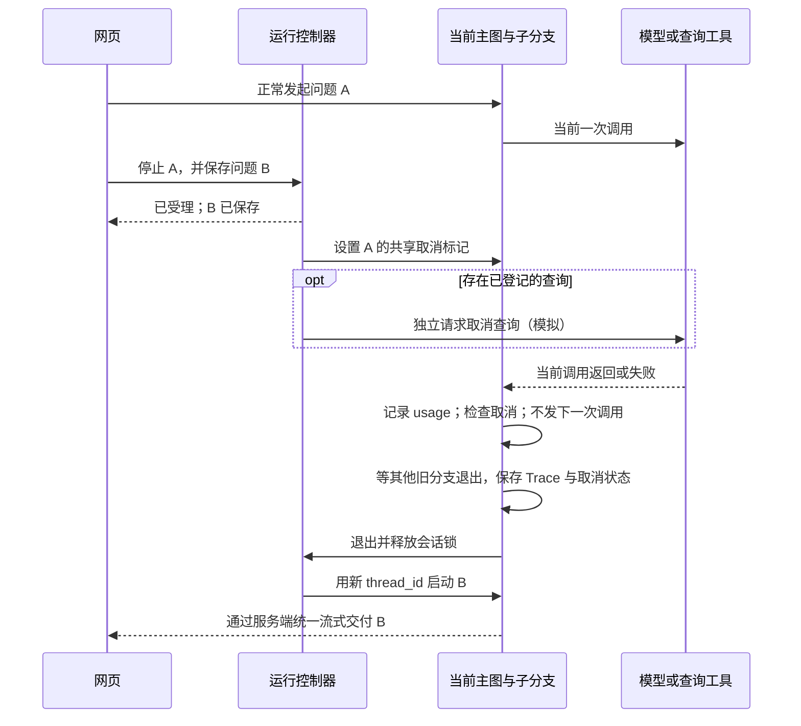

# 停止与换方向：实现与验收

> 2026-09-12。已在本地复现中实现并验证；用户亲自试用仍待验证。详细实施契约见[技术方案 v0.3](../../../../记录/2026-09-12-Agent停止与换方向实施细节-v0.3.md)。

## 现在怎么试

打开[经营分析试玩](http://127.0.0.1:8787/)，发送一个查询或分析问题。执行期间输入框仍可编辑：

| 操作 | 实际行为 |
| --- | --- |
| 点击“停止” | 立即受理停止；当前单次模型请求或工具调用返回后退出，不再执行后续步骤 |
| 输入新问题，点击“停止并发送” | 先保存新文字；旧执行的所有本地分支退出、结果落盘、释放会话锁后，自动启动新问题 |
| 已点击停止，再输入问题 | 按钮变为“发送新问题”，同样先保存，等待旧执行退出 |
| 执行中按 Enter | 保留草稿，不擅自取消或发送 |
| 刷新页面 | 读取当前执行和已保存的待启动问题，恢复订阅；不重复发模型请求 |
| 服务进程重启 | 遗留执行标记为中断；保留待启动文字，供手动重新发送，不自动重跑收费任务 |

同一会话一次只保存一条待启动问题；不同第二条不会覆盖第一条。默认五个并行执行名额保持不变。

可直接查看这次验收：

- [正文生成中停止，然后换查另一个指标](http://127.0.0.1:8787/?id=aa12092600000001)。
- [检索中停止，“改成本周”继承原指标](http://127.0.0.1:8787/?id=aa12092600000004)。
- [分析决策中停止，改为本周后完成分析](http://127.0.0.1:8787/?id=aa12092600000003)。
- [停止发生在哪个节点：执行路线示例](http://127.0.0.1:8787/flow/aa12092600000001/06d631da417442f4)。

## 实际架构

保留现有六类父图节点及分析函数，新增一个普通 Python 运行控制器。控制器管理停止和交接，不调用模型。



“等当前调用”在代码里是这样的：

```python
cancel.check()                 # 取消后，尚未开始的调用不会启动
response = model.invoke(...)   # 已发出的这一次允许返回
trace.record_usage(response)  # 已消耗的 Token 必须计入
cancel.check()                 # 如果停止了，到这里退出
execute_next_tool(...)         # 停止时不会执行到这里
```

这是说明机制的伪代码。实际检查还覆盖模型名额排队结束、查询前后、两期查询之间、分析决策之后、补查、重试、汇总和发布前。停止信号是专用的 RunCancelled，宽泛异常处理不能把它变成重试或兜底报告。

并行分支收到取消后返回取消终态；父图收齐全部分支后才退出。这样不会因为一个分支先停了，就让仍在工作的旧分支与新问题争用会话状态。

## 数据保存在哪里

| 数据 | 位置与格式 | 谁写 |
| --- | --- | --- |
| 网页聊天消息、最近完成任务摘要 | 每个 conversation 下的 conversation.json | ChatStore，持有会话文件锁，临时文件原子替换 |
| 主图 State、checkpoint、澄清暂停信息 | 每个 task 下的 checkpoints.sqlite | LangGraph SqliteSaver |
| 当前运行和下一条问题 | .runs/playground/run-control.sqlite | RunControl 的短事务 |
| 完整事件、模型输入输出、usage、query_id、停止记录 | 每个 task 下的 trace.jsonl | 加锁追加，分支用 job_id 归属 |
| 可读路线与离线回放 | 网页投影、trace.html、state.json | 从已记录的 Trace 生成 |

取消句柄包含 threading.Event 和查询取消回调，仅存在进程内并绑定 Trace；不塞进需要序列化的业务 State。数据库保存可恢复的控制事实。

控制表的一行代表什么：

- runs：一行是一条用户输入对应的一次运行，用 (cid, rid) 唯一标识；tid 是这次使用的 LangGraph 任务 ID。保存 text、status、cancel_requested、predecessor、updated。
- pending_requests：一行是“停止并发送”时保存的新输入；expected 指向要停止的旧 rid。状态依次为 queued → starting → started → completed，重启或交接失败用 interrupted。这里 completed 表示该输入已处理完，业务回答也可能是在请求澄清。
- 部分唯一索引保证同一 cid 最多一条 running / cancelling 运行，最多一条 queued / starting 输入。

新问题使用新 thread_id。旧任务已经查到的局部结果可以留在原 Trace；取消回复不带这些结果卡片，也不加入“已完成任务”摘要。为理解“改成本周”，新理解节点只接收旧需求及已有结构化范围，重新校验指标和日期。

## 防止串线的几个具体处理

1. 停止请求必须携带 expected_request_id；旧标签页不能笼统地“停止最新任务”。
2. 同一 request_id 重复提交只读既有记录；不能重复产生付费执行。
3. 服务端按被取消的 request_id 屏蔽 SSE 旧片段；网页也用当前 request_id 拦截迟到的 delta / done。
4. 保存结果与检查取消使用控制器的短锁；释放会话文件锁后才交还运行权。避免刚存好结果就提前启动下一条。
5. 查询 ID 登记与停止并发时会补发取消；同一个 ID 只发一次取消回调。取消接口失败记 Trace，不阻止本地退出。
6. 模型响应先记 usage 再检查取消。仍在模型名额队列、实际请求尚未发出时停止，不计为一次 API 调用。

## 验证结果

本地全套 **145 项测试通过**，其中新增 **12 项停止与交接测试**；Ruff 和两个页面脚本的 Node 语法检查通过。测试执行真实 StateGraph、SQLite、HTTP 和 SSE，模型和慢工具使用可控替身，不消耗 API。

新增测试覆盖：

| 场景 | 证据 |
| --- | --- |
| 五个分支正在调用、另外三个排队时停止 | 只有前五个工具执行；全部旧分支退出后，替代问题才启动 |
| 理解模型返回后停止 | 不再进入日期复核 |
| 分析本期查询中停止 | 本期返回就退出，不启动前期查询 |
| 普通或流式模型调用中停止 | 当前响应的18个测试 Token 仍计入；不再调工具、重试或交付正文 |
| 模型名额排队中停止 | 没有真正发请求，用量调用数为0 |
| 查询取消接口成功 / 失败、重复停止 | 回调只执行一次，取消失败也正常退出 |
| 查询 ID 在停止时才登记 | 补发取消，不启动后续查询 |
| 旧 request_id、另一会话、重复 replace、第二条待处理输入 | 不串线、不覆盖、不重复启动 |
| 重启 | 中断状态和待启动文字保留，不自动付费重放 |
| 结果刚保存、执行尚未退出时停止 | 仍能撤销本轮交付，没有提前释放运行权 |

真实 Kimi 小样本：

| 验收场景 | 停止后到图退出 | 结果 |
| --- | ---: | --- |
| 正文流式生成时停止 | 2.645秒 | 停止后的旧正文不再交付；替代指标完成 |
| 检索请求中停止，再说“改成本周” | 4.681秒 | 原指标保留，改查2026-08-31至2026-09-01，完成 |
| 分析决策中停止 | 7.316秒 | 当前决策响应计费保留；不再补查或生成旧报告，替代分析完成 |

停止接口在两次脚本样本中分别约6.55ms、2.28ms返回“已受理”；这只是本机小样本，不是线上时延保证。上述等待主要是已发出的那一次模型请求剩余耗时。

浏览器实际操作验证了“执行中回车不发送”“停止并发送”“自动开始新问题”“刷新后恢复已保存记录”和可读路线的停止时间、停止节点。实际验收未连接真实查询平台；取消成功、失败和迟到 ID 用可控模拟验证。

首次“改成本周”样本产生了不必要的澄清，保留在[失败样本](http://127.0.0.1:8787/?id=aa12092600000002)。检查发现日期函数原本就按当前周期截至基准日计算，Prompt 对这一约定和取消后省略追问约束不够明确；补充规则后在新会话复测通过。不能据此推断所有自然语言指代都正确。

这次真实验收合计 **33 次模型请求、62,303 Token**：输入60,144，输出2,159，其中27,648输入 Token 命中缓存；全部33次返回了 usage，无未知用量。包括失败样本和复测。按项目2026-09-09价格参数估算 **¥0.299929**，不代表实际账单。

原始汇总：[summary.json](../../.runs/stop-acceptance-20260912-153952/summary.json)；手动付费验收脚本：[verify_live.py](../../.runs/stop-acceptance-20260912-153952/verify_live.py)。脚本不属于自动测试，重复执行会消耗 API；现有 ID 用于留存验收证据。

## 按什么顺序读代码

| 顺序 | 文件 | 解决的问题 |
| --- | --- | --- |
| 1 | [run_control.py](run_control.py) | 运行准入、停止、待启动输入、重启处理、查询取消句柄 |
| 2 | [server.py](server.py) | 接收网页动作；完成旧会话写入后启动下一条；清理取消回复 |
| 3 | [parallel_agent.py](parallel_agent.py) | 节点与并行分支如何响应取消，最终 State 如何记录 cancelled |
| 4 | [parallel_model.py](parallel_model.py)、[model.py](../main_agent/model.py) | 当前模型调用完成后停止、先记 usage、阻止重试和后续工具 |
| 5 | [data.py](data.py)、[investigation.py](investigation.py) | 两期查询之间、分析补查之前的取消检查 |
| 6 | [streaming.py](streaming.py)、[stream_chat.js](stream_chat.js) | 服务端和网页如何共同阻止旧结果覆盖新结果 |
| 7 | [test_stop_replace.py](../../tests/test_stop_replace.py) | 用可控时序验证竞态，而不只是看运行时间 |

## 当前边界

这版是单服务进程的合作式停止。主 Agent 不在旧分析运行时另开一段模型对话；网页可以立即受理输入、显示状态，新的业务执行等待旧本地分支退出。每次已经发出的模型请求允许正常结束，现有模型请求超时为60秒；停止不等于供应商退款或远端立即停止计算。

没有接入真实平台取消接口、跨进程调度、进程重启后的远端取消补偿、用户登录和权限体系。真实平台接入时需要把 query_id 和取消回调替换为平台契约。当前任务仍是有限分析，语义理解和报告文字可能出错；查询参数、日期和证据范围由代码继续校验。

改动前代码保留在 .runs/stop-backup-20260912-152438；原有公司资料、历史 Trace 和旧教学入口保留。本次没有提交或推送 Git。
