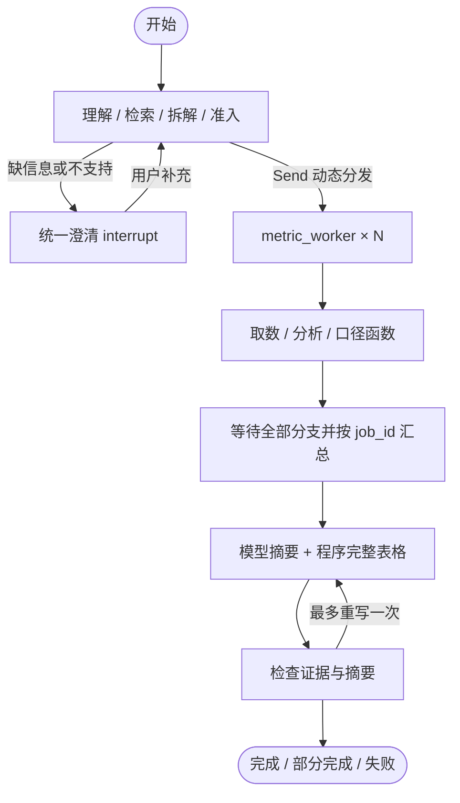

# 多指标并行 v4：实现、阅读顺序与验收

> 2026-09-07。用户已要求实现并指定并发上限为5。本文件描述当前可运行的学习实验；原公司数据、线上平台、生产服务能力均不由此推断。用户独立理解与操作仍为待验证。

后续流式交付更新见 [流式输出实现与验收](流式输出实现与验收.md)。本页保留并行阶段的110项测试和该阶段用量，最新检查为116项。

## 直接试玩

- [打开当前试玩](http://127.0.0.1:8787/)
- [四指标与连续追问的已完成对话](http://127.0.0.1:8787/?id=d409070000000201)
- [四指标、60行明细的完整 Trace](http://127.0.0.1:8787/trace/d409070000000201/eeb6e45256ea4924)
- [七指标、实际执行峰值为5的 Trace](http://127.0.0.1:8787/trace/d409070000000004/f64bb2887c224ef4)
- [两个保费口径、各自不同维度的 Trace](http://127.0.0.1:8787/trace/d409070000000003/581028822d784d42)
- [指标 × 维度总线矩阵](指标维度矩阵.md)

启动方式不变：实验根目录执行 `.venv/bin/python -m business_analysis_repro.playground --open`，或双击启动脚本。现在网页走 `parallel_agent.execute`；原 `agent.py` 的单指标版本及 v2 教学副本保留。Python/知识配置变更需重启服务。

## 这次并行的对象

一个父任务统一理解、检索、澄清、校验，产生多个独立 job。LangGraph 使用 Send 将 job 交给同一个 metric_worker 的不同执行实例；每个分支只收到自己的查询任务。



实际图注册六个节点：understand_request、clarify、metric_worker、gather_results、compose_reply、validate_reply。图中的取数/分析函数、Send 和程序准入不是另外注册的节点。每次执行目录里都有实际 `graph.mmd`。

## Prompt 里什么时候一起、什么时候分开

| 用户需求 | 当前处理 |
| --- | --- |
| “这几个都要” | 展开此前候选清单，生成多个 request，不再要求只能选一个 |
| 一个指标同时按商户类型 × 新老商 × 品类交叉拆解 | 同一个 request 中设置多个 group_by，一次取回联合分组 |
| 一个维度筛选“新商或老商” | 同一个 filters 值列表；按该条件一起查 |
| 同一个指标分别要一张按渠道、一张按新老商的表 | 两个不同粒度的 request |
| 不同指标，或同指标不同期间/筛选/粒度 | 独立 job 并行；当前不拼跨指标 SQL |
| 完全相同指标和查询范围重复出现 | 程序按规范化后的参数去重，只执行一次 |
| “为什么变化了” | 一个 analysis job 内查询本期和前一等长期间，再按相同维度对齐；不是两个互不关联的指标任务 |
| “每个指标尽可能细” | 各用自己的全部合法维度，不用共同维度替代，不补出不支持的枚举 |
| 下钻条件依赖前一步查询结果 | 不当作独立并行任务；当前实验说明限制并集中澄清，尚无自动依赖 DAG |

“一起分析”与“一条 SQL 查完”是两件事。跨指标物理合并至少需证明事实粒度、业务口径、期间、过滤和权限语义兼容；同一个数据集 ID 不足以证明兼容。本实验每个指标使用独立模拟立方体，未实现跨指标统一事实表。

## State 和并发控制

```python
# 示意，实际类型见 parallel_state.py
BatchState:
    messages
    jobs                       # 父节点生成的有序可信计划
    job_results                # reducer 按 job_id 合并
    result                     # 汇总后的卡片、成功/失败数量和证据ID
    status

WorkerState:
    job                        # 只带本分支的任务，不带全部聊天和别的分支
```

程序根据指标、时间、筛选、分组、revision 生成 job_id。分支返回 `{job_id: outcome}`；reducer 拒绝相同 ID 的冲突写入，重新理解时由父节点显式清空旧结果。汇总再次检查预期 ID 全覆盖、结果范围和版本，按计划顺序展示，完成顺序不会改变归属。

并发有两层：

1. 图运行配置 `max_concurrency=5`，限制单次图的 worker 并发。
2. 当前 Python 服务进程共享 `BoundedSemaphore(5)`，不同会话共同竞争5个指标执行名额。模型请求另有共享5个请求名额，两个池分开。

超出5个的任务排队；没有承诺跨会话严格先来先服务。分析分支内的本期和前期顺序查询，不开第二层并行。每次业务 SQL 在执行线程中创建自己的内存 SQLite 连接；父图的持久化由 SqliteSaver 管理，不让 worker 共享业务游标。

## 并行可能出的问题及当前边界

| 问题 | 当前已做 | 仍需区分 |
| --- | --- | --- |
| 结果串到别的指标、并发覆盖 State | 独立输入、稳定ID、reducer、scope/revision/metric检查 | 任意外部工具还需遵守结果契约 |
| 一个分支失败使整轮丢失 | 分支捕获普通异常，保留其他结果，明确 partial / failed | 未实现手动仅重跑失败项的网页按钮 |
| 超时后全图重跑、重复查询 | TimeoutError/ConnectionError 只在本分支重试一次，共最多两次尝试 | 本地模拟没有远程查询超时；接真实平台须配置客户端超时、错误分类和幂等策略 |
| 5个并发仍撞 TPM/RPM | 模型并发名额、每任务40次调用预算、有限重试 | 并发上限不等于每分钟限额；没有令牌桶、分布式配额或完整 Retry-After 调度 |
| 多进程启动后上限叠加 | 当前一个服务进程内共享上限5 | 多进程/多服务器需要共享限流器；不是全机器或账号级上限 |
| 一个慢任务拖住汇总 | 记录排队、运行、重试和结束；等待所有结果后交付 | 目前不是边完成边推送答案；尚无全批截止时间和取消按钮 |
| 日志交错、父子关系丢失 | ContextVar 绑定分支，RLock 保护 seq 与单行追加，HTML 按分支呈现 | 大型数据应存外部结果文件/对象存储；当前详细 JSONL 会增长 |
| 数据分别查出却被模型错误混算 | 各指标独立呈现，完整表格由代码生成，不让模型合并事实表 | 并行本身不提供真实因果；分组变化排名不等于贡献分解 |
| 摘要上下文未带全量明细 | 明确传分组覆盖数量、维度和少量变化样例；全部表格另外交付 | 模型语义检查仍可能误判，不保证所有自然语言输出正确 |
| 旧 checkpoint 用新结构读取失败 | v3待澄清任务开新v4 ID，带入旧问答，保留旧数据库和Trace | 当前入口只支持人类澄清 resume；未验收进程崩溃后的自动接续 |

同一会话仍有请求锁，避免用户两次输入同时改同一份对话。不同会话的 State、checkpoint 和执行目录分开。

## 为什么摘要和表格分开

四个渗透率联合拆解共60组，两期共120组记录。要求模型逐个复述所有事实会迅速触及输出长度上限。现在：

- 每个结果保留完整两期数据、分组、查询参数和证据。
- 代码构造完整表格，网页每个指标下可以展开。
- 摘要只传总体结果、明细是否存在、分组数量/维度及变化绝对幅度最大的三组。
- 摘要模型或复核失败时，保留已经通过范围检查的程序表格，并说明摘要不可用。

没有把 State、checkpoint 或 Trace 自动拼到模型上下文中；各模型调用的实际 payload 在 Trace 中可展开。

## 按执行顺序阅读

以下行范围对应本次验收后的文件。注释在源码中，旧版导读见 README-v3.md。

| 文件 / 行范围 | 解决的问题 |
| --- | --- |
| [server.py](/Users/gaoronghui/Documents/agent_learning/2-进行中/面试准备/项目准备/智能经营分析/实验/LangGraph经营分析面试复现/business_analysis_repro/playground/server.py:256)，256–271 | argparse、端口和本机服务入口 |
| [server.py](/Users/gaoronghui/Documents/agent_learning/2-进行中/面试准备/项目准备/智能经营分析/实验/LangGraph经营分析面试复现/business_analysis_repro/playground/server.py:181)，181–253 | HTTP消息、进度、实时Trace与网页接口 |
| [server.py](/Users/gaoronghui/Documents/agent_learning/2-进行中/面试准备/项目准备/智能经营分析/实验/LangGraph经营分析面试复现/business_analysis_repro/playground/server.py:55)，55–133 | 对话锁、任务ID、澄清恢复和旧v3任务迁移 |
| [parallel_agent.py](/Users/gaoronghui/Documents/agent_learning/2-进行中/面试准备/项目准备/智能经营分析/实验/LangGraph经营分析面试复现/business_analysis_repro/playground/parallel_agent.py:595)，595–679 | execute：模型、Trace、SQLite、图配置与运行入口 |
| [parallel_state.py](/Users/gaoronghui/Documents/agent_learning/2-进行中/面试准备/项目准备/智能经营分析/实验/LangGraph经营分析面试复现/business_analysis_repro/playground/parallel_state.py:19)，19–73 | 模型候选结构、父State、局部WorkerState和reducer |
| [parallel_agent.py](/Users/gaoronghui/Documents/agent_learning/2-进行中/面试准备/项目准备/智能经营分析/实验/LangGraph经营分析面试复现/business_analysis_repro/playground/parallel_agent.py:269)，269–397 | 理解、统一准入、日期检查及集中澄清 |
| [parallel_model.py](/Users/gaoronghui/Documents/agent_learning/2-进行中/面试准备/项目准备/智能经营分析/实验/LangGraph经营分析面试复现/business_analysis_repro/playground/parallel_model.py:24)，24–50；59–219 | 拆解Prompt和真实模型工具循环；枚举编码也可精确搜索 |
| [parallel_agent.py](/Users/gaoronghui/Documents/agent_learning/2-进行中/面试准备/项目准备/智能经营分析/实验/LangGraph经营分析面试复现/business_analysis_repro/playground/parallel_agent.py:52)，52–110 | 确定日期、白名单校验、规范化去重、生成任务ID |
| [parallel_agent.py](/Users/gaoronghui/Documents/agent_learning/2-进行中/面试准备/项目准备/智能经营分析/实验/LangGraph经营分析面试复现/business_analysis_repro/playground/parallel_agent.py:562)，562–592 | Send动态分发、六个节点和边、等待汇总 |
| [parallel_agent.py](/Users/gaoronghui/Documents/agent_learning/2-进行中/面试准备/项目准备/智能经营分析/实验/LangGraph经营分析面试复现/business_analysis_repro/playground/parallel_agent.py:399)，399–450 | 共享并发名额、普通能力函数、分支异常及有限重试 |
| [data.py](/Users/gaoronghui/Documents/agent_learning/2-进行中/面试准备/项目准备/智能经营分析/实验/LangGraph经营分析面试复现/business_analysis_repro/playground/data.py:84)，84–251 | 本地参数化SQL/平台模拟、两期和同组比较 |
| [parallel_agent.py](/Users/gaoronghui/Documents/agent_learning/2-进行中/面试准备/项目准备/智能经营分析/实验/LangGraph经营分析面试复现/business_analysis_repro/playground/parallel_agent.py:136)，136–248；453–560 | 证据检查、完整表格、摘要覆盖清单、汇总与交付 |
| [parallel_trace.py](/Users/gaoronghui/Documents/agent_learning/2-进行中/面试准备/项目准备/智能经营分析/实验/LangGraph经营分析面试复现/business_analysis_repro/playground/parallel_trace.py:84)，84–301 | 并发日志锁、分支上下文、可读HTML回放 |

## 验收结果

本地全部测试 **110项通过**，其中新增并行相关17项；Ruff通过。模型均为离线替身的测试包括：

- 两个真实 StateGraph 同时各分发6个任务，用同步屏障证明实际5个分支重叠，全进程峰值不超过5。
- 不同完成顺序按计划合并；同ID冲突拒绝；scope/revision错配不交付。
- 单分支瞬时故障仅重试自己，另一个永久失败时保留其余结果。
- 四指标全部60组、8次期间查询；联合分组与精确去重。
- 先澄清再恢复同一checkpoint；非法维度/日期在取数前阻断。
- 旧v3迁移保留旧文件；目录浏览与非法枚举区分，编码精确搜索仍受指标白名单约束。
- 使用真实HTTP Handler + 真实图 + 模型替身，POST消息交付4张卡片、60行明细，GET能打开Trace。
- 摘要故障保留确定性表格；Trace并发序号、父子关系和HTML转义。

真实 Kimi 验收覆盖以下目标场景；中间失败有修复和局部复验，不能表述为全部首次成功：

| 场景 | 最终结果 |
| --- | --- |
| 原句“看看今天为什么变化了，这几个都要，然后维度尽可能的细” | 4个analysis任务，09-01与08-31比较，8次查询、60行对比明细；运行峰值4 |
| 追问上周、只看新商、仍是4个指标 | 自然周08-24至08-30，前期08-17至08-23，4份新商筛选、30行明细 |
| 两个渗透率都按获客来源拆解 | 等待澄清，未取数 |
| 取消来源、改按商户新老 | 恢复任务，两指标均按新老商分组，未残留来源条件 |
| 泛称“准时宝保费” | 先澄清两个标准口径 |
| 两个保费口径都要、各自全部维度 | 两份独立查询，各用各自3个维度，12行和8行明细 |
| 一次查询7个明确指标合计 | 7个任务全部完成，Trace实际运行峰值5 |

网页已实际检查：新版入口、展开完整明细、四个分支的起止时间、父图下的工具/模型记录；桌面1280×720输入区可见。服务健康接口返回 `parallel-v4 / max_concurrency=5`。未做十真实会话压测或线上平台验收。

### 联调发现的问题

1. 以维度名浏览枚举列表时，不能把“没有同名枚举候选”当成非法维度；增加目录浏览回归测试。
2. 元数据中提供了枚举ID，搜索却原先只比名称/别名；现在ID也参与精确匹配，仍保留每指标支持判断。
3. 日期复核受到旧助手单指标限制的干扰；收窄为用户日期需求、既有任务日期和实际计划，不传旧助手能力声明。
4. 摘要只收到总体数值时，曾误说“没有分组数据”，复核也因缺少覆盖信息而未拦截；现在摘要和复核共享分组覆盖清单。已复用原查询结果重新生成三份摘要，没有重新取数；旧稿和新稿都保留在Trace。

这些发现说明结构正确与语义正确需分开验证。模板/测试替身通过不代表真实模型一定按预期表达。

### 实际调用与原始证据

本轮共 **59次模型请求，输入170,881 Tokens，输出8,923 Tokens**，合计179,804。包含10轮用户输入（含3次失败尝试）和3次仅摘要的局部复验；未核算人民币费用，未跑全量公司评测集。真实业务函数共27次期间查询，均为本地模拟。

- [按任务核对的实际用量与并发峰值](/Users/gaoronghui/Documents/agent_learning/2-进行中/面试准备/项目准备/智能经营分析/实验/LangGraph经营分析面试复现/.runs/parallel-validation-20260907/audit.json)
- [首批场景及其当时结果](/Users/gaoronghui/Documents/agent_learning/2-进行中/面试准备/项目准备/智能经营分析/实验/LangGraph经营分析面试复现/.runs/parallel-validation-20260907/results.json)
- [最终补验与摘要局部复验](/Users/gaoronghui/Documents/agent_learning/2-进行中/面试准备/项目准备/智能经营分析/实验/LangGraph经营分析面试复现/.runs/parallel-validation-20260907/final-cases.json)

离线回归不消费模型额度：

```bash
.venv/bin/pytest -q
.venv/bin/ruff check business_analysis_repro/playground tests/test_playground.py tests/test_parallel_playground.py
```

LangGraph接口依据：[Send worker 工作流](https://docs.langchain.com/oss/python/langgraph/workflows-agents)、[图API、reducer与并行执行](https://docs.langchain.com/oss/python/langgraph/use-graph-api)。实际环境：Python3.12、LangGraph1.2.11、SQLite checkpointer3.1.1、Kimi K2.6。
