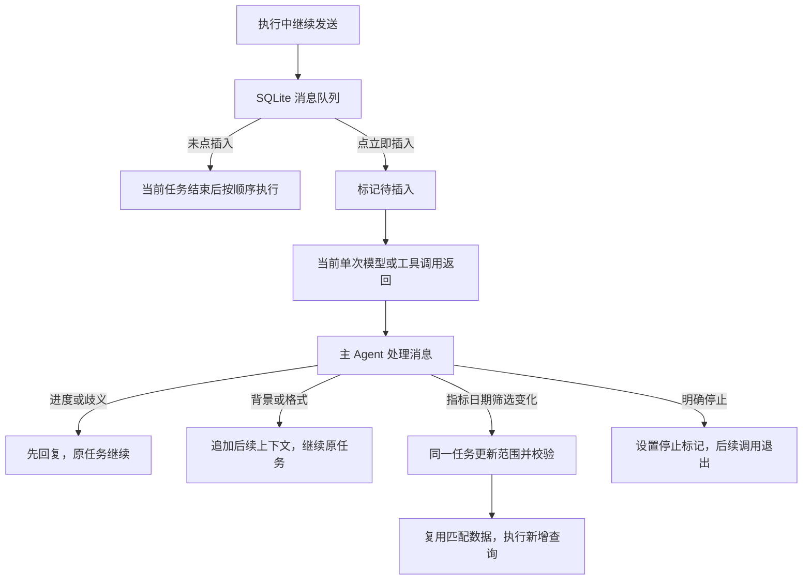

# 消息队列与即时插入

2026-09-12，当前本机学习实验的交互说明。用户选择：**执行中发送默认排队，可点“立即插入”在下一安全位置处理**。

## 怎么使用

1. 在[试玩页面](http://127.0.0.1:8787/)发送查询或分析问题。
2. 执行期间继续输入并发送。输入区上方出现消息及“已排队”，原任务继续执行。
3. 想让当前任务尽快收到这条消息，就点它的“立即插入”。可以先排几条，只提升其中一条。
4. 页面显示“待插入 → 主 Agent 正在处理 → 主 Agent 回复”。刷新页面仍能恢复消息和状态。
5. 没点插入的消息按发送顺序，在当前任务结束后作为后续输入执行。

| 插入内容 | 当前实现 |
| --- | --- |
| 最终结论只写三句话 | 追加后续报告要求，继续当前任务；如果摘要正在生成，返回后重写摘要，不为格式变化重复查数 |
| 补充一下，这周做过促销 | 作为用户提供的待验证背景进入后续模型上下文 |
| 现在进展到哪一步了 | 主 Agent 根据 Trace 中已记录的状态回复，原任务继续 |
| 日期改成本周 | 形成完整的最新需求，重新校验与拆解；旧范围的结果保留为历史，不混入最终结果 |
| 再加一个指标 | 扩展同一任务；已经查过且范围完全一致的数据可以复用 |
| 停止当前任务 | 明确停止才设置取消标记；也可直接点“停止”按钮 |

“立即”是下一次模型/工具调用的安全位置：当前单次调用已经发出时，等它返回后处理，不必等整个分析 Agent 结束。已发出请求的上下文无法就地修改。其他并行分支也会在各自的调用边界看到决定；子 Agent 的结果经过主流程交付。

停止针对当前执行；队列里已经保存的其他问题仍按顺序等待处理。

## 实际执行关系



这是已有图上的小型消息控制器，没有另建独立的后台 Agent 平台。它复用原来的5个模型调用名额；处理插入消息之前必须先释放当前模型名额，避免所有名额被等待主 Agent 决定的分支占住。

## 主 Agent 的决策结构

```python
MessageDecision(
    action="continue",            # reply / continue / revise / stop
    reply="好，最终结论改成三句话。",  # 立即显示给用户的简短答复
    instructions="最终结论只写三句话", # continue时追加到后续模型上下文
    updated_request="",           # revise时必须提供完整最新需求
)
```

模型负责理解文字。程序负责校验结构、消费消息、更新版本、查询准入、结果复用和停止标记。主 Agent 不直接修改可信数值。

## 数据保存在哪里

| 内容 | 保存位置 / 用途 |
| --- | --- |
| 消息队列 | `.runs/playground/run-control.sqlite` 的 `inbox_messages` 表 |
| 一行消息 | `seq` 全局顺序；`cid` 会话；`mid` 消息ID；`target` 当前执行ID；`text` 原话；`delivery` 排队或插入；`status` 状态；`reply` 回复；`decision` JSON决策；`created` 入库时间 |
| 当前运行控制 | 同一库的 `runs` 表，保存执行状态；内存 Token 持有停止标记与队列唤醒事件 |
| 正在使用的补充 | 本次运行的 `Steering.notes`；通过 `user_supplements` 加入后续模型请求，不把整个 Trace 拼入上下文 |
| 最新查询范围 | LangGraph State 的 `jobs/task`，`task_revision` 区分修改前后；`request_start` 标记最新完整需求的起点，原消息仍保留 |
| 摘要版本 | `draft_note_revision` 对应生成摘要时采用的补充版本，变化后重新生成文字 |
| 已应用消息记录 | 本轮结束时写入 State 的 `steering_messages/steering_notes`，由检查点持久化 |
| 可复用查询结果 | 本次运行内存缓存；指标、日期、筛选、分组、基准日等范围一致才复用，Trace记录原证据及新版本引用 |
| 对话记录 | 单会话写入者在本轮结束时把已处理的补充和主 Agent 回复归并到 `conversation.json` |
| 实际调用 | 任务的 `trace.jsonl`，记录插入消息、实际模型上下文、模型返回、主 Agent 动作、改版、数据复用及 Token |

这版没有把聊天正文整体迁到SQLite：SQLite新增的是收件箱与运行控制；会话展示记录仍是JSON，LangGraph检查点仍由SqliteSaver管理。

重启会保留未完成的队列文字并标为中断，不会自动产生重复付费请求。已经启动过的中断消息要用新消息ID重新发送；页面可恢复文字到输入框。单条最多4000字符，最多32条待处理消息；每次最多合并8条已点插入的消息，按入库顺序理解。

## 代码阅读顺序

路径均相对此文件所在目录。

1. `stream_chat.js` 的 `send/queueMessage/insertMessage`：什么时候进入队列，什么时候只是提升优先级；`renderInbox`显示每条消息的状态。
2. `server.py` 的 `receive/insert/_start_inbox`：HTTP接收立即返回；空闲后由同一会话唯一运行者顺序处理。
3. `inbox.py`：SQLite事务、消息去重、顺序领取、目标任务检查和重启恢复。数据库只保存事实，不理解语言。
4. `run_control.py` 的 `CancellationToken.check`：每个安全位置同时检查停止与待插入消息。
5. `steering.py` 的 `MessageDecision/PROMPT/Steering.check`：主 Agent 读取用户消息和当前进度，做一次结构化决策。
6. `parallel_model.py` 的 `complete`：释放模型名额后再处理消息；给后续调用追加补充；必要时重写摘要或分析决策。
7. `parallel_agent.py` 的 `execute`：范围修改时等待旧分支到达边界，清掉旧待执行步骤，再在同一个thread中重新校验；格式变化只回到摘要生成。
8. `parallel_trace.py/flow_trace.py`：消息处理步骤在回放里单独出现；`usage.py`仍按真实模型请求与响应累计用量。

两个实际踩到的问题：`update_state(as_node=...)`不会自动删除其他待执行节点，需要先清理旧任务；修改日期后不能让旧“上周”和新“本周”同时参加有效需求校验。原始记录仍留存，当前规划只读取新版本范围。

## 验证与边界

本地回归 **157项通过**，其中新增12项消息队列测试：默认排队顺序、插入四种决策与模型故障、同任务数据复用、消息去重/隔离/重启、结束边界到达、已启动消息中断后防重复执行、5个模型名额同时使用时处理插入，以及流式摘要中途补充后重写且不重查。测试使用Event固定慢调用窗口，未消耗API。

真实Kimi与Chrome网页验收结果、所有尝试的Token统计在本节后附。模型语义判断仍可能需要澄清；这些样例通过不代表所有表达都能正确分类。当前验收范围是本机单进程模拟平台，未做分布式运行或真实平台取消接口的验收。

用量沿用现有统计：每批被插入的消息通常增加1次主 Agent 决策请求；如果正在写的摘要因新要求被替换，已返回的旧摘要也计入Token。普通排队的问题仍是一轮完整后续任务。价格按本地参考参数估算，不是实际账单。

## 本次真实验收结果

四组最终交互链路通过：网页默认排队/刷新/立即插入后继续、摘要途中改日期、插入进度询问并保留普通排队问题、插入明确停止。使用真实Kimi与本地模拟取数；Chrome独立无头会话完成按钮操作和页面截图，未读取用户浏览器配置。网页未捕获到JavaScript运行异常。

| 样例 | 状态 | 模型请求 | Tokens | 参考费用（元） |
| --- | --- | ---: | ---: | ---: |
| 网页排队、刷新和补充后继续 | completed | 13 | 35,595 | 0.2306 |
| 改日期首测：进入澄清，已修复 | waiting_user | 10 | 18,042 | 0.0734 |
| 改日期修复后复测 | completed | 12 | 18,656 | 0.0674 |
| 插入询问进度，普通排队问题随后执行 | completed | 17 | 42,717 | 0.2406 |
| 插入明确停止 | cancelled | 2 | 2,992 | 0.0122 |
| 进度答复修复后单独验证 | 答复已核对 | 1 | 1,414 | 0.0105 |

**所有尝试合计：55次模型请求，119,416 Tokens，参考费用约¥0.6348；用量未知调用为0次。** 包括日期调整首测失败和后续修复验证，不只统计成功样例。价格沿用本地2026-09-09参数，不是账单。

真实首测中，主 Agent 曾把“本周”展开到周日，日期复核也受旧“上周”约束干扰；修复后同任务查到8月31日至9月1日。进度首测能插入并回复，但阶段表述过粗；补入已返回查询数和当前调用步骤后，单独真实模型验证已正确识别两期数据已返回、分析流程仍在继续。

可直接查看[补充后继续的对话](http://127.0.0.1:8787/?id=ab12092600000001)、[同一任务中改日期的执行路线](http://127.0.0.1:8787/flow/ab12092600000012/def10db5aad846f7)、[普通排队随后执行的对话](http://127.0.0.1:8787/?id=ab12092600000003)。

验收原始文件位于实验根目录 `.runs/inbox-live-20260912/`：`report.json`为四组完成记录，`usage-all-attempts.json`为全部尝试账目，PNG为网页截图，`progress-probe/trace.jsonl`为单独进度答复验证的真实调用。单独答复验证不属于网页会话任务，未混入会话用量；已计入上面的验收总额。所有常规对话用量仍可在网页的“Token用量/容量”查看。
