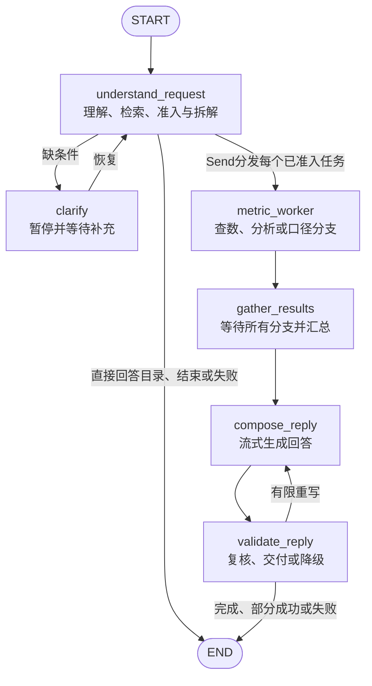

# 智能经营分析复现总览与能力缺口 v1

核对日期：2026-09-09。对应网页实际引擎 **analysis-v5**；文档 v1 是盘点版本，不表示代码升级为 v6。

**结论：查口径、查数、短分析、并行、澄清、流式、Trace 和用量统计已形成可运行的基本闭环；四类专题已有简易 Skill。完整的非平台复现仍缺专题计算方法、跨指标分析数据与调度、分析中途续跑，以及知识/记忆/结果管理等能力。不能把四份 Skill 文件等同于四套完整分析方法已经跑通。**

本轮按源代码、实际导入的工具注册表、Skill 文件、现有验收收据及健康接口核对。没有新增 Kimi 请求，没有修改业务代码。最近一次离线验收133项通过，本轮没有重新运行全套测试。

## 1. 本文范围与证据规则

用户本轮明确：真实平台接口不做，以模拟方式代替。LangSmith 沿用此前决定，不接入。

本文的“完整非平台复现”指：在本地模拟数据上，能够演示已确认的四类专题、按需取数与补查、计算和报告、连续对话与可恢复执行，并能回放、计量和验证结果。它是可验收的学习实现，不替代公司生产项目；公司材料中的95%等数字不用于证明本实验。

| 标记 | 含义 |
| --- | --- |
| 已实现 | 当前源代码有对应执行路径 |
| 简版 | 能运行，但覆盖范围、语义或工程机制有限 |
| 未实现 | 当前网页执行链路中没有该能力 |
| 已验证 | 必须说明是离线替身测试、真实 Kimi 样例，还是网页检查 |
| 建议补齐 | 本次 AI 建议，不表示用户已经授权下一轮开发或已决定优先级 |

依据：当前 [项目手册](../项目手册.md)、[专题 Skill 设计 v0.3](../资料/智能经分分析Skill设计评审-v0.3-AI草案.md)、[LangGraph 方向确认](2026-09-06-LangGraph技术架构方向确认.md)，以及下文的当前代码。历史旧稿不作为当前已实现证据。

## 2. 目前有哪些能力

| 能力 | 当前状态 | 实际做到哪里 | 实际边界 |
| --- | --- | --- | --- |
| 指标/维度/枚举搜索与消歧 | 已实现简版 | 名称、别名、精确ID与模糊匹配；不支持的条件先澄清 | 只有小目录；自然语言条件遗漏仍不能全面阻断 |
| 指标口径咨询 | 已实现 | 读标准名称、定义、单位、维度与查询配置；无需日期和取数 | 来源是本地模拟目录，不是线上权威接口 |
| 日期标准化 | 已实现简版 | 自然周期、滚动周期、明确日期范围由代码计算 | 模拟基准日固定2026-09-01；每次1–31天；数据限定2026年且不晚于基准日 |
| 参数化取数 | 已实现 | 平台模拟与本地SQLite SQL两个分支；筛选、交叉分组、合计 | 当前10个平台配置、10个SQL配置；SQL实际执行统一的demo表，不是执行公司SQL模板 |
| 比例与两期比较 | 已实现 | 按分子分母汇总算比例；按编码对齐分组，输出差额、变化率/百分点 | 默认对比前一等长期间；没有通用同比、自选双基准及时间序列分析工具 |
| 多指标并行 | 已实现 | Send 分发；超出5个排队；reducer按job合并，防结果串线 | 最多20个入口任务；进程内5个worker和5个模型请求名额；不合并跨指标SQL |
| 四类专题简易分析 | 已实现简版 | 读Skill → 两期证据 → 模型提议补查 → 代码执行 → 发现/假设 | 共用短循环；补查只限同一指标和原时间范围；不是四套完整分析引擎 |
| 澄清与连续追问 | 已实现简版 | 父图interrupt恢复；已完成任务的新追问带最近3个任务上下文 | 不是长期记忆；分析内部没有独立的暂停澄清与逐步恢复 |
| 流式与完整过程追踪 | 已实现 | 正文真实流式；阶段进度；分支明细；执行路线与JSONL回放 | 中间工具JSON不是正文流；Trace不等于模型隐藏思考 |
| 用量与容量估算 | 已实现简版 | 每轮/任务/会话/项目累计请求与Token、缓存和费用；TPM/RPM估算 | 样本少；不是供应商账单，也不是实际配额限流或并发压测 |
| 错误处理 | 已实现基础版 | 部分临时故障限次重试、分支局部失败、摘要失败保留表格、调用预算 | 无统一错误码体系、任务级取消/总超时、熔断、自动接管 |
| 数据结果交付 | 已实现简版 | 正文、两期表格、补查表、事实与证据ID | 无业务图表、CSV/Excel/PDF一键导出与独立结果文件管理 |

### 当前数据底座

- 20个指标，每个指标恰好开放3个维度；全局字典14个候选维度，不代表每个维度都被每个指标使用。
- 不同指标的枚举允许范围不同，支持“不支持维度/枚举”的测试。
- 数值、指标ID、数据集、业务线与权限矩阵都是演示配置。
- 每个指标的模拟分组可以回算自身合计，但不同指标来自独立的模拟立方体，不能据此直接构造统一漏斗、跨指标公式或商户cohort。
- 预设值是数据生成配置，不提前作为模型已经查得的事实；回答应来自真正执行的模拟查询结果。

[完整指标×维度矩阵](../实验/LangGraph经营分析面试复现/business_analysis_repro/playground/指标维度矩阵.md)。

## 3. 当前工具清单

### 3.1 真正绑定给理解节点模型的6个工具

这6个名字来自 `parallel_model.READ_TOOLS` 加 `FINISH`。模型产生 tool_calls，代码执行工具，结果以 ToolMessage 回到模型。

| 工具 | 输入 | 输出/作用 |
| --- | --- | --- |
| `search_metrics` | 指标表达 | 候选标准名、ID、别名、定义与分数 |
| `get_metric_definition` | 精确指标ID | 口径、单位、支持维度/枚举、SQL或平台查询配置 |
| `search_dimensions` | 指标ID、维度表达 | 候选维度，注明该指标是否支持 |
| `search_dimension_values` | 指标ID、枚举表达、可选维度ID | 找到枚举及所属维度，检查支持范围 |
| `search_business_knowledge` | 专题/业务表达 | 相关方法、推荐指标、来源和适用说明 |
| `finish_resolution` | 候选请求清单，或澄清问题 | 提交结构化需求；本工具本身不取数 |

指标搜索实际采用标准化、名称/别名/ID精确匹配、子串与 Python `SequenceMatcher`。业务知识检索采用关键词匹配。都不是向量搜索；分数不表示正确概率。

### 3.2 由程序调用的能力与辅助函数

这些同样在执行链路中发挥工具作用，但不是上面6个模型可自由选择的工具。Trace里标为tool，也不代表它一定由原生tool_calls触发。

| 函数/能力 | 当前调用方式 | 作用 |
| --- | --- | --- |
| `query_agent(task)` | worker或分析函数直接调用 | 模拟平台/参数化SQL取数，筛选和聚合，返回事实与证据 |
| `data.analysis_agent(task)` | 简易分析循环调用 | 分别查询本期与前期，计算两期及分组变化；这是确定性比较函数 |
| `investigate(task, model, trace)` | analysis worker的实际入口 | 封装“读Skill、读证据、模型决策、合法补查、结束” |
| `read_skill(metric_id)` | 分析入口直接调用 | 选取本地专题Skill和配套知识；日志名称为`load_analysis_skill` |
| `knowledge_agent(task, trace=None)` | knowledge worker调用 | 将指标定义整理成口径结果 |
| `calculate_business_period` / `periods_for` | 准入与比较阶段直接调用 | 明确日期及前期范围 |
| `validate_task` / `check_result` | 执行前后固定调用 | 检查ID、维度、枚举、期间、版本及证据归属 |

`knowledge_agent` 接收单个已确认任务，直接整理口径，不包含独立的模型检索循环。

### 3.3 分析模型当前只有两种行动

| `AnalysisAction.action` | 程序怎样处理 |
| --- | --- |
| `compare` | 模型给出理由、假设、分组、筛选及已有证据ID；代码确认合法且未重复后，执行两期补查 |
| `finish` | 结束调查，输出发现、假设、待核验事项及引用证据 |

这部分是结构化JSON决策，不是给模型开放任意SQL或Python。分析模型目前不能主动选择新指标、读取任意结果文件、执行Shapley/留存/漏斗计算，也不能返回中途`clarify`后原地等待用户。

目前没有名为 `compare_results`、`run_python`、`export_excel` 的新工具；旧方案中出现过的工具名不能直接算作当前已有工具。

## 4. 当前4份简易Skill

这些是应用读取的4份Markdown方法文件，不是Codex的全局技能。版本均为`demo-v1`，方法来自当前材料整理的实验简版。

| 专题与文件 | 简版方法 | 当前缺少的专题能力 | 验证边界 |
| --- | --- | --- | --- |
| [保费 premium](../实验/LangGraph经营分析面试复现/business_analysis_repro/playground/analysis_skills/premium/SKILL.md) | 看保费两期变化，选择新老商/品类/配送方式等维度补查，提出规模/渗透/单均假设 | 目标、达成率、Gap；跨指标公式闭合；Shapley等贡献计算 | 文件已接入共用引擎；本轮没有保费完整分析实模样例，保费查数样例不等于分析验证 |
| [渗透率 penetration](../实验/LangGraph经营分析面试复现/business_analysis_repro/playground/analysis_skills/penetration/SKILL.md) | 看比例与分子分母、百分点变化、组内变化及候选结构效应 | 完整时间趋势、商户/订单两种渗透率联合解释、量化结构贡献 | 有通用比较及旧版多指标验证；不据此声称v5完整专题实模跑通 |
| [渠道 channel](../实验/LangGraph经营分析面试复现/business_analysis_repro/playground/analysis_skills/channel/SKILL.md) | 从核心指标比较渠道，根据结果选择某渠道按source补查 | 兼容的一级→二级链路、统一漏斗、流量与转化分解、跨指标追查 | v5真实Kimi完成过“一级渠道→来源补查→报告” |
| [商户 merchant](../实验/LangGraph经营分析面试复现/business_analysis_repro/playground/analysis_skills/merchant/SKILL.md) | 区分加入/退出，按新老商、规模等维度看变化并补查 | 商户事件明细、cohort、D7/D30留存；其他商户子方法尚未完整定义 | 文件已接入共用引擎；没有完整留存能力与实模验收 |

**当前的Skill选择仍然很粗：**代码对已确认指标的标准名称做规则判断：含保费→premium；含渗透率→penetration；入口/详情页/外卖险加入→channel；其他→merchant。当前分布为5/4/6/5个指标。这是代码分布，不是已确认的业务专题映射。

一个实际缺口是：净投保订单量、可投保订单量、外卖餐饮订单量都会进入merchant兜底，尽管它们也可能是保费或渗透率专题的分析因子。应补为“指标ID—允许专题—在专题中的角色”的明确配置，结合用户目标选择；不能为了凑覆盖率把兜底路由当成业务适用性正确。

完整报告与局部一层目前主要靠问法、Prompt和次数限制区分，尚无完善的`analysis_depth`字段与每个专题的完整执行路径。

## 5. 当前架构和完整节点关系

### 5.1 总体组件

```text
网页聊天 / 指标面板 / 知识与Skill页面 / 用量与Trace页面
                            │ HTTP + SSE
                            ▼
                      ChatStore 服务入口
                  会话恢复、重复请求识别、文件保存
                            │
                            ▼
               LangGraph 父图：BatchState
       理解与检索 → 准入 → 并行任务 → 汇总 → 报告 → 复核
                            │
                    一个 metric_worker
               ┌────────────┼────────────┐
               ▼            ▼            ▼
            query        analysis     knowledge
         模拟取数函数    investigate     口径函数
                            │
                       4份Skill之一
                      两期比较与短循环
                            │
                 共享 query_agent 函数
               平台模拟 / 内存SQLite SQL

Kimi：理解检索、日期复核、分析决策、报告和报告复核
本地配置：20个指标 + 14个维度字典 + 5条业务知识 + 4份Skill
持久化：聊天JSON / SQLite checkpoint / JSONL Trace
```

上图的共享取数目前是共享函数，不是独立QueryGraph。分析目前是函数里的循环，不是独立AnalysisGraph。以前确认过的父图＋分析子图＋取数子图是目标方向，不能直接写成当前已实现架构。

### 5.2 父图实际六个节点与边



`START/END`不是业务节点；Send给同一个worker节点分发多个输入，不是每个指标新定义一个节点。取数Agent和分析Agent是worker内部调用的不同能力，两个角色并非两个额外父图节点。

| 节点 | 是否调用模型 | 主要输出 |
| --- | --- | --- |
| understand_request | 是 | 已验证任务列表或澄清问题 |
| clarify | 否 | 用户补充消息，恢复原任务 |
| metric_worker | 分析分支会；查数与口径分支本身不会 | 当前job的结果或结构化错误 |
| gather_results | 否 | 全部任务的有序结果卡与证据ID |
| compose_reply | 是 | 流式文字草稿 |
| validate_reply | 通常是，另有代码检查与降级 | 最终答复/重写反馈/已验证表格 |

### 5.3 State与上下文

| 层 | 保存什么 | 给模型什么 |
| --- | --- | --- |
| `BatchState` | 当前任务消息、jobs、job_results、status、澄清信息、汇总、草稿与复核 | 各节点自行构造消息，不是整份State自动发给模型 |
| `WorkerState` | 单个job | 分析入口拿该job的目标和范围，不拿其他worker的结果 |
| 分析循环局部变量 | evidence、steps、seen、预算等，结束时放进`investigation`结果 | Skill、定义、原范围、证据摘要、已执行步骤和剩余预算 |
| ChatStore | 全会话消息、最近任务、等待/运行标记 | 已完成任务追问带最近3项上下文；回答正文截取1800字符，并非严格Token预算 |

步骤和证据会持续写Trace，但分析局部循环没有每一步独立checkpoint。进程中断后的精确续跑、人工中途澄清需要进一步设计。

### 5.4 数据到底存在哪里

| 内容 | 当前存储 | 后续缺口 |
| --- | --- | --- |
| 网页聊天及结果卡 | 每会话`conversation.json` | 整体读写；没有消息表分页、聊天搜索和生命周期管理 |
| 父图State/执行位置 | 每任务`checkpoints.sqlite` | 分析循环内部无逐步存档；无运行中任务自动接管 |
| 最后状态 | `state.json` | 调试导出，不是恢复机制本身 |
| 模型、节点、工具、路由事件 | `trace.jsonl`及可读页面 | 大量记录的索引、归档与保留策略仍简略 |
| 查询与补查结果 | Python结构、State、消息卡、Trace | 尚无独立结果文件仓库、result_ref、全量计算/预览分离 |
| 指标和方法知识 | 本地JSON、Skill Markdown | 无自动文档入库、切片、更新、版本与冲突处理 |

## 6. 排除真实平台后，还缺哪些能力

下面按可独立验收的能力族列出，不把未选用某个产品名称当成能力缺口。ES、向量库、PostgreSQL、独立Planner都不是必须安装的清单。

### A. 补齐经营分析主链路所需的核心能力

| 编号 | 能力 | 当前差距 | 可以在本地怎样复现 |
| --- | --- | --- | --- |
| A1 | 明确的专题路由与执行深度 | 名称规则＋兜底；完整报告/局部一层无完备契约 | 指标ID/角色/允许专题配置；明确local/full和停止条件；测试同指标不同目标 |
| A2 | 可跨指标核对的模拟数据 | 独立立方体不足以联算公式、漏斗、留存 | 生成一致的订单/投保/渠道事件/商户事件及目标数据；由同一事实派生相关指标 |
| A3 | 时间趋势与基准 | 单次区间合计＋固定前期；不是时间序列 | 按日/周序列查询、自选对照期、目标基准；用模拟数据测试缺失日期与零分母 |
| A4 | 专题计算方法 | 通用compare只算差额与变化率 | 保费公式/Gap/贡献；渗透率分子分母及结构分解；渠道漏斗；商户cohort/留存；方法内部代码计算 |
| A5 | 跨指标的结果驱动补查 | worker仅限原指标；不能看A结果再决定查B/C | 分析动作允许提出已授权的新指标任务；查定义、范围准入、执行、证据合并；限制深度和请求数 |
| A6 | 分析中途澄清与续跑 | 只有父图的前置澄清；内部局部变量不逐步存档 | 补查、决策、等待用户各有持久化边界；恢复时复用已有证据，避免整段重复付费 |
| A7 | 分析与报告的验收集 | 有机制测试与少量真实样例，没有四专题覆盖的统一质量集 | 每专题几道固定案例＋歧义/不支持/失败案例；检查执行方法、数值计算、范围、事实与假设区分、停止、Trace和费用 |

A4不要求假设一定命中，更不要求因果结论准确。你当前要求的“有分析能力”可以用可执行方法、能随证据改变下一步、能说明未验证事项来验收。但不能把不同口径的数据硬算出一张看似完整的报告。

A5不必先做一个独立Planner Agent。先扩展当前结构化行动与调度就能复现短依赖链；真的出现长任务、多层条件分支时再判断是否需要独立计划模块。

A6可以按已确认方向引入分析子图、取数子图；不是要求为了画图漂亮把每个函数都拆成节点。关键验收是中途能停、能恢复、结果不串线、已做工作不盲目重跑。

### B. 更接近完整使用体验的能力

| 编号 | 能力 | 当前差距 | 最小复现形式 |
| --- | --- | --- | --- |
| B1 | 业务知识入库与可维护检索 | 5条手工说明，不能检索整批报告、活动、案例 | 本地资料清单、文档切片、来源定位、版本更新与检索；语义召回按需要增加 |
| B2 | 长对话与用户记忆 | 最近3任务截取；没有用户偏好、冲突或遗忘机制 | 历史按需检索＋对话摘要；用户默认险种/时间偏好等记忆可查看、改正、删除，明确来源 |
| B3 | 大结果管理与可复用计算 | 全量分组留在内存/State/日志，重复保存 | 本地CSV/Parquet结果仓库，返回result_id与预览；计算读取全量，查询与下载检查归属 |
| B4 | 查询结果缓存 | 相同需求去重和“看上次明细”不等于跨任务查询缓存 | 以指标、版本、时间、筛选、粒度等建键；TTL、刷新、失效与并发回填 |
| B5 | 业务图表和报告产物 | 有表格、Trace图；没有经营趋势图/贡献图与报告导出 | 确定性图表、CSV/Excel/HTML报告导出，带指标/期间/来源说明；无需接外部BI平台 |
| B6 | 完整性与结论保护 | 有范围/证据校验；正文复核依赖模型；complete目前只是有无数据的弱信号 | 校验预期时间覆盖、分页/截断模拟、分组闭合、分母、缺失/零；保护标准名和单位，事实引用可定位 |
| B7 | 周报、定时分析和异常提醒 | 当前是用户触发的请求，无调度器和业务异常检测 | 本地定时触发＋去重＋异常规则＋本地通知列表；对外发送不在当前实施范围 |

B1中的向量搜索不是硬性门槛；能稳定找到正确资料、带准确出处，比是否用了向量库更重要。B5的业务图表与现有“执行路线图”是两种不同产物。

### C. 运行可靠性与多人使用

| 编号 | 能力 | 已有基础 | 仍未做，可用Mock独立验证 |
| --- | --- | --- | --- |
| C1 | 统一故障策略 | 模型/worker有限重试、局部失败、摘要降级 | 统一可重试/不可重试错误、退避与总超时、取消、仅重跑失败项、重启接管；故障注入可本地做 |
| C2 | 实际用量控制 | 累计统计、40次请求预算、并发5 | 真正RPM/TPM限流、每任务Token/费用预算、排队公平性与跨会话预算；目前估算不会拦截超预算请求 |
| C3 | 多用户隔离 | conversation_id目录、会话/任务锁和基本路径校验 | 登录身份、user_id归属、结果与Trace权限；模拟不同用户即可验证，不依赖公司平台 |
| C4 | 会话与数据运维 | JSON持久化、SQLite存档、源文件指纹 | 消息分页、备份/恢复、过期清理、迁移；是否换SQLite/PostgreSQL是实现选型 |
| C5 | 并发与长任务验证 | 离线覆盖5名额、多个图及结果隔离 | 10–15会话压力、长对话/大结果、断连/取消/重启的端到端验证；先用模型替身避免花钱压测 |

已有Trace会脱敏已知Kimi密钥，模型上下文不注入该密钥；不能把这一点扩大成完整的日志敏感信息治理或用户权限体系。

平台共享Token的真实获取、24小时刷新和线上鉴权按本轮范围不接；如果要学习鉴权失败行为，可以模拟invalid_token与权限不足两种返回，只验证错误分流，不调用真实平台。

## 7. 哪些不必为了“完全体”强行加入

| 内容 | 当前判断 |
| --- | --- |
| 真实指标平台、生产数仓、企业SSO和通知渠道 | 依用户要求排除；保留Mock契约即可 |
| LangSmith | 依用户要求不接；本地Trace和统计继续使用 |
| 向量数据库/ES | 检索规模和效果需要时再选，不是基本闭环必需品 |
| PostgreSQL/Redis | 多实例、并发或持久化需求需要时再选；单机可先SQLite和本地文件 |
| 独立Planner、多角色辩论、任意代码沙箱 | 没有必要为了架构完整度硬加；优先受限动作和具体计算工具 |
| 完整通用Text2SQL、任意Python执行 | 当前指标配置＋受控查询已经满足取数路径，新增专题方法不必开放任意代码 |
| 完全正确的因果归因、预测模型、A/B实验平台 | 不是用户目前要求的复现验收门槛；不承诺通过写Skill获得这些能力 |

## 8. 建议的后续顺序与完成标准

以下是AI建议，尚未作为新开发任务启动。

1. **先让四个专题各有一个完整的小案例。** 补A1/A2/A4：明确Skill映射、一致模拟数据、四类最小计算工具。验收重点是方法能执行、数字来自工具、假设有标签，不要求判断命中。
2. **再补有依赖的分析与中途恢复。** 补A3/A5/A6：跨指标取数、结果驱动下一步、一层/完整模式、分析内澄清和恢复。
3. **贯穿前两步建立固定案例。** 补A7/B6，记录首轮通过、澄清、失败恢复、调用与Token，不用单个成功样例代替覆盖率。
4. **按实际试玩痛点补体验。** 优先B3/B5（结果引用和图表报告）；长对话明显影响使用时补B2/C4；重复查数频繁再补B4；需要自动周报再补B7。
5. **准备多人部署时补C类。** 先Mock并发和故障测试，再小样本实模；不为了得到TPS而批量消耗付费额度。

建议的“核心复现完成”验收题：

| 专题 | 示例目标 | 可接受的完成证据 |
| --- | --- | --- |
| 保费 | 上周保费为何下降，与目标差多少 | 同口径因子/目标取数，实际计算Gap与所选贡献方法，维度补查，报告与Trace |
| 渗透率 | 比例变化来自分子、分母还是结构变化 | 两期分子分母及合法分组，代码计算，证据引用；解释可保留假设 |
| 渠道 | 加入商户数下降发生在哪个入口/漏斗环节 | 兼容的渠道层级与漏斗数据，按结果选择下一步，完整计算记录 |
| 商户 | 某批新商留存怎样，哪些组变化较大 | 明确cohort、观察窗口和去重口径，用模拟事件算留存，说明数据覆盖 |

商户留存只是商户专题内的一个验收案例，不把它等同于整个商户分析，更不补造所有商户子方法都已经被确认。

## 9. 现有验证、入口与阅读顺序

- 当前健康接口返回`analysis-v5 / max_concurrency=5 / streaming=sse`。
- 最近一次离线验收：133项通过，Ruff通过，详见[上一版实现与验收](../实验/LangGraph经营分析面试复现/business_analysis_repro/playground/分析知识库与用量-v5实现与验收.md)。测试包含旧教学实验和新机制，不能把133理解为133道业务分析题。
- 真实样例：简单查数6次模型请求、8,859 Token；最终渠道分析9次、22,757 Token，1个worker、4次模拟查询、1次来源补查、623个正文增量。
- 当前v5完整分析样本只有2个，另有1个部分完成样例；其中一个完整样例来自中间版本并包含澄清/多分支，不能拿均值当最终复杂分析的稳定成本。
- 本轮只是核对与整理，新增模型调用数为0，未做新的并发或四专题质量测试。

[聊天试玩](http://127.0.0.1:8787/) · [最终渠道分析实例](http://127.0.0.1:8787/?id=a509090000000004) · [执行路线](http://127.0.0.1:8787/flow/a509090000000004/36c0b1ea52994198) · [知识库与Skill](http://127.0.0.1:8787/knowledge) · [用量与容量](http://127.0.0.1:8787/usage)

| 阅读顺序 | 当前代码与范围 | 看什么 |
| --- | --- | --- |
| 1 | [server.py](../实验/LangGraph经营分析面试复现/business_analysis_repro/playground/server.py) 56–230 | 请求、会话、最近上下文与保存 |
| 2 | [parallel_state.py](../实验/LangGraph经营分析面试复现/business_analysis_repro/playground/parallel_state.py) 19–73 | 候选请求、父State、worker输入和合并规则 |
| 3 | [parallel_model.py](../实验/LangGraph经营分析面试复现/business_analysis_repro/playground/parallel_model.py) 1–57、147–328 | 工具注册、拆解Prompt、检索循环 |
| 4 | [parallel_agent.py](../实验/LangGraph经营分析面试复现/business_analysis_repro/playground/parallel_agent.py) 54–181、289–737 | 准入、分支、汇总、复核和实际图边 |
| 5 | [data.py](../实验/LangGraph经营分析面试复现/business_analysis_repro/playground/data.py) 84–251 | 模拟取数和确定性两期比较 |
| 6 | [business_knowledge.py](../实验/LangGraph经营分析面试复现/business_analysis_repro/playground/business_knowledge.py) 18–59 | 小型知识检索和当前Skill路由 |
| 7 | [investigation.py](../实验/LangGraph经营分析面试复现/business_analysis_repro/playground/investigation.py) 19–164 | 分析决策、范围检查、补查与结束 |
| 8 | [usage.py](../实验/LangGraph经营分析面试复现/business_analysis_repro/playground/usage.py) 39–207 | 请求/轮/任务统计与容量公式 |

原问题的解释见 [18个问题逐项解答](2026-09-09-LangGraph待解决问题逐项解答.md)。该文档是回答完成的记录，不把原TODO的“待继续”自动改成用户“已理解”。
