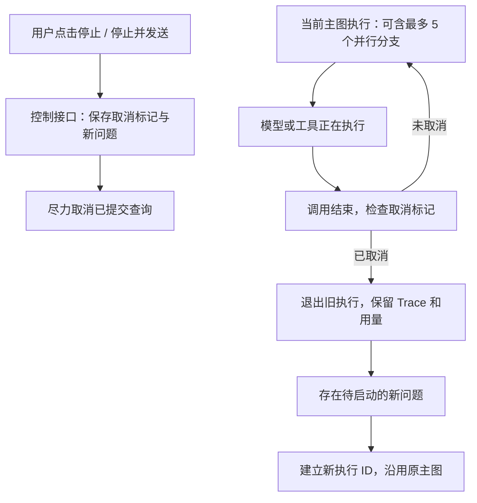

# Agent 停止与换方向技术方案 v0.2

> 日期：2026-09-12。状态：**当前推荐方案，待用户确认，未实施**。  
> 用户最新要求：需求可以调整；优先保证结果准确和工程简单，再改善体验；可以放弃收益不高的交互。  
> 本版收窄了[完整事件队列方案 v0.1](2026-09-12-主Agent事件队列与后台任务技术方案-v0.1-AI草案.md)。v0.1 保留作为备选，不视为已批准范围。

## 1. 结论

**建议先做“停止当前任务，再按新问题继续”，暂不做“原分析继续运行、主 Agent 同时接待新消息”。**

前者是低至中等复杂度的小型机制改造；后者需要改动主 Agent 检索循环、任务生命周期、会话存储和会话级流式订阅，收益尚未得到用户实际使用验证。两者都能实现，但当前优先选择前者。

停止功能不会自动提高指标或分析的准确率。它提供纠错入口；准确性保障仍来自标准指标与维度确认、日期和口径校验、数据计算、证据引用以及必要澄清。新功能应保持这些检查，不让旧任务的半成品结论污染新方向。

本轮仅调研、核对源码、写方案；没有修改运行代码、重启服务、调用付费模型或验证新行为。

## 2. 两种功能的区别

| 对比 | A：停止并换方向——当前推荐 | B：后台分析与主 Agent 对话同时进行——备选 |
| --- | --- | --- |
| 用户能否纠正方向 | 能 | 能 |
| 旧分析是否继续为用户工作 | 停止后不再推进 | 可以选择继续、取消或追加 |
| 何时处理新问题 | 旧执行当前调用结束并退出后 | 主 Agent 自己当前调用结束后，无需等分析 |
| 同一会话里的活跃主执行 | 始终一个 | 主执行和多个后台任务分开管理 |
| 现有图、存储、SSE | 大部分保留 | 多处需要调整 |
| 主要收益 | 停止错误方向，不必等完整报告 | 分析期间继续问口径、追加独立任务 |
| 复杂度判断 | 低至中，主要是运行控制与验证 | 中，主要是事件协调与接口改造 |
| 本次建议 | 先实现并试用 | 出现明确需求后再评估 |

A 的界面应诚实显示：“已收到新问题，等待当前步骤结束后开始。”不能宣称按下停止就能让所有远端计算立刻消失。

如果用户实际最在意的是“旧分析不停止，我还能持续问其他问题”，A 不满足这点，需要采用 B。本版将这一点明确列为取舍，等待用户确认。

## 3. 通常的设计与官方依据

### 3.1 停止当前执行、保存历史、接收新方向

[Agent Server 的取消文档](https://docs.langchain.com/langsmith/cancel-run)区分停止并保留运行记录/checkpoint，以及撤销运行记录；取消默认可以先受理，另行等待终止确认。这支持把“已受理停止”和“执行已经退出”分开显示。

本版借鉴“保留记录，取消后新建执行”的思路，不删除旧 Trace，也不需要模型先判断才能响应明确的停止按钮。

### 3.2 运行中收到新消息需要选择处理策略

[Double texting 官方说明](https://docs.langchain.com/langsmith/double-texting)提供排队、拒绝、中断、回滚等策略。排队等待当前 run 结束；中断策略需要处理未完成的工具消息。功能存在，不代表所有产品采用相同的运行模型。

本版不把新输入硬塞进一个正在执行的模型请求。旧执行退出后，用新输入和已确认上下文启动新 run，规避半截 tool_call 历史的继续拼接。

这些是 Agent Server / Deployment 的 API 能力，不是本地 StateGraph 的自动行为。当前不接 LangSmith 或该部署服务，采用小型本地运行控制器。

### 3.3 原分析继续跑、主 Agent 继续聊天也是正式支持的模式

[LangChain Subagents](https://docs.langchain.com/oss/python/langchain/multi-agent/subagents)描述了启动即返回 job ID、查状态、取结果的后台模式；[Deep Agents Async subagents](https://docs.langchain.com/oss/python/deepagents/async-subagents)提供后台任务的启动、检查、取消及更新。

这证明 B 是可行的设计方向；本轮不把它作为必须实现的能力，也不因工具包支持就额外引入部署依赖。官方文档示例不能替代本项目的运行验证。

## 4. 推荐的用户体验

1. 分析期间可以继续在输入框写新问题，保留草稿。
2. 提供“停止”按钮；点击后立即反馈“正在停止”，不再次询问是否允许。
3. 输入新问题后，可点击“停止并发送”。如果已经在停止中，则可直接提交新问题。
4. 新问题先保存为待启动请求；旧任务退出后自动开始，不要求用户再点一次。
5. 旧任务保留“已停止”、Trace 和真实 Token 用量；不把未完成结果包装成完整报告。
6. 新问题沿用同一会话，但获得新的执行 ID；明确以最新日期、指标和筛选条件为准。

**第一版明确限制：同一会话最多一条待启动请求。** 不静默覆盖已经收下的新问题；重复 request_id 返回已有记录，额外新请求提示先等待待启动请求开始。前端保留未提交文字。

运行中按 Enter 默认不隐式取消任务；“停止并发送”的按钮文字明确说明行为。空闲时保留正常发送操作。仅停止时没有待启动请求，就保持空闲。

这让用户显式表达“换方向”，避免新增一次模型意图判断和误停风险。

## 5. 运行方式与主图变化

保留当前六节点主图、既有指标准入、Skill 和模拟取数函数。继续允许一项需求内部的独立指标并行，最多 5 个；不同会话仍可独立运行。

同一会话的新 run 只在旧 run 的本地 worker 都退出、会话执行锁释放后启动。不能只看到主图抛出取消异常，就认为所有子线程已经退出。

不用把原 resolve 重写成完整的事件驱动图，但必须在内部模型和工具调用前后检查取消；只在 understand_request 整个节点结束时检查是不够的。

普通“运行中插一句话，旧分析继续”的自然语言插入不在第一版实现。主 Agent 回复、结果表格和进度显示仍经过服务端，取消后只屏蔽旧执行的后续输出，不关闭整个应用。

## 6. 最小实现结构

### 6.1 运行控制器

新增小型 run_control 模块，负责：

- 注册当前 conversation_id、run_id 和取消句柄；
- 原子受理停止及下一条输入；
- 查询取消登记和后台清理；
- 旧执行全部退出后启动待处理请求；
- 重复请求去重、旧标签页目标核对。

停止入口独立于持有整轮会话锁的 ChatStore.send。否则停止请求也会等被停止的任务结束，功能失去意义。

所有“开始执行”入口通过同一个运行控制器准入，避免旧执行退出瞬间，正常发送与待启动请求同时启动。取消请求携带 expected_run_id，只影响用户看见的那一轮；过期标签页不能误停新任务。

### 6.2 存储

保留现有 conversation.json、每任务 checkpoints.sqlite、trace.jsonl / trace.html 和结果文件。**不在本次把聊天记录整体迁移到数据库。**

新增一个小型 SQLite 控制库，仅保存两类记录：

| 表 | 主要字段 |
| --- | --- |
| run_control | run_id、conversation_id、cancel_requested、accept_result、local_status、query_refs、时间戳 |
| pending_requests | request_id、conversation_id、expected_run_id、text、state、started_run_id、时间戳 |

停止与新输入在控制库的短事务里保存。旧执行继续独占写自己的 conversation.json；控制接口只写控制库，不并发覆盖旧会话副本。页面通过状态接口读取待启动请求。

普通新输入只要已经展示“已收到”，就必须有持久化记录，不能只放在浏览器内存。进程重启后保留待发送文字，显示“执行中断，请重试”；本版不自动恢复旧执行或重放付费调用。

### 6.3 API

| 接口 | 行为 |
| --- | --- |
| POST /api/stop | conversation_id + expected_run_id；受理取消立即返回 |
| POST /api/replace | conversation_id + expected_run_id + request_id + text；受理取消并保存下一条问题 |
| GET /api/control | 返回停止进度、待启动请求、新 run_id |
| 原 POST /api/message | 空闲时正常执行；不跳过运行控制器准入 |

不增加跨子任务聊天、通用事件总线、长期后台调度器。现有按 request_id 的 SSE 继续使用；切换新任务时按明确的新 request_id 建立订阅。旧订阅迟到的 done 或 delta 不能覆盖新回复。

## 7. 取消检查与查询取消

取消句柄传入主模型封装、检索工具执行、查询函数和 investigation 分析循环；同一轮所有分支共享父取消标记。

检查点：

- 模型调用前、返回后；
- 工具调用前、返回后；
- 排队获取 worker / 模型名额之后，真正执行之前；
- 自动重试、补查、回复生成及结果发布之前。

使用专用 RunCancelled。先处理取消，再处理普通失败；不要让宽泛 except 把取消变成 partial 报告、自动重试或摘要兜底。

查询取消继续模拟：登记 query_id，调用 cancel_query；调用失败记录到 Trace，不影响旧本地链在下一边界退出。query_id 在取消后才取得时，登记后补发取消。清理操作不占用已经被长查询占满的分析工作名额。

[Python 3.12 官方文档](https://docs.python.org/3.12/library/concurrent.futures.html#concurrent.futures.Future.cancel)说明，Future.cancel 无法取消已经运行的函数。因此本版采用协作退出和有限超时，不强杀线程；这与用户接受“等工具结束后停”一致。

**停止时间边界：**取消受理应快速返回，但新分析的启动可能等待当前模型或工具调用结束。查询取消成功可以缩短等待；单纯给 Future.result 设置等待超时不等于底层线程已经退出。验收要记录停止受理耗时和本地退出耗时，不能混为一个数字。

## 8. 对准确性的保护

- “改成本周”等省略表达，需要携带旧任务的原始问题和已确认范围作为背景；否则新 run 不知道要改哪个指标。
- 新旧条件逐字段合并，以最新明确输入为准；指标、日期、维度、枚举、权限和证据检查继续执行。
- 取消任务的部分分析结论默认不进入新任务上下文。已确认指标定义可复用，旧筛选和时间不能无条件沿用。
- 新方向的主 Agent 仍可集中澄清缺失信息；停止按钮只表示停止，不代表用户确认了任何新查询口径。
- 同一会话只启动一个 run，避免旧新执行同时改写消息或生成相互矛盾的报告。
- 原已展示的草稿标明“已停止，未完成”；取消后的迟到正文和结果卡不再显示。
- 取消结果保留在 Trace，不删除旧记录；实际发生的模型调用与 usage 继续累计。

这几项是本功能与准确性直接相关的验收点。本轮不顺便新增分析方法、向量库、多用户认证或平台接口。

## 9. 改动范围

| 文件或模块 | 预期改动 |
| --- | --- |
| 新 run_control.py | 活跃执行登记、控制库、待启动请求、取消句柄与交接 |
| server.py | stop / replace / control 接口；正常发送统一准入；取消与完成状态区分 |
| parallel_agent.py | 取消检查、终态与汇总处理；确保分支退出后才结束本地执行 |
| parallel_model.py / 模型封装 | 每次调用、工具、重试前后检查；保留真实 usage |
| investigation.py / data.py | 子链检查、模拟 query_id 与取消接口 |
| stream_chat.js / 页面 | 停止、停止并发送、待启动提示、旧输出过滤 |
| streaming.py / Trace 与用量 | 记录取消、任务交接，旧 run 的事件不污染新 run |

不重写完整主图，不迁移聊天数据库，不改成会话级事件 SSE，不引入 LangSmith、Deep Agents 或外部消息队列。完整后台交互的 v0.1 作为后续可选方案。

## 10. 实施顺序与验收

实施顺序：先运行控制和可控取消测试，再接主图与网页，最后做少量真实 Kimi 验收。旧版本及历史日志保留；验证通过后才切换默认入口。

| 验收场景 | 通过标准 |
| --- | --- |
| 单纯停止 | 立即显示受理，当前调用结束后无下一步模型、查询或报告 |
| 停止并改日期/指标 | 新输入已保存；旧本地执行全部退出后自动开始新 run |
| 仅说“改成本周” | 正确继承所指指标，同时重新确认本周范围 |
| 多指标并行时停止 | 全部分支遵守取消，不误启动排队分支；计数归零后才交接 |
| 查询取消成功/失败/ID 迟到 | 记录真实状态；失败不触发旧链继续补查 |
| 模型或工具异常与取消同时发生 | 按取消退出，不重试、不生成 partial 兜底回答 |
| 正文已在流式输出时停止 | 已展示草稿标记停止；后续旧片段不显示、不覆盖新消息 |
| 两次点击或网络重发 | 不重复创建待启动请求、不重复执行新任务 |
| 旧标签页点击停止 | expected_run_id 不匹配时不取消新执行 |
| 接受下一条输入后刷新/重启 | 文字不丢；刷新能接续观察，重启显示中断待重试 |
| 原有业务能力与用量 | 查数、分析、歧义、非法维度、证据校验无回归；取消调用不漏记 |
| 实际体验 | 测量受理停止、退出、开始新方向三个时间；用户判断等待是否可接受 |

确定性测试覆盖完整分支。真实 Kimi 初期只抽取约 4 个代表场景，不做无必要的全量测试；调用前说明预计请求数及 Token 范围。用真实调用验证“停止与换方向”，不把模拟取消说成真实平台验收。

## 11. 何时再考虑完整后台方案

只有试用暴露以下需要时，再评估 v0.1：

- 经常想保留旧分析继续运行，同时问口径或其他问题；
- 停止当前步骤的等待明显影响使用，用户确实需要旧 run 未退出就处理新问题；
- 经常需要主 Agent 同时协调多项独立、持续的分析任务。

届时复用本版任务 ID、取消句柄、Trace 与控制记录，扩展到事件队列。当前先确认是否接受 A 的明确取舍，再实施。

