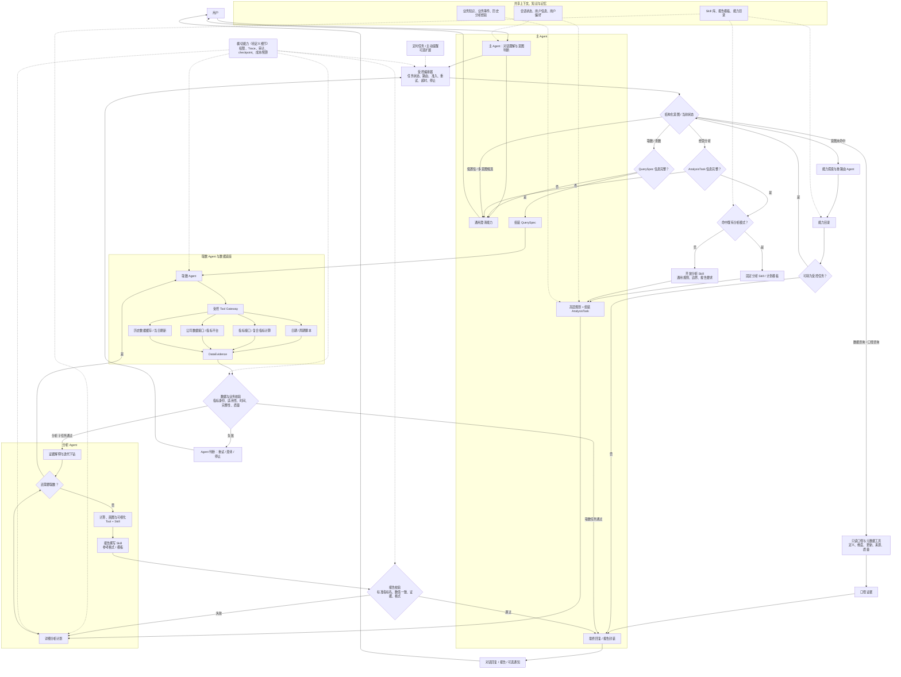

# 2026-08-28 智能经营分析整体拓扑架构规划讨论

> 当前状态：受控编排主骨架、通用兜底、主/分析 Agent 边界与分析方法默认承载形式已确认；其他模块细节待继续梳理。本文是理想架构规划，不反向证明原项目已经实现对应组件。

## 已确认事实

- 入口是主 Agent，负责与用户交互和组装最终回复。
- 顶层至少存在三类意图：取数/查数、经营分析、数据咨询/口径咨询。
- 取数前会确认指标、维度、时间和相关条件；信息不足时进入澄清。
- 澄清的具体内容和表达方式由 Agent 结合当前上下文判断，不是由平台代码写死每一句话。
- 取数 Agent 根据已组装的查询信息访问公司数据接口和工具。工具主要封装日期相关逻辑、指标接口及其计算。
- 经营分析会先识别用户要解决的问题类型，例如流量、商户或保费问题，再尝试命中已准备的分析方法。
- 分析 Agent 会结合分析方法拆解任务，将取数任务交给取数 Agent，再基于数据生成图表和报告。
- 当顶层意图没有命中已知业务链路时，系统使用“能力探索与重路由 Agent”作为通用兜底。
- 通用兜底 Agent 负责澄清、查询能力目录、拆解请求和重新路由，不绕过受控编排直接调用底层取数工具。
- 数据咨询/口径咨询采用完整数据咨询范围，覆盖指标定义与计算口径、支持维度、数据更新时间、数据来源和数据质量。
- 数据咨询不拆分独立 Agent，由主 Agent 使用受控的只读口径与元数据工具完成。
- 主 Agent 统一承担通用澄清能力，包括数据咨询中的术语消歧，以及取数和分析任务进入专业 Agent 前的信息补全。
- 已确认为分析意图但未命中既有分析方法时，系统不直接停止，而是进入开放分析链路。
- 主 Agent 会先生成任务计划，再通过受控编排将任务派给取数 Agent、分析 Agent 等子 Agent。
- 开放分析采用“计划—取数—校验—继续分析”的受控循环，计划由主 Agent 生成。
- 分析方法默认以“分析 Agent + Skill/计划模板”承载，Workflow 主要用于保护必须按顺序执行、必须校验或高影响的硬约束步骤。
- 开放分析也会加载专用 Skill，其中保存开放分析需要遵循的通用规则和报告生成要求，不是没有方法约束的自由推理。
- 分析 Agent 内部持有较重的画图与可视化工具/Skill，并使用报告撰写的参考格式或模板组织产物。

## 未知项

- 取数工具返回的错误是否有结构化错误码、可重试标记和缺失字段，还是主要为自然语言错误信息。
- 平台当时具体控制了哪些状态、路由、重试上限和停止条件，仍待按真实调用链核对。
- 开放分析的最大循环、预算、证据不足和安全停止条件尚待定义。
- 通用兜底 Agent 可查询的“能力目录”具体包含哪些 Agent、Skill、工具说明、适用条件和权限信息，尚待定义。
- `QuerySpec`、`AnalysisTask`、`DataEvidence`、`AnalysisResult` 的标准字段和版本契约尚待定义。
- 主 Agent 组装上下文时，用户信息、用户偏好、会话状态、历史分析经验和业务知识的选择与注入边界尚待定义。
- Trace、权限、成本/预算、checkpoint 和高影响报告的发布/人工审核边界尚待定义。

## 本次关键问题

理想架构的顶层应由主 Agent 自由调度，还是以受控编排作为主骨架，在每个受限阶段内保留 Agent 的自主判断？

## 方案比较

| 方案 | 形态 | 优点 | 主要代价 |
| --- | --- | --- | --- |
| A：主 Agent 自由调度 | 主 Agent 自行判断下一步、调用工具和处理错误 | 实现直接、灵活 | 关键步骤容易跳过，失败边界难稳定保证 |
| B：受控编排 + 受限 Agent 自主循环 | 平台控制阶段、权限、上限和准入条件；Agent 判断如何澄清和处理可恢复错误 | 同时保留可靠性和必要的灵活性 | 需要定义状态、中间结构和停止条件 |
| C：多专家 Agent 网络 | 不同领域 Agent 自主协作和交接 | 适合工具、权限和知识边界高度独立的领域 | 路由、状态、调试和一致性成本最高 |

## 用户决定

> 已确认选择 B：整体以受控编排器为主骨架。受控不表示平台写死每个决策；平台代码控制外层阶段、准入条件、权限和停止边界，Agent 在阶段内根据上下文自行澄清、解释错误和选择可允许的恢复动作。

> 已确认通用兜底选择 B：使用“能力探索与重路由 Agent”。它用于处理意图未命中或多个意图候选的请求，通过澄清、能力发现和任务拆解将请求转回受控的专业链路，不作为拥有全部工具权限的万能 Agent。

> 已确认数据咨询不只回答狭义指标口径，也支持查询指标维度、更新时间、数据来源和数据质量。

> 已确认数据咨询由主 Agent 直接承担，不新增独立数据咨询 Agent。主 Agent 本身持有通用澄清能力，并通过受控、只读的口径与元数据工具查询相关信息。

> 已确认分析方法未命中时进入开放分析，不直接安全停止，也不转给顶层通用兜底 Agent。开放分析仍属于分析链路。

> 已确认开放分析内部选择 B：主 Agent 先生成计划，再将任务派给子 Agent 执行，并在取数和证据校验后决定继续、调整或停止。

> 已确认分析 Agent 采用 B 形态：主 Agent 负责高层规划、澄清、分析模式选择与完整 `AnalysisTask` 组装；分析 Agent 拥有独立的详细规划、取数协调、证据解释、迭代下钻和报告草稿能力。

> 已确认分析方法以分析 Agent + Skill/计划模板为默认，Workflow 只承载不允许跳过的硬约束。该决定也适用于高度固定的分析模式，除非其确定性或风险要求明确要求升级为 Workflow。

> 已确认开放分析同样有对应 Skill，分析 Agent 还配置画图与可视化工具/Skill，以及报告撰写参考格式。

## 用户理解 / 假设演进

> 已通过后续决定收口：如果主 Agent 已经把具体分析步骤完全拆解，再将零散子任务交给分析 Agent，主 Agent 与分析 Agent 的职责会重复，分析 Agent 的存在意义不明显。

> 用户曾提出两类有意义的形态：要么不使用分析 Agent，由主 Agent 直接完成分析；要么主 Agent 先明确分析目标和范围，将相关上下文与知识组装完整后，把整个有边界的分析任务交给分析 Agent。后续已确认第二种形态。

> 用户曾提出分析 Agent 可能是类 Workflow 的分析运行时，不同分析模式对应不同方法或流程。后续已确认以 Agent + Skill/计划模板为默认，Workflow 仅保护硬约束。

> 用户判断：对高度固定的分析模式，Skill 和 Workflow 都可以顺利完成，功能结果上差异可能不大；使用 Agent 承载方法会更方便维护。后续架构决定保留这个默认倾向。

## Codex 反馈（AI 草案 / 待确认）

- 子 Agent 只有在拥有独立的任务目标、上下文、知识、工具权限或内部规划循环时，才比普通函数/节点更有意义。
- 如果主 Agent 已经完成指标选择、下钻顺序、取数任务和图表类型等全部明细分析计划，分析 Agent 只是转调工具，应考虑删除分析 Agent。
- 如果保留分析 Agent，更清晰的边界是：主 Agent 负责澄清、选择分析模式和组装完整 `AnalysisTask`；分析 Agent 负责详细分析计划、取数协调、证据解释、迭代下钻和报告草稿。
- 既有分析模式可以作为 Skill 或计划模板约束同一个分析 Agent；只有当步骤、分支和校验条件高度固定时，才需要升级为显式 Workflow/Subgraph。
- Skill 与 Workflow 不是互斥选项：Skill 提供分析方法和业务知识，Workflow 可以只负责不允许跳过的状态门禁、校验与发布步骤。
- 已被用户确认的默认规则是：分析方法优先用 Skill/计划模板配置给同一分析 Agent；只有必须保证顺序、必须执行或高影响的步骤使用 Workflow 硬控。
- 分析 Agent 内部可以分为三层：方法层的固定/开放分析 Skill，执行层的计算、画图与可视化工具/Skill，输出层的报告格式与撰写参考。

## 对计划的影响

- 后续拓扑图不再将主 Agent 画成能任意跳转的全能调度者。
- 顶层统一由受控编排器管理任务状态，内部嵌入口径咨询、取数和分析的 Agent 或受限执行节点。
- 澄清应画成受状态门控的 Agent Loop，而不是固定问句节点。
- 错误恢复同样由 Agent 做语义判断，但平台限制可用工具、重试次数和无证据时的终止条件。
- 数据咨询/口径咨询作为第三条顶层意图链路，与取数、分析并列。
- 数据咨询在意图上是独立链路，但在执行上不对应独立 Agent；受控编排器将其路由回主 Agent 的咨询能力及只读工具集。
- 主 Agent 统一生成澄清问题，受控编排器仍负责澄清状态、专业链路准入和停止边界。
- 意图路由需增加兜底出口：置信度低或多意图候选时先澄清，完全未命中时进入能力探索与重路由 Agent。
- “意图未命中”与“已确认为分析，但分析方法未命中”分属两个层级；后者仍应在分析链路内处理。
- 分析方法路由增加“开放分析”分支：命中时，主 Agent 根据既有 Skill/方法生成受约束的计划；未命中时，主 Agent 动态生成开放分析计划。
- 固定分析与开放分析共用同一套“主 Agent 规划 → 受控编排 → 子 Agent 执行 → 证据回传 → 主 Agent 更新计划”主循环。
- 主 Agent 的“计划”收窄为高层能力调度与任务边界；分析 Agent 负责领域内明细分析计划，避免两层 Agent 重复拆解同一任务。
- 拓扑图中不再把“开放分析”画成无约束分支，而是显示它加载开放分析 Skill，并与固定分析共享取数、校验、可视化和报告生成能力。

## 2026-08-29 缺口检查（AI 草案 / 待确认）

当前已确认主干足够画出第一版整体拓扑。仍需补充但不阻塞画图的内容有：

1. **标准中间契约**：`QuerySpec`、`AnalysisTask`、`DataEvidence`、`AnalysisResult`；
2. **上下文与知识组装**：会话状态、用户信息/偏好、业务知识、业务事件和历史分析经验；
3. **可靠性与横切能力**：证据校验、报告校验、重试/停止、权限、Trace、预算和 checkpoint；
4. **非会话入口与交付**：定时任务、主动提醒、通知与高影响报告人工审核；这些在第一版中标为可选扩展。

## 2026-08-29 第一版整体拓扑图（AI 草案 / 待确认）

## 结论状态

- 受控编排主骨架：已理解
- 开放分析使用计划—执行—校验循环：已理解
- 主 Agent 与分析 Agent 的计划粒度边界：已理解
- 分析模式应使用 Skill、计划模板还是 Workflow：已理解

## 后续动作

- 下次继续时，将分析 Agent 的方法层、执行层和输出层补入最终拓扑图。
- 后续再单独确认分析 Agent 的标准输出结构和与主 Agent 的回传契约。

## 下次只讨论什么

本轮分析 Agent 的职责与方法承载形式先收口。下次继续时，先补画分析 Agent 内部的“分析方法 Skill → 取数/计算/可视化能力 → 报告生成”局部拓扑，再继续其他模块。
