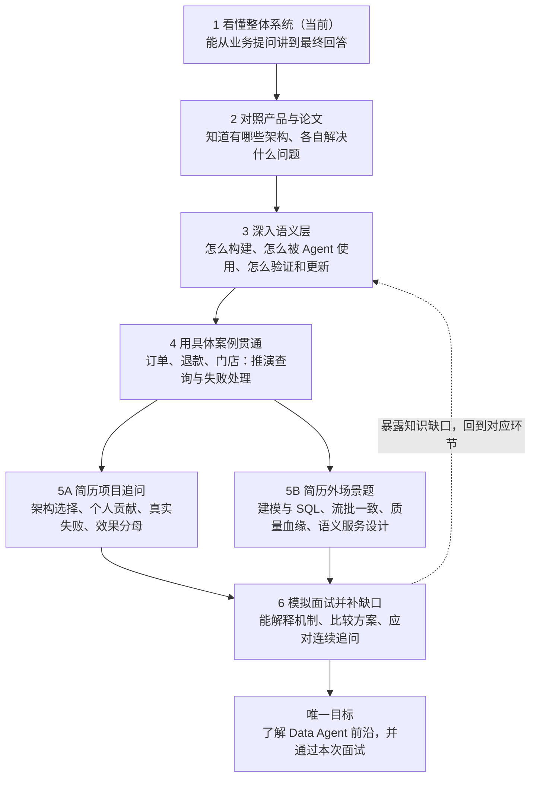
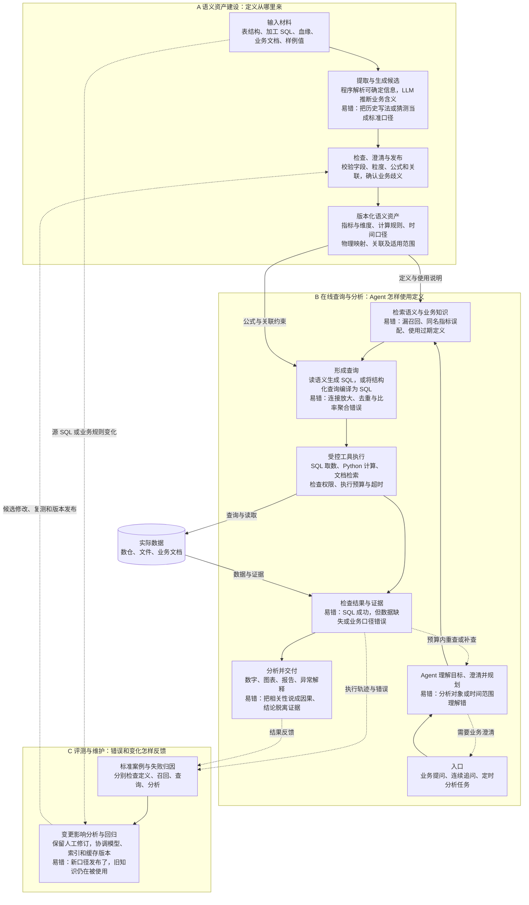
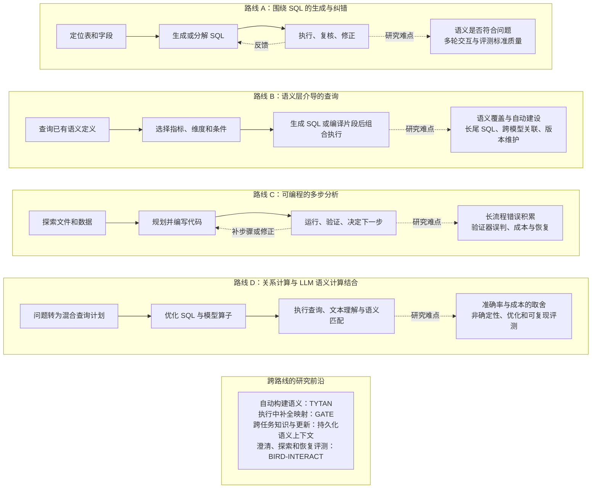

# 2026-09-05 Data Agent 学习路线、完整架构与研究地图

> 2026-09-07 入口调整：本文件保留三图的架构解释与历史研究分类；图一的学习顺序是9月5日草案。当前问题、准备顺序和进度统一见[AI数据面试准备](../../../../2-进行中/面试准备/AI数据面试准备.md)，不再以本图启动重复的基础追问或论文阅读任务。

用户目标：了解 Data Agent 的前沿，并通过本次面试。三图用于恢复全局学习主线，不再将问题收窄为“用户项目如何人工配置指标”。具体学习顺序是 AI 草案，理解状态为待继续；未实施产品或论文复现。

## 图一：从现在到面试，先做什么

先完成整体认识和路线比较，再深入语义层。每篇论文都需要回答：解决哪个环节的问题、输入输出是什么、方法是什么、验证了什么、哪些限制尚未解决。两条面试准备线均保留，不能用项目叙述替代数仓与系统设计基础。

## 图二：带语义层的企业问数与分析参考架构

这是结合公开产品与论文形成的参考架构，不是某个产品完整的内部实现，也不是所有 Data Agent 都必须包含全部组件。框是职责，不等同于独立 Agent 或独立服务。语义资产提供规则，真实结果来自数仓等实际数据源。节点中的“易错”是教学用失败分析。

- 建设流程依据：[DataWorks 语义分析](https://help.aliyun.com/zh/dataworks/user-guide/data-agent-semantic-analysis)、[Snowflake Autopilot](https://docs.snowflake.com/en/user-guide/views-semantic/autopilot)；其中数据来源、生成、编辑能力有公开依据，图中完整治理闭环是设计归纳。
- Agent 循环依据：[Cortex Agents](https://docs.snowflake.com/en/user-guide/snowflake-cortex/cortex-agents)：规划、调用工具、反思和继续执行。
- 语义消费方式依据：[SMQ v1](https://arxiv.org/html/2606.31041v1)；其编译器提供 SQL 片段，Agent 仍需组合复杂查询，不能说所有最终 SQL 都由编译器生成或已获正确性保证。
- 评测参考：[Cortex Analyst evaluations](https://docs.snowflake.com/en/user-guide/snowflake-cortex/cortex-analyst-evaluations)；产品提供标准查询与执行结果比较，不等于图中所有分层检查都由该产品实现。
- 查不到定义、歧义无法消除、权限不足或预算耗尽时，应按原因澄清、降级或停止；图中重查不表示无限重试。
- 定时入口可以运行预先定义的监控任务，不据此认定已经实现自主发现问题和目标的高自主性 Agent。

## 图三：架构路线与研究现状

分类边界：SIGMOD 教程使用数据生命周期（管理、准备、分析）和自主等级来组织全局。以下围绕当前岗位相关的企业问数与分析，按关键执行机制归纳四条可组合路线，不是互斥分类或行业统一标准。路线 D 是可嵌入其他 Agent 的执行层研究；单 Agent、多 Agent、固定工作流是另一条组织维度。

### 路线依据与可确认的研究进展

| 路线 | 代表性一手材料 | 当前可以确认的内容 | 不能据此推出 |
| --- | --- | --- | --- |
| A | [MAC-SQL，COLING 2025](https://aclanthology.org/2025.coling-main.36/)；[GBV-SQL，ACL 2026](https://aclanthology.org/2026.acl-long.837/) | 选表、分解、执行纠错以及 SQL 回译到自然语言的语义复核均已有具体系统与任务评测 | SQL 可执行就满足业务目标；回译自检保证语义正确；旧论文的最好分数仍是当前排名 |
| B | [SMQ v1，2026](https://arxiv.org/html/2606.31041v1)；DataWorks、Snowflake 等官方文档 | 语义定义可以为检索、SQL 生成和编译提供依据，已有产品流程和受约束查询系统研究 | 企业全部语义均可准确自动生成；采用语义层就消除了长尾 SQL 与口径错误 |
| C | [DS-STAR v4，2026-02 更新](https://arxiv.org/html/2509.21825v4) | 基于数据探索、逐步规划、代码执行、充分性判断和重规划处理多文件及开放分析任务 | 代码运行成功或验证 Agent 同意，就证明分析正确；多 Agent 总是优于单 Agent |
| D | [Sema-SQL v2，2026](https://arxiv.org/html/2604.23477v2) | 关系操作与 LLM UDF 组成混合查询计划，并研究优化与执行成本 | “语义算子”等于“指标口径定义”；论文系统已部署到目标团队 |

### 跨路线前沿

- [TYTAN v1，2026-08](https://arxiv.org/html/2608.06331v1)：从数据库证据生成分析语义模型；产物评价与下游完整业务任务评价分开。
- [GATE v1，2026-06](https://arxiv.org/html/2606.05634v1)：用执行观察补全待确定映射；主要复用边界不能直接扩张为企业跨任务长期知识库。
- [What Happens When the Model Eats the Stack? v1，2026-09](https://arxiv.org/html/2609.03141v1)：基于实验提出持久化语义上下文的研究议程，涉及维护、一致性和成本；是很新的预印本观点，不是行业定论。
- [BIRD-INTERACT](https://bird-interact.github.io/)：将澄清、知识探索及错误恢复纳入交互任务评测，不再只检查一次生成 SQL。
- [Data Agents: Levels, State of the Art, and Open Problems](https://arxiv.org/html/2602.04261v1)：提供跨数据生命周期和自主程度的全局入口。其 L0–L5 为作者分类；不能简单用 Agent 数量判定自主程度。

上述系统使用不同模型、数据和预算，本文不直接比较跨论文准确率，也不提供“最强”或“最流行”的排名。当前完成的是公开资料与结构对照，未进行统一条件下的实验。

## 后续学习入口

先按图二走一遍业务问题“昨天各门店净实付是否下降、下降来自哪里”的完整链路。逐个节点说明输入、输出、执行主体和错误处理，再从图三选择与当前节点直接相关的方法深入。具体实验规模和正式日程尚未确定。

[返回面试准备](../../../../2-进行中/面试准备/README.md) · [已有项目配置口述与学习记录](../../../../2-进行中/面试准备/项目准备/智能经营分析/记录/2026-09-05-指标维度配置口述与语义层学习.md)
